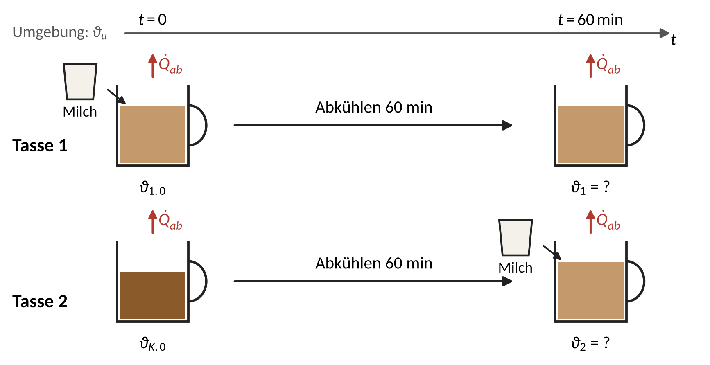
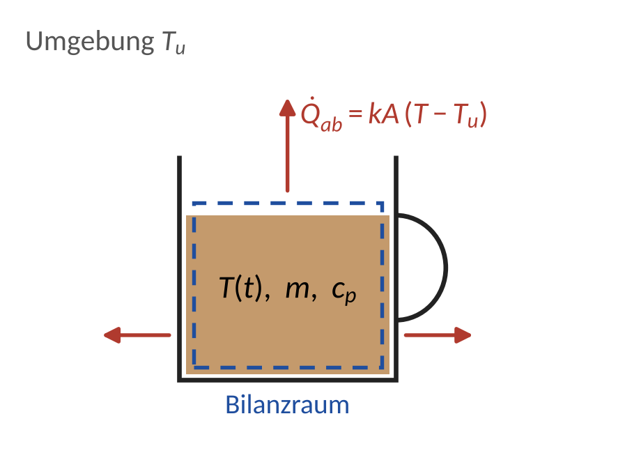
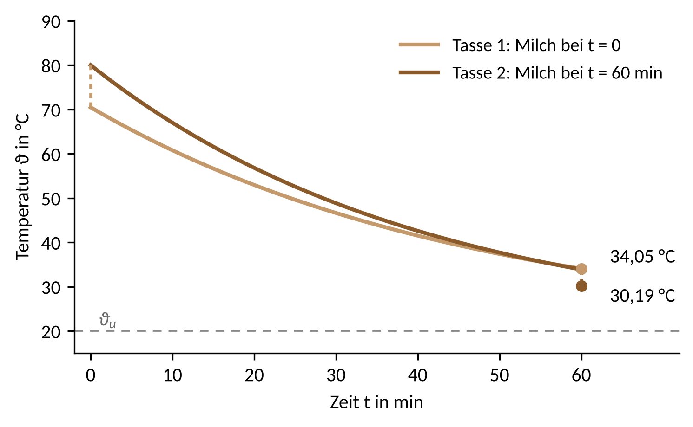

::: center
**[Tutorium 5: Wärmebilanzen (instationär global)]{.underline}**
:::

**[Ausgangssituation]{.underline}**

Sonntagmorgen in der WG-Küche: Sie haben Filterkaffee gekocht und zwei gleiche Tassen mit je 200 ml gefüllt. Da klingelt das Telefon, und das Gespräch wird eine Stunde dauern. Ihr Mitbewohner gießt seine Milch sofort in den Kaffee (Tasse 1). Sie stellen Ihre Tasse daneben und wollen die Milch erst nach dem Telefonat hineingießen (Tasse 2), damit der Kaffee „länger heiß bleibt“. Die Milch kommt in beiden Fällen direkt aus dem Kühlschrank.

{width=92%}

**Abb. 1:** Die beiden Tassen

**[Frage 1]{.underline}** (Vorab-Frage)

Ihr Mitbewohner meint: „Ob man die Milch sofort oder später hineingießt, ist egal. Die Energie bleibt ja erhalten.“ Welche Tasse ist nach einer Stunde wärmer? Notieren Sie Ihre Vermutung, bevor Sie Aufgabe 1 rechnen.

**[Aufgabe 1]{.underline}** (neu)

Um die Frage zu klären, messen Sie nach 10 Minuten die Temperatur in Tasse 2, die bis dahin noch keine Milch enthält.

**Annahmen:**

- Der Tasseninhalt wird als ideal durchmischt angenommen.
- Die Wärmekapazität der Tasse wird bis Teil e vernachlässigt.
- Die gesamte Wärmeabgabe an die Umgebung (Konvektion, Strahlung, Verdunstung und Wärmedurchgang durch die Tassenwand) wird über ein konstantes Produkt $kA$ beschrieben, das mit und ohne Milch gleich ist. Die verdunstete Masse wird vernachlässigt.
- Kaffee und Milch mischen sich sofort und ohne Wärmeverlust.
- Die Stoffdaten sind unabhängig von der Temperatur; Kaffee hat die Stoffdaten von Wasser.

***Gegebene Größen:***

| ***Kaffee:*** | | ***Milch:*** | |
|:---------------------|:-----------------------------|:---------------------|:-----------------------------|
| Volumen: | $V_K = 200\,\mathrm{ml}$ | Volumen: | $V_M = 30\,\mathrm{ml}$ |
| Dichte: | $\rho_K = 1000\,\mathrm{kg/m^3}$ | Dichte: | $\rho_M = 1030\,\mathrm{kg/m^3}$ |
| Spez. Wärmekapazität: | $c_{p,K} = 4{,}18\,\mathrm{kJ/(kg\,K)}$ | Spez. Wärmekapazität: | $c_{p,M} = 3{,}94\,\mathrm{kJ/(kg\,K)}$ |
| Temperatur bei $t = 0$: | $\vartheta_{K,0} = 80\,\mathrm{°C}$ | Temperatur: | $\vartheta_M = 5\,\mathrm{°C}$ |
| | | | |
| ***Umgebung:*** | | ***Messung:*** | |
| Temperatur: | $\vartheta_u = 20\,\mathrm{°C}$ | Temperatur nach 10 min: | $\vartheta_K(10\,\mathrm{min}) = 67\,\mathrm{°C}$ |
| | | | |
| ***Becher:*** | | ***Milchschaum:*** | |
| Masse: | $m_B = 300\,\mathrm{g}$ | Temperatur: | $\vartheta_S = 60\,\mathrm{°C}$ |
| Spez. Wärmekapazität: | $c_B = 0{,}85\,\mathrm{kJ/(kg\,K)}$ | | |

**Aufgabenstellung:**

a) Bestimmen Sie mit einer Energiebilanz die Mischtemperatur $\vartheta_{1,0}$ direkt nach dem Zugießen der Milch in Tasse 1.\
   $\vartheta_{1,0} = 70{,}47\,\mathrm{°C}$

b) Zeichnen Sie den Bilanzraum für Tasse 1 in Abb. 1 ein und stellen Sie die instationäre Energiebilanz für den Inhalt einer Tasse auf. Lösen Sie die Differentialgleichung durch Trennung der Variablen für die Anfangstemperatur $T(t = 0\,\mathrm{s}) = T_0$.\
   $T(t) = T_u + (T_0 - T_u)\cdot \exp\left(-\frac{kA}{m\,c_p}\,t\right)$

c) Bestimmen Sie aus der Messung in Tasse 2 das Produkt $kA$.\
   $kA = 0{,}3402\,\mathrm{W/K}$

d) Berechnen Sie die Temperaturen $\vartheta_1$ und $\vartheta_2$ beider Tassen nach 60 Minuten, bei Tasse 2 direkt nach dem Zugießen der Milch. Welche Tasse ist kühler?\
   $\vartheta_1 = 34{,}05\,\mathrm{°C}$, $\quad\vartheta_2 = 30{,}19\,\mathrm{°C}$

e) Berechnen Sie für beide Tassen die Wärme, die in den 60 Minuten an die Umgebung abgegeben wird. Erklären Sie damit das Ergebnis aus d). Hat Ihr Mitbewohner recht?\
   $Q_1 = 34{,}88\,\mathrm{kJ}$, $\quad Q_2 = 38{,}57\,\mathrm{kJ}$

f) Die Tassen sind in Wirklichkeit Keramikbecher. Sie wurden vorgewärmt und haben immer die Temperatur ihres Inhalts. Bestimmen Sie $kA$ mit Becher erneut aus der Messung und berechnen Sie $\vartheta_1$ und $\vartheta_2$ noch einmal. Bleibt die Aussage aus d) gültig?\
   $kA = 0{,}4440\,\mathrm{W/K}$, $\quad\vartheta_1 = 34{,}04\,\mathrm{°C}$, $\quad\vartheta_2 = 30{,}96\,\mathrm{°C}$

g) Am nächsten Tag trinkt Ihr Mitbewohner Cappuccino: Statt kalter Milch kommt Milchschaum mit $\vartheta_S$ in beide Tassen (gleiche Masse, Becher wieder vernachlässigt). Sagen Sie zuerst voraus, welche Tasse nach 60 Minuten wärmer ist. Prüfen Sie Ihre Vorhersage dann mit den Gleichungen aus d).\
   $\vartheta_1 = 35{,}99\,\mathrm{°C}$, $\quad\vartheta_2 = 37{,}18\,\mathrm{°C}$

h) *Zusatzfrage:* (1) Bei welcher Milchtemperatur ist es egal, ob die Milch sofort oder erst nach 60 Minuten hineinkommt (ohne Becher)? (2) Sie nehmen die Milch für Tasse 2 schon bei $t = 0$ aus dem Kühlschrank und stellen sie neben die Tasse. Kann Tasse 2 dadurch wärmer werden als Tasse 1? Begründen Sie mit einer Abschätzung und den Ergebnissen aus e).\
   Zu (1): $\vartheta_M = 47{,}0\,\mathrm{°C}$

**[Versuch zu Aufgabe 1]{.underline}** (im Tutorium, läuft neben der Rechnung)

*Material:* drei gleiche Becher, heißes Wasser oder Kaffee aus der Thermoskanne, Milch aus der Kühltasche, ein kleines Glas, Messbecher, ein Einstichthermometer für alle Becher, Löffel, Uhr.

1. Notieren Sie Ihre Vermutung zu Frage 1.
2. $t = 0$: Becher vorwärmen, je 200 ml einfüllen und die Starttemperatur messen. Becher 1 bekommt die Milch sofort. Für Becher 2 bleibt die Milch in der Kühltasche, für Becher 3 steht sie im Glas neben dem Becher.
3. $t = 10\,\mathrm{min}$: Becher 2 messen und daraus $kA$ wie in Teil f (mit Becher) bestimmen.
4. Mit den gemessenen Werten die Temperaturen nach 60 Minuten vorhersagen, für Becher 3 mit Milch bei Raumtemperatur.
5. $t = 60\,\mathrm{min}$: Milchtemperatur in Kühltasche und Glas messen, Milch in Becher 2 und 3 gießen, umrühren und alle drei Becher messen.

| Becher | Vorhersage nach 60 min | Messung nach 60 min |
|:-------------------------------|:---------------------------|:---------------------------|
| 1: Milch sofort | | |
| 2: Milch nach 60 min aus der Kühltasche | | |
| 3: Milch nach 60 min aus dem Glas | | |

::: seitenumbruch
:::

**[Lösung:]{.underline}**

**[Frage 1:]{.underline}** Tasse 1 (Milch sofort) ist nach einer Stunde wärmer: 34,05 °C gegenüber 30,19 °C. Das Argument des Mitbewohners trägt nicht: Erhalten bleibt die Energie von Kaffee, Milch und Umgebung zusammen; wie viel Wärme an die Umgebung geht, hängt vom Temperaturverlauf ab (Aufgabe 1, Teile d und e).

**[Aufgabe 1:]{.underline}**

[Geg.:]{.underline} Größen aus der Tabelle, daraus

$m_K = \rho_K V_K = 0{,}200\,\mathrm{kg}$, $\quad m_M = \rho_M V_M = 0{,}0309\,\mathrm{kg}$,

$m_K c_{p,K} = 836{,}0\,\mathrm{J/K}$, $\quad m_M c_{p,M} = 121{,}7\,\mathrm{J/K}$

[Ges.:]{.underline} $\vartheta_{1,0}$, $kA$, $\vartheta_1$ und $\vartheta_2$ nach 60 min, $Q_1$ und $Q_2$; dazu $kA$, $\vartheta_1$ und $\vartheta_2$ mit Becher (f), mit Milchschaum (g) und die Milchtemperatur aus h

[Skizze:]{.underline} Bilanzraum um den Tasseninhalt (Abb. L1)

[Annahmen:]{.underline} siehe Aufgabe

[Ansatz:]{.underline} Energiebilanz für das Mischen (a) und globale instationäre Energiebilanz um das geschlossene System „Tasseninhalt“ (b bis e)

{width=44%}

**Abb. L1:** Bilanzraum um den Tasseninhalt

**a)** Energiebilanz für das Mischen (geschlossenes System, keine Wärmeabgabe während des Mischens): Die Wärme, die der Kaffee abgibt, nimmt die Milch auf.
$$m_K c_{p,K}\,(T_{K,0} - T_{1,0}) = m_M c_{p,M}\,(T_{1,0} - T_M)$$

Umstellen nach $T_{1,0}$ und Werte einsetzen:
$$T_{1,0} = \frac{m_K c_{p,K}\,T_{K,0} + m_M c_{p,M}\,T_M}{m_K c_{p,K} + m_M c_{p,M}}$$
$$T_{1,0} = \frac{836{,}0\,\mathrm{J/K} \cdot 353{,}15\,\mathrm{K} + 121{,}7\,\mathrm{J/K} \cdot 278{,}15\,\mathrm{K}}{957{,}7\,\mathrm{J/K}} = 343{,}62\,\mathrm{K} = 70{,}47\,\mathrm{°C}$$

**b)** Globale instationäre Energiebilanz um das geschlossene System „Tasseninhalt“ ($V = \mathrm{const.}$, kein Zu- und Abfluss, keine Quelle):
$$\frac{dU}{dt} = -\dot{Q}_{ab} \quad\Rightarrow\quad m\,c_p\,\frac{dT}{dt} = -kA\,(T - T_u)$$

Trennung der Variablen und Integration von $t = 0\,\mathrm{s}$ ($T = T_0$) bis $t$:
$$\int_{T_0}^{T} \frac{dT}{T - T_u} = -\frac{kA}{m\,c_p} \int_0^{t} dt \quad\Rightarrow\quad \ln\frac{T - T_u}{T_0 - T_u} = -\frac{kA}{m\,c_p}\,t$$

Umstellen nach $T$:
$$T(t) = T_u + (T_0 - T_u)\cdot \exp\left(-\frac{kA}{m\,c_p}\,t\right)$$

Für Tasse 1 gilt $m\,c_p = m_K c_{p,K} + m_M c_{p,M}$, für Tasse 2 bis zum Zugießen $m\,c_p = m_K c_{p,K}$.

**c)** Lösung aus b) für den Kaffee ohne Milch nach $kA$ umstellen und die Messung in Tasse 2 einsetzen:
$$kA = -\frac{m_K c_{p,K}}{t}\,\ln\frac{T_K(t) - T_u}{T_{K,0} - T_u} =-\frac{836{,}0\,\mathrm{J/K}}{600\,\mathrm{s}}\,\ln\frac{47\,\mathrm{K}}{60\,\mathrm{K}} = 0{,}3402\,\mathrm{W/K}$$

Zur Einordnung: Zeitkonstante $\tau = m\,c_p/kA$ ohne Milch $41{,}0\,\mathrm{min}$, mit Milch $46{,}9\,\mathrm{min}$. Das passt zu Messungen an einem offenen, nicht umgerührten Keramikbecher ($\tau \approx 41\,\mathrm{min}$ aus der Steigung in Abb. 6 bei Ferreira 2025).

**d)** Tasse 1: Anfangsbedingung $T(0\,\mathrm{s}) = T_{1,0}$ und $m\,c_p = m_K c_{p,K} + m_M c_{p,M}$:
$$T_1 = T_u + (T_{1,0} - T_u)\cdot \exp\left(-\frac{kA\,t}{m_K c_{p,K} + m_M c_{p,M}}\right)$$
$$T_1 = 293{,}15\,\mathrm{K} + 50{,}47\,\mathrm{K} \cdot 0{,}2783 = 307{,}20\,\mathrm{K} = 34{,}05\,\mathrm{°C}$$

Tasse 2: erst Abkühlen mit $m\,c_p = m_K c_{p,K}$, dann Mischen wie in a):
$$T_K(60\,\mathrm{min}) = T_u + (T_{K,0} - T_u)\cdot \exp\left(-\frac{kA\,t}{m_K c_{p,K}}\right)$$
$$T_K(60\,\mathrm{min}) = 293{,}15\,\mathrm{K} + 60{,}00\,\mathrm{K} \cdot 0{,}2310 = 307{,}01\,\mathrm{K} = 33{,}86\,\mathrm{°C}$$
$$T_2 = \frac{m_K c_{p,K}\,T_K(60\,\mathrm{min}) + m_M c_{p,M}\,T_M}{m_K c_{p,K} + m_M c_{p,M}}$$
$$T_2 = \frac{836{,}0\,\mathrm{J/K} \cdot 307{,}01\,\mathrm{K} + 121{,}7\,\mathrm{J/K} \cdot 278{,}15\,\mathrm{K}}{957{,}7\,\mathrm{J/K}} = 303{,}34\,\mathrm{K} = 30{,}19\,\mathrm{°C}$$

Tasse 2 ist um $3{,}85\,\mathrm{K}$ kühler.

**e)** Die abgegebene Wärme folgt aus der Energiebilanz über die Abkühlzeit:
$$Q_1 = (m_K c_{p,K} + m_M c_{p,M})\,(T_{1,0} - T_1) = 957{,}7\,\mathrm{J/K} \cdot 36{,}42\,\mathrm{K} = 34{,}88\,\mathrm{kJ}$$
$$Q_2 = m_K c_{p,K}\,(T_{K,0} - T_K(60\,\mathrm{min})) = 836{,}0\,\mathrm{J/K} \cdot 46{,}14\,\mathrm{K} = 38{,}57\,\mathrm{kJ}$$

Kontrolle: Beide Tassen enthalten am Ende dieselbe Menge Kaffee und Milch. Der Temperaturunterschied folgt allein aus der Mehrabgabe: $(Q_2 - Q_1)/(m_K c_{p,K} + m_M c_{p,M}) = 3{,}85\,\mathrm{K}$, wie in d).

Erklärung: Der Wärmestrom $\dot{Q}_{ab} = kA\,(T - T_u)$ ist umso größer, je heißer der Tasseninhalt ist. Der Kaffee in Tasse 2 startet ohne Milch heißer (Wärmestrom am Anfang 20,4 W gegenüber 17,2 W in Tasse 1) und bleibt es bis etwa 56 min (Abb. L2). Er gibt deshalb mehr Wärme ab. Die Energie bleibt erhalten, aber wie viel davon an die Umgebung geht, hängt vom Temperaturverlauf ab. Der Mitbewohner hat also nicht recht. Wer seinen Kaffee später möglichst warm trinken will, gibt die Milch sofort hinein.

{width=70%}

**Abb. L2:** Temperaturverlauf beider Tassen

**f)** Die Wärmekapazität des Bechers kommt zu jedem Tasseninhalt hinzu: $C_B = m_B c_B = 0{,}300\,\mathrm{kg} \cdot 850\,\mathrm{J/(kg\,K)} = 255{,}0\,\mathrm{J/K}$. Messung in Tasse 2 wie in c), jetzt mit $m_K c_{p,K} + C_B$:
$$kA = -\frac{m_K c_{p,K} + C_B}{t}\,\ln\frac{T_K(t) - T_u}{T_{K,0} - T_u} = -\frac{1091{,}0\,\mathrm{J/K}}{600\,\mathrm{s}}\,\ln\frac{47\,\mathrm{K}}{60\,\mathrm{K}} = 0{,}4440\,\mathrm{W/K}$$

Tasse 1: Mischen mit Becher (er hat vorher die Kaffeetemperatur), dann Abkühlen:
$$T_{1,0} = \frac{(m_K c_{p,K} + C_B)\,T_{K,0} + m_M c_{p,M}\,T_M}{m_K c_{p,K} + C_B + m_M c_{p,M}} = 345{,}62\,\mathrm{K}$$
$$T_1 = T_u + (T_{1,0} - T_u)\cdot \exp\left(-\frac{kA\,t}{m_K c_{p,K} + C_B + m_M c_{p,M}}\right)$$
$$T_1 = 293{,}15\,\mathrm{K} + 52{,}47\,\mathrm{K} \cdot 0{,}2676 = 307{,}19\,\mathrm{K} = 34{,}04\,\mathrm{°C}$$

Tasse 2: Der schwarze Kaffee kühlt mit derselben Zeitkonstante ab wie in der Messung, also wie in d) auf $T_K(60\,\mathrm{min}) = 307{,}01\,\mathrm{K}$. Dann Mischen mit Becher:
$$T_2 = \frac{(m_K c_{p,K} + C_B)\,T_K(60\,\mathrm{min}) + m_M c_{p,M}\,T_M}{m_K c_{p,K} + C_B + m_M c_{p,M}} = 304{,}11\,\mathrm{K} = 30{,}96\,\mathrm{°C}$$

Tasse 2 bleibt kühler, der Unterschied sinkt von 3,85 K auf 3,08 K: Der Becher gibt beim Mischen Wärme an die kalte Milch ab und dämpft so den Mischsprung.

**g)** Rechnung wie in a) und d), nur mit $T_S = 333{,}15\,\mathrm{K}$ statt $T_M$:
$$T_{1,0} = \frac{m_K c_{p,K}\,T_{K,0} + m_M c_{p,M}\,T_S}{m_K c_{p,K} + m_M c_{p,M}} = 350{,}61\,\mathrm{K}$$
$$T_1 = T_u + (T_{1,0} - T_u)\cdot 0{,}2783 = 309{,}14\,\mathrm{K} = 35{,}99\,\mathrm{°C}$$
$$T_2 = \frac{m_K c_{p,K}\,T_K(60\,\mathrm{min}) + m_M c_{p,M}\,T_S}{m_K c_{p,K} + m_M c_{p,M}} = 310{,}33\,\mathrm{K} = 37{,}18\,\mathrm{°C}$$

Jetzt ist Tasse 2 um 1,19 K wärmer. Zieht man die Ergebnisse aus d) voneinander ab, ergeben sich zwei Anteile:
$$\vartheta_1 - \vartheta_2 = \underbrace{\frac{m_K c_{p,K}\,(\vartheta_{K,0} - \vartheta_u)\,(e_G - e_K)}{m_K c_{p,K} + m_M c_{p,M}}}_{\text{Kaffee-Effekt}} + \underbrace{\frac{m_M c_{p,M}\,(\vartheta_M - \vartheta_u)\,(e_G - 1)}{m_K c_{p,K} + m_M c_{p,M}}}_{\text{Milch-Effekt}}$$

mit $e_G = \exp(-kA\,t/(m_K c_{p,K} + m_M c_{p,M})) = 0{,}2783$ und $e_K = \exp(-kA\,t/(m_K c_{p,K})) = 0{,}2310$. Kaffee-Effekt: Mit Milch ist mehr Wärmekapazität in der Tasse, der Kaffee kühlt langsamer ab; er spricht immer für „sofort“ (2,48 K). Milch-Effekt: Spät zugegossene Milch bringt ihre Temperatur unverändert mit. Kalte Milch kühlt dann stärker (1,38 K für „sofort“), heißer Schaum wärmt stärker (−3,67 K, also für „später“).

**h)** (1) Beide Anteile heben sich auf, wenn $\vartheta_1 = \vartheta_2$:
$$\vartheta_M = \vartheta_u + \frac{m_K c_{p,K}\,(\vartheta_{K,0} - \vartheta_u)\,(e_G - e_K)}{m_M c_{p,M}\,(1 - e_G)} = 20\,\mathrm{°C} + 27{,}0\,\mathrm{K} = 47{,}0\,\mathrm{°C}$$

Erst Milch über etwa 47 °C dreht das Ergebnis um.

Zu (2): Nein. Draußen erwärmt sich die Milch höchstens auf Raumtemperatur und nimmt dabei aus der Raumluft höchstens
$$Q_M = m_M c_{p,M}\,(\vartheta_u - \vartheta_M) = 121{,}7\,\mathrm{J/K} \cdot 15\,\mathrm{K} = 1{,}83\,\mathrm{kJ}$$

auf. Tasse 2 hat nach e) aber $Q_2 - Q_1 = 3{,}69\,\mathrm{kJ}$ mehr abgegeben als Tasse 1. Selbst im günstigsten Fall bleibt Tasse 2 deshalb um mindestens
$$\frac{(Q_2 - Q_1) - Q_M}{m_K c_{p,K} + m_M c_{p,M}} = \frac{3{,}69\,\mathrm{kJ} - 1{,}83\,\mathrm{kJ}}{957{,}7\,\mathrm{J/K}} = 1{,}95\,\mathrm{K}$$

kühler (mit Milch von 20 °C: $\vartheta_2 = 32{,}10\,\mathrm{°C}$ gegenüber $\vartheta_1 = 34{,}05\,\mathrm{°C}$). Der Kipppunkt aus (1) entscheidet die Frage nicht allein, weil er für gleich warme Milch in beiden Tassen gilt.

```{=latex}
\needspace{7\baselineskip}
```

**[Hinweise für die Tutoriumsleitung]{.underline}**

- *Typische Fehler:* Mischtemperatur nach dem Volumen statt nach $m\,c_p$ gewichtet; in Tasse 1 nur mit $m_K c_{p,K}$ gerechnet; in Tasse 2 schon während der 60 Minuten mit $m_K c_{p,K} + m_M c_{p,M}$ gerechnet; in f) das alte $kA$ weiterverwendet (dann 39,1 und 36,1 °C: Aussage gleich, aber nicht mehr passend zur Messung).
- *Fehlvorstellungen:* „Energieerhaltung, also egal“: Erhalten bleibt die Energie von Kaffee, Milch und Umgebung zusammen, nicht die des Tasseninhalts (Teil e). „Schaum ist kälter als der Kaffee, wirkt also wie kalte Milch“: Entscheidend ist nicht der Vergleich mit dem Kaffee, sondern ob die Milch wärmer als der Kipppunkt aus h ist.
- *Was die Rechnung weglässt:* Bei hoher Temperatur trägt die Verdunstung rund die Hälfte der Wärmeabgabe (Condoret 2007, Tab. 2), deshalb ist $kA$ in Wirklichkeit nicht konstant. Mit einer überlinearen Wärmeabgabe $\dot{Q}_{ab} \propto (T - T_u)^{4/3}$, angepasst an dieselbe Messung, ergeben sich $\vartheta_1 = 37{,}65\,\mathrm{°C}$ und $\vartheta_2 = 33{,}34\,\mathrm{°C}$, also 4,31 K statt 3,85 K: Der Vorsprung der heißeren Tasse 2 beim Wärmeverlust wächst.
- *Zum Weiterdenken:* Hätte die Milch in beiden Tassen Raumtemperatur, wäre der Unterschied mit 2,5 K kleiner, aber vorhanden. Der schwarze Kaffee ist bis etwa 56 min heißer als das Gemisch in Tasse 1 (Abb. L2) und verliert deshalb mehr Wärme; erst die kalte Milch am Ende macht Tasse 2 deutlich kühler.
- *Versuch:* Mit echten, vorgewärmten Bechern sind nach 60 Minuten zwischen Becher 1 und 2 rund 3 K Unterschied zu erwarten (nach 30 Minuten schon gut 2,5 K), mit einem Küchenthermometer gut messbar; Becher 3 (Milch draußen) bleibt um mindestens 1,6 K kühler als Becher 1. Starttemperatur messen statt 80 °C annehmen, ein Thermometer für alle Becher verwenden, vor jeder Messung umrühren. Heißes Wasser verhält sich wie Kaffee; Verbrühungsgefahr beachten.

```{=latex}
\needspace{7\baselineskip}
```

**[Quellen der Arbeitswerte]{.underline}**

- Kaffee: Ausschank 71 bis 85 °C (Brown & Diller 2008, Burns 34, 648); beim Eingießen 2 bis 5 K weniger (Abraham & Diller 2019, J. Food Sci. 84); Stoffwerte wie Wasser (SCA, Gehalt an gelösten Stoffen 1,15 bis 1,35 %).
- Milch: Kühlschrank höchstens 7 °C, besser unter 5 °C (Bundesinstitut für Risikobewertung, 2023); im Mittel 31 g Milch je Tasse (FSANZ 2011); Dichte 1027 bis 1033 kg/m³ (Goff, Dairy Science and Technology); $c_p$ wie in Tutorium 8.
- Abkühlung: offener, nicht umgerührter Keramikbecher, $\tau \approx 41\,\mathrm{min}$ aus der Steigung 0,0241 1/min in Abb. 6 (Ferreira 2025, Phys. Educ. 60, 035001); Verdunstung bei 79 °C 12,0 von 22,7 W (Condoret 2007, Chem. Eng. Educ. 41, 137, Tab. 2).
- Milchschaum 55 bis 65 °C (Thermoplan, Coffee knowledge: milk); Keramikbecher 300 g mit 0,85 kJ/(kg·K) als Arbeitswert (Schätzung).
- Rechenskript: nachrechnung_kaffee.py mit kaffee_modell.py.

