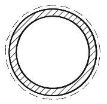
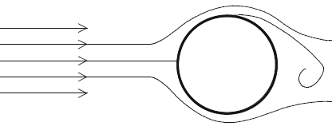
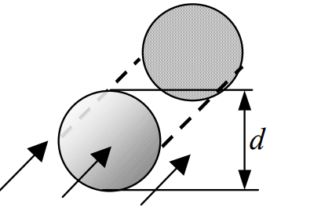
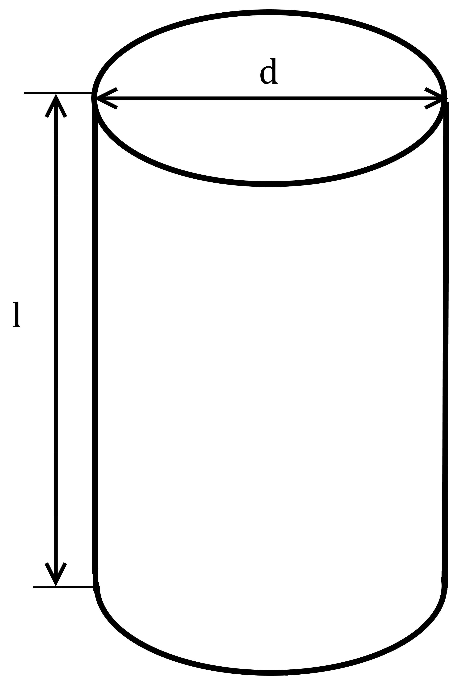

> Formelsammlung Wärmeübertragung 2026 des Lehrstuhls (Textfassung; das Original-PDF liegt in der Projektablage).

**Dimensionslose Kennzahlen**

| **Kennzahl**  | **Formulierung**                                        | **Bedeutung**                            |
|---------------|---------------------------------------------------------|------------------------------------------|
| Reynolds-Zahl | $$Re = \frac{\rho\ w\ L}{\eta}$$                        | $$\frac{Trägheit}{Reibung}$$             |
| Grashof-Zahl  | $$Gr = \frac{g\ \beta_{th}\ \Delta T\ L^{3}}{\nu^{2}}$$ | $$\frac{Auftrieb,Trägheit}{Reibung}$$    |
| Nußelt-Zahl   | $$Nu = \frac{\alpha\ L}{\lambda}$$                      | $$\frac{Wärmekonvektion}{Wärmeleitung}$$ |
| Prandtl-Zahl  | $$\Pr = \frac{\nu}{a} = \frac{\eta\ c_{p}}{\lambda}$$   | $$\frac{Reibung}{Wärmeleitung}$$         |

$L$: Charakteristische Länge

Für ideales Gas*:* $\beta_{th} = \frac{1}{T_{u}}\ $, $\Delta T > 0$

**Korrelationen zur Berechnung der *Nußelt*-Zahl** (Stoffwerte beziehen sich auf $T_{m}$)

1.  **Freie Konvektion**

<table>
<colgroup>
<col style="width: 13%" />
<col style="width: 19%" />
<col style="width: 41%" />
<col style="width: 25%" />
</colgroup>
<thead>
<tr class="header">
<th><strong>Geometrie</strong></th>
<th><strong>Strömungsform</strong></th>
<th><strong>Korrelation</strong></th>
<th><strong>Gültigkeitsbereich</strong></th>
</tr>
</thead>
<tbody>
<tr class="odd">
<td>
<strong>Senkrechte</strong>

<strong>Platte</strong>
</td>
<td>Alle</td>
<td>
$$Nu_{m} = \left\lbrack 0,825 + 0,387\left( Gr\ Prf(Pr) \right)^{\frac{1}{6}} \right\rbrack^{2}$$

$$f\left( \Pr \right) = \left\lbrack 1 + \left( \frac{0,492}{\Pr} \right)^{\frac{9}{16}} \right\rbrack^{\frac{- 16}{9}}$$
</td>
<td>
10−1 &lt; <em>G</em><em>r</em> <em>P</em><em>r</em> &lt; 1012

10−3 &lt; <em>P</em><em>r</em>
</td>
</tr>
<tr class="even">
<td>
<strong>Waagerechte</strong>

<strong>Platte</strong>
</td>
<td>Laminar</td>
<td>
$$Nu_{l} = 0,766\left\lbrack Gr\ Pr\ f\left( \Pr \right) \right\rbrack^{\frac{1}{5}}$$

$$f\left( \Pr \right) = \left\lbrack 1 + \left( \frac{0,322}{\Pr} \right)^{\frac{11}{20}} \right\rbrack^{\frac{- 20}{11}}$$
</td>
<td><em>G</em><em>r</em> <em>P</em><em>r</em> <em>f</em>(Pr) ≤ 7 ⋅ 104</td>
</tr>
<tr class="odd">
<td>
<strong>Waagerechte</strong>

<strong>Platte</strong>
</td>
<td>Turbulent</td>
<td>
$$Nu_{t} = 0,15\left\lbrack Gr\ Pr\ f\left( \Pr \right) \right\rbrack^{\frac{1}{3}}$$

$$f\left( \Pr \right) = \left\lbrack 1 + \left( \frac{0,322}{\Pr} \right)^{\frac{11}{20}} \right\rbrack^{\frac{- 20}{11}}$$
</td>
<td><em>G</em><em>r</em> <em>P</em><em>r</em> <em>f</em>(Pr) &gt; 7 ⋅ 104</td>
</tr>
<tr class="even">
<td>
<strong>Waager.</strong>

<strong>Zylinder</strong>
</td>
<td>Übergangsbereich</td>
<td>
$$Nu_{m} = \left\lbrack 0,752 + 0,387\left\lbrack Gr\ Pr\ f\left( \Pr \right) \right\rbrack^{\frac{1}{6}} \right\rbrack^{2}$$

$$f\left( \Pr \right) = \left\lbrack 1 + \left( \frac{0,559}{\Pr} \right)^{\frac{9}{16}} \right\rbrack^{\frac{- 16}{9}}$$
</td>
<td>
10−1 &lt; <em>G</em><em>r</em> <em>P</em><em>r</em> &lt; 1012

10−3 &lt; <em>P</em><em>r</em>
</td>
</tr>
<tr class="odd">
<td>
<strong>Senkr.</strong>

<strong>Zylinder</strong>
</td>
<td>Alle</td>
<td>$$Nu_{m} = 0,435\frac{h}{d} + Nu_{m,senkr.Platte}$$</td>
<td>
10−1 &lt; <em>G</em><em>r</em> <em>P</em><em>r</em> &lt; 1012

10−3 &lt; <em>P</em><em>r</em>
</td>
</tr>
<tr class="even">
<td><strong>Kugel</strong></td>
<td>Alle</td>
<td>$$Nu_{m} = 2 + 0,56\left\lbrack Gr\ Pr\ \left( \frac{\Pr}{0,846 + Pr} \right) \right\rbrack^{\frac{1}{4}}$$</td>
<td>
10−1 &lt; <em>G</em><em>r</em> <em>P</em><em>r</em> &lt; 1012

0, 7 &lt; <em>P</em><em>r</em> &lt; 100
</td>
</tr>
</tbody>
</table>

2.  **Erzwungene Konvektion für um- bzw. überströmte Körper**

<table>
<colgroup>
<col style="width: 13%" />
<col style="width: 19%" />
<col style="width: 41%" />
<col style="width: 25%" />
</colgroup>
<thead>
<tr class="header">
<th><strong>Geometrie</strong></th>
<th><strong>Strömungsform</strong></th>
<th><strong>Korrelation</strong></th>
<th><strong>Gültigkeitsbereich</strong></th>
</tr>
</thead>
<tbody>
<tr class="odd">
<td rowspan="2"><strong>Längsumströmte Platte</strong></td>
<td>Laminar</td>
<td>$$Nu_{l} = 0,664\ \sqrt{Re}\ \sqrt[3]{\Pr}$$</td>
<td>
0, 5 &lt; <em>P</em><em>r</em>

<em>R</em><em>e</em> &lt; 5 ⋅ 105
</td>
</tr>
<tr class="even">
<td>Turbulent</td>
<td>$$Nu_{t} = \frac{0,037Re^{0,8}\Pr}{1 + 2,443Re^{- 0,1}\left( \Pr^{\frac{2}{3}} - 1 \right)}$$</td>
<td>
0, 5 &lt; <em>P</em><em>r</em> &lt; 2000

5 ⋅ 105 &lt; <em>R</em><em>e</em> &lt; 107
</td>
</tr>
<tr class="odd">
<td rowspan="3"><strong>Querumströmter Zylinder</strong></td>
<td>Laminar</td>
<td>$$Nu_{l} = 0,664\ \sqrt{Re}\ \sqrt[3]{\Pr}$$</td>
<td>
0, 5 &lt; <em>P</em><em>r</em> &lt; 2000

<em>R</em><em>e</em> &lt; 105
</td>
</tr>
<tr class="even">
<td>Turbulent</td>
<td>$$Nu_{t} = \frac{0,037Re^{0,8}\Pr}{1 + 2,443Re^{- 0,1}\left( \Pr^{\frac{2}{3}} - 1 \right)}$$</td>
<td>
0, 5 &lt; <em>P</em><em>r</em> &lt; 2000

5 ⋅ 105 &lt; <em>R</em><em>e</em> &lt; 107
</td>
</tr>
<tr class="odd">
<td>Übergangsbereich</td>
<td>$$Nu_{m} = 0,3 + \sqrt{Nu_{l}^{2} + Nu_{t}^{2}}$$</td>
<td>
0, 5 &lt; <em>P</em><em>r</em> &lt; 2000

101 &lt; <em>R</em><em>e</em> &lt; 107
</td>
</tr>
<tr class="even">
<td rowspan="2"><strong>Kugel</strong></td>
<td>Laminar</td>
<td>$$Nu_{l} = 0,664\ \sqrt{Re}\ \sqrt[3]{\Pr}$$</td>
<td>
0, 5 &lt; <em>P</em><em>r</em>

<em>R</em><em>e</em> ≤ 105
</td>
</tr>
<tr class="odd">
<td>Turbulent</td>
<td>$$Nu_{t} = \frac{0,037Re^{0,8}\Pr}{1 + 2,443Re^{- 0,1}\left( \Pr^{\frac{2}{3}} - 1 \right)}$$</td>
<td>
0, 5 &lt; <em>P</em><em>r</em> &lt; 2000

106 ≤ <em>R</em><em>e</em> ≤ 107
</td>
</tr>
<tr class="even">
<td><strong>Kugel</strong></td>
<td>Übergangsbereich</td>
<td>$$Nu_{m} = 2 + \sqrt{Nu_{l}^{2} + Nu_{t}^{2}}$$</td>
<td>
0, 6 &lt; <em>P</em><em>r</em> &lt; 1000

100 &lt; <em>R</em><em>e</em> &lt; 106
</td>
</tr>
</tbody>
</table>

3.  **Erzwungene Konvektion für durchströmte Körper**

<table>
<colgroup>
<col style="width: 13%" />
<col style="width: 19%" />
<col style="width: 41%" />
<col style="width: 25%" />
</colgroup>
<thead>
<tr class="header">
<th><strong>Geometrie</strong></th>
<th><strong>Strömungsform</strong></th>
<th><strong>Korrelation</strong></th>
<th><strong>Gültigkeitsbereich</strong></th>
</tr>
</thead>
<tbody>
<tr class="odd">
<td rowspan="3"><strong>Durchströmtes Rohr</strong></td>
<td>Laminar</td>
<td>$$Nu_{l} = \sqrt[3]{49,37 + \left\lbrack 1,615\ \left( Re\ Pr\frac{d}{l} \right)^{\frac{1}{3}} - 0,7 \right\rbrack^{3}}$$</td>
<td>
0 &lt; <em>P</em><em>r</em>

<em>R</em><em>e</em> &lt; 2300
</td>
</tr>
<tr class="even">
<td>Turbulent</td>
<td>
$$Nu_{t} = \frac{(\zeta/8)\ Re\ Pr}{1 + 12,7\ \sqrt{\zeta/8}\ \left( \Pr^{\frac{2}{3}} - 1 \right)}\left\lbrack 1 + \left( \frac{d}{l} \right)^{\frac{2}{3}} \right\rbrack$$

Mit dem Druckverlustbeiwert:

<em>ζ</em> = [1,8log10(<em>R</em><em>e</em>)−1,5]−2 
</td>
<td>
10−1 &lt; <em>P</em><em>r</em> &lt; 103

104 &lt; <em>R</em><em>e</em> &lt; 106
</td>
</tr>
<tr class="odd">
<td>Übergangsbereich</td>
<td>
<em>N</em><em>u</em><em>m</em> = (1−<em>γ</em>)<em>N</em><em>u</em><em>l</em>, 2300 + <em>γ</em><em>N</em><em>u</em><em>t</em>, 104

<em>N</em><em>u</em><em>l</em>, 2300 = <em>N</em><em>u</em><em>l</em>(<em>R</em><em>e</em>=2300)

<em>N</em><em>u</em><em>t</em>, 104 = <em>N</em><em>u</em><em>t</em>(<em>R</em><em>e</em>=104)

$$\gamma = \frac{Re - 2300}{10^{4} - 2300}$$
</td>
<td>
0, 6 &lt; <em>P</em><em>r</em> &lt; 1000

2300 &lt; <em>R</em><em>e</em> &lt; 104
</td>
</tr>
</tbody>
</table>

4.  **Anströmbedingungen**

Charakteristische Länge $L$ zur Bestimmung der *Nußelt*-Zahlen:

Allgemeine Definition: $L = \frac{A}{U}$ mit $A$: Fläche des Körpers

$U$: Umfang des projizierten Schattens

<table>
<colgroup>
<col style="width: 16%" />
<col style="width: 35%" />
<col style="width: 16%" />
<col style="width: 32%" />
</colgroup>
<thead>
<tr class="header">
<th><strong>Körper</strong></th>
<th><strong>Strömungsbild</strong></th>
<th><strong>Körper</strong></th>
<th><strong>Strömungsbild</strong></th>
</tr>
</thead>
<tbody>
<tr class="odd">
<td><strong>Längsangeströmte, (unendlich) breite Platte der Länge</strong> <strong>L</strong></td>
<td></td>
<td><strong>Konzentrisches, durchströmtes Rohr mit Durchmesser</strong> <strong>d</strong></td>
<td></td>
</tr>
<tr class="even">
<td><strong>Querumströmte Zylinder mit Durchmesser</strong> <strong>d</strong></td>
<td></td>
<td><strong>Umströmte Kugel mit Durchmesser</strong> <strong>d</strong></td>
<td></td>
</tr>
<tr class="odd">
<td>
<strong>Aufrechter Zylinder</strong>

<strong>(freie Konvektion)</strong>
</td>
<td></td>
<td></td>
<td></td>
</tr>
</tbody>
</table>

5.  **Lösung von Differentialgleichungen**

<table>
<colgroup>
<col style="width: 9%" />
<col style="width: 31%" />
<col style="width: 59%" />
</colgroup>
<thead>
<tr class="header">
<th></th>
<th><strong>DGL</strong></th>
<th><strong>allgemeine Lösung</strong></th>
</tr>
</thead>
<tbody>
<tr class="odd">
<td><strong>5.1</strong></td>
<td>$$\frac{dy}{dx} + ay = b$$</td>
<td>$$y = \frac{b}{a} + Ce^{- ax}$$</td>
</tr>
<tr class="even">
<td><strong>5.2</strong></td>
<td>$$\frac{d^{2}y}{dx^{2}} + a\frac{dy}{dx} + by + c = 0$$</td>
<td>
<strong>F</strong><strong>a</strong><strong>l</strong><strong>l</strong> <strong>1</strong><strong>:</strong>     <em>a</em>2 − 4<em>b</em> &gt; 0:

$$y = C_{1}e^{y_{1}x} + C_{2}e^{y_{2}x} - \frac{c}{b}$$

<strong>F</strong><strong>a</strong><strong>l</strong><strong>l</strong> <strong>2</strong><strong>:</strong>      <em>a</em>2 − 4<em>b</em> = 0:

$$y = \left( C_{1}x + C_{2} \right)e^{- \frac{a}{2}x} - \frac{c}{b}$$

<strong>F</strong><strong>a</strong><strong>l</strong><strong>l</strong> <strong>3</strong> : <em>a</em>2 − 4<em>b</em> &lt; 0:

$$y = \left( C_{1}\cos(\beta x) + C_{2}\sin{(\beta x)} \right)e^{- \frac{a}{2}x} - \frac{c}{b}$$

$$mit:y_{1,2} = - \frac{a}{2} \pm \sqrt{\frac{a^{2}}{4} - b}$$

$$und:\beta = \sqrt{\left| \frac{a^{2}}{4} - b \right|}$$
</td>
</tr>
<tr class="odd">
<td><strong>5.3</strong></td>
<td>$$\frac{d^{2}y}{dx^{2}} + a\frac{dy}{dx} + b = 0$$</td>
<td>$$y = C_{1}e^{- ax} - \frac{b}{a}x + C_{2}$$</td>
</tr>
<tr class="even">
<td><strong>5.4</strong></td>
<td>$$\frac{d^{2}y}{dx^{2}} + ay + b = 0$$</td>
<td>
<strong>F</strong><strong>a</strong><strong>l</strong><strong>l</strong> <strong>1</strong> : <em>a</em> &gt; 0:

$$y = C_{1}\cos{\left( \sqrt{a}x \right) + C_{2}\sin{\left( \sqrt{a}x \right) - \frac{b}{a}}}$$

<strong>F</strong><strong>a</strong><strong>l</strong><strong>l</strong> <strong>2</strong><strong>:</strong><em>a</em> = 0:

$$y = - \frac{b}{2}x^{2} + C_{1}x + C_{2}$$

<strong>F</strong><strong>a</strong><strong>l</strong><strong>l</strong> <strong>3</strong> : <em>a</em> &lt; 0:

$$y = C_{1}e^{- \sqrt{|a|}x} + C_{2}e^{\sqrt{|a|}x} - \frac{b}{a}$$
</td>
</tr>
</tbody>
</table>
