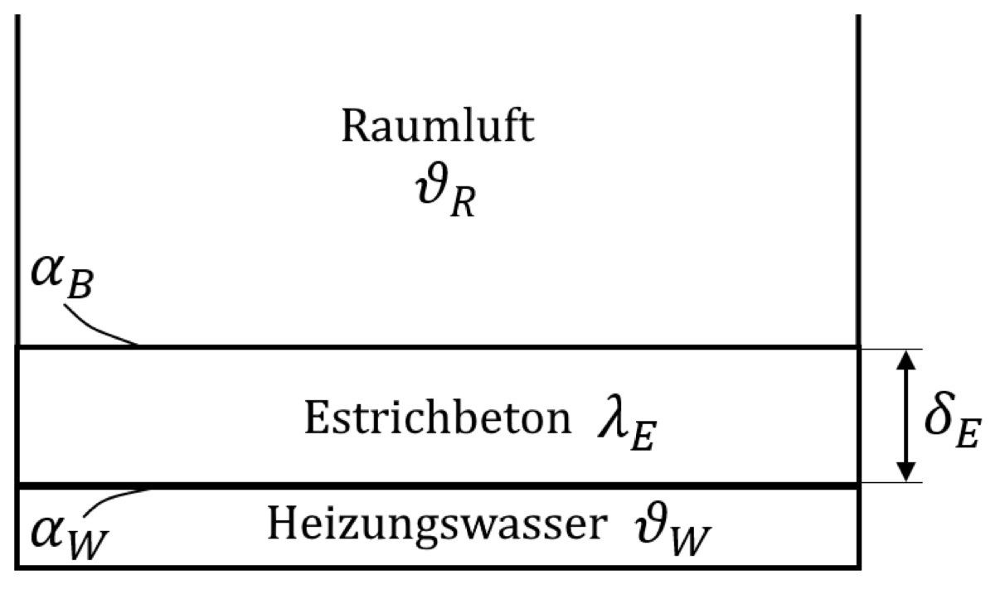

> Stilvorbild: Lehrstuhl-Tutorium 3 „Wärmedurchgang“, Aufgabe 3 (Fußbodenheizung, Klausur 2022-02-17), Aufgabenblatt.

**<u>Aufgabe 3</u>** (Klausur 2022-02-17)

Ein 16m² großer Wohnraum mit zwei außenliegenden Wänden wird durch eine Fußbodenheizung beheizt. Der Raum hat eine quadratische Grundfläche mit den Maßen 4m x 4m x 2,4m (L x B x H). Einen schematischen Aufbau der Fußbodenheizung zeigt Abb. 1. Dabei wird vereinfacht angenommen, dass anstelle einzelner Rohre, ein ebener Kanal mit Heizungswasser unter einer Schicht Estrichbeton liegt.

**Abb. 1:** Vereinfachter Schichtaufbau der Fußbodenheizung

Das Heizungswasser gibt kontinuierlich Wärme an den Estrichbeton ab. Dieser fungiert auch als Wärmespeicher und gibt die Wärme nach und nach an die Raumluft ab und hält so die Raumtemperatur auf einer konstanten Temperatur $\vartheta_{R}$.

| ***Daten zur Raumluftluft:***   |                                       | ***Fußbodenheizung:***                 |                                   |
|---------------------------------|---------------------------------------|----------------------------------------|-----------------------------------|
| Temperatur:                     | $\vartheta_{R} = 20{^\circ}C$         | Oberflächentemperatur:                 | $\vartheta_{B} = 22{^\circ}C$     |
| Dynamische Viskosität:          | $\eta_{L} = 1,82 \cdot 10^{- 5}Pa\ s$ | Estrichbeton Dicke:                    | $\delta_{E} = 0,07m$              |
| Wärmeleitfähigkeit:             | $\lambda_{L} = 0,0259\frac{W}{mK}$    | Wärmeleitfähigkeit Estrichbeton:       | $\lambda_{E} = 0,2\frac{W}{mK}$   |
| Spez. Wärmekapazität:           | $c_{p,L} = 1006\frac{J}{kgK}$         | Wärmeübergangs-koeffizient Heizwasser: | $\alpha_{W} = 10\frac{W}{m^{2}K}$ |
| Dichte:                         | $\rho_{L} = 1,205\frac{kg}{m^{3}}$    |                                        |                                   |
|                                 |                                       |                                        |                                   |
| ***Daten zu den Außenwänden:*** |                                       | ***Heizkörper:***                      |                                   |
| Wärmedurchgangs-koeffizient:    | $k_{wand} = 0,75\frac{W}{m^{2}K}$     | Oberflächentemperatur:                 | $\vartheta_{HK} = 50{^\circ}C$    |
| Umgebungstemperatur:            | $\vartheta_{u} = 5{^\circ}C$          | Breite:                                | $B_{HK} = 1,2m$                   |
|                                 |                                       | Höhe:                                  | $H_{HK} = 0,5m$                   |

Aufgaben:

1)  Berechnen Sie den Wärmeübergangskoeffizienten $\alpha_{B}$ für den Übergang Fußboden-Raumluft. Gehen Sie davon aus, dass man den beheizten Fußboden als gute Näherung als waagerechte Platte ($L = B$) betrachten kann. Gehen Sie nur für Berechnung des Wärmeübergangskoeffizienten davon aus, dass der Fußboden eine Oberflächentemperatur von $\vartheta_{B} = 22{^\circ}C$ hat. $\alpha_{B} = 1,6984\frac{W}{m^{2}K}$

2)  Näherungsweise betrachten wir den Aufbau der Fußbodenheizung wie in Abb. 1 dargestellt. Die untere Schicht sei Heizungswasser, welches eine konstante Temperatur $\vartheta_{W}$ habe. Darüber liegt eine Schicht Estrichbeton ($\lambda_{E} = 0,2\frac{W}{mK}$) der Stärke $\delta_{E} = 0,07m$, durch welche die Wärme an die Raumluft übertragen wird. Der Wärmeübergangskoeffizient Heizungswasser-Estrichbeton ist mit $\alpha_{W} = 10\frac{W}{m^{2}K}$ bekannt. Berechnen Sie den Wärmedurchgangskoeffizienten $k_{B}$ von dem Heizungswasser zur Raumluft. $k_{B} = 0,9626\frac{W}{m^{2}K}$

3)  Der betrachtete Raum hat zwei Außenwände, über welche konstant Wärme abgegeben wird. Der Wärmedurchgangskoeffizient der Außenwände ist mit $k_{wand} = 0,75\frac{W}{m^{2}K}$ gegeben. Berechnen Sie welche Temperatur das Heizungswasser $\vartheta_{W}$ haben muss, damit bei einer Außentemperatur von $\vartheta_{u} = 5{^\circ}C$ die Raumtemperatur konstant bei $\vartheta_{R} = 20{^\circ}C$ bleibt. Nutzen Sie dazu den Wärmedurchgangskoeffizienten $k_{B}$ aus dem vorherigen Aufgabenteil.  
    $$T_{W,B} = 307,17K = 34,02{^\circ}C$$

4)  Nun wird die Fußbodenheizung mit einem Flachheizkörper der Breite $B_{HK} = 1,2m$ und Höhe $H_{HK} = 0,5m$ verglichen. Der Heizkörper wird in einem baugleichen Raum nah an der Wand angebracht, sodass angenommen wird, dass zur Wärmeübertragung nur eine Fläche von $A_{HK} = 1,5 \cdot B_{HK}H_{HK}$ effektiv genutzt wird.

    1.  Berechnen Sie den Wärmeübergangskoeffizienten $\alpha_{HK}$ für den Übergang Heizkörper-Raumluft. Gehen Sie nur für die Berechnung des Wärmeübergangskoeffizienten davon aus, dass der Heizkörper eine Oberflächentemperatur von  
        $\vartheta_{HK} = 50{^\circ}C$ hat. $\alpha_{HK} = 4,7609\frac{W}{m^{2}K}$

    2.  Um wieviel Grad heißer muss die Heizwassertemperatur $\vartheta_{W,HK}$ im Heizkörper im Vergleich zur Fußbodenheizung sein, wenn die Raumtemperatur ebenfalls konstant bei $\vartheta_{R} = 20{^\circ}C$ bleiben soll? Für den Wärmedurchgangskoeffizient vom Heizungswasser zur Raumtemperatur kann folgende Annahme getroffen werden: $k_{HK} \approx \alpha_{HK}$.$\Delta T = T_{W,HK} - T_{W,B} = 36,39K$
