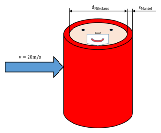

> Stilvorbild: Lehrstuhl-Tutorium 6 „Bilanzen Teil II“, Aufgabe 1 (Nikolaus am Nordpol, Klausur 2017-08-09) mit Lösung des Lehrstuhls.

<u>**Aufgabe 1** (Klausur 2017-08-09)</u>

Der Nikolaus geht am Nordpol spazieren, als plötzlich ein Sturm mit einer Windgeschwindigkeit von 20m/s aufzieht. Niemand konnte erahnen, dass es am Nordpol kalt ist ($\vartheta_{Umgebung} = - 40{^\circ}C$) und so hat er nur seinen Sommeranzug ($s_{Mantel} = 1cm$) an. Durch den aufgewirbelten Schnee hat er völlig die Orientierung verloren und kann nur darauf hoffen, dass die Elfen ihn rechtzeitig finden. Wird er das überleben?

**Anmerkungen:**

1)  Strahlungseffekte können vernachlässigt werden.

2)  Die Stoffdaten können als konstant betrachtet werden (temperaturunabhängig).

3)  Es wird nur Wärmeübergang aufgrund erzwungener Konvektion betrachtet.

4)  Wärmeübertragung findet nur über die Mantelfläche statt.

5)  Die Wärmeleitfähigkeit des Körpers vom Nikolaus kann als unendlich groß angenommen werden, wodurch der Körper als isotherm angesehen werden kann.

**Daten vom Nikolaus:** m$= 101kg$; Körpergröße h=1,70m; $\rho_{Nikolaus} = 1000kg/m³$; $c_{p,Nikolaus} = 4000J/kgK$;

**Daten vom Anzug:** $\mathbf{\ \ \ \ }s_{Mantel} = 0,01m$; $\lambda_{Iso} = 0,0226W/mK$

**Stoffdaten der Luft:** $\nu = 1,159 \cdot 10^{- 5}\ m^{2}/s$; $\lambda = 0,0226W/mK$; $c_{p} = 1,007kJ/kgK$; $\rho = 1,38kg/m³$

1)  Der Nikolaus kann im Folgenden als isolierter Zylinder approximiert werden, der nur über seine Mantelfläche Wärme abgibt. Berechnen Sie den Durchmesser $d_{Nikolaus}$ des äquivalenten Zylindernikolaus‘ (gleiche Masse und Höhe). Runden Sie den berechneten Wert auf 3 Dezimalstellen genau. $d_{Nikolaus} = 0.275m$

2)  Der Nikolaus wird im Sturm quer angeströmt. Berechnen Sie hierfür den Wärmeübergangskoeffizienten. $\alpha = 81,92\frac{W}{m^{2}K}$

3)  Bestimmen Sie den thermischen Widerstand von der Umgebung bis zum Körper vom Nikolaus. Runden Sie das Ergebnis auf 3 Dezimalstellen genau. $R_{th} = 0,2983\frac{K}{W}$

4)  Welche Wärme muss der Körper vom Nikolaus produzieren, um seine Körpertemperatur von $\vartheta_{0} = 37{^\circ}C$ konstant zu halten? ${\dot{Q}}_{N} = 258,4\ W$

5)  Die Elfen haben den Nikolaus per GPS geortet. Nach ihren Berechnungen werden sie 6,5 Stunden benötigen, um dem Nikolaus zur Hilfe zu kommen. Nehmen Sie an, dass der Körper vom Nikolaus nur eine Wärmeproduktion von $\dot{W} \bullet V_{Nikolaus} = 115,15W$ leistet. Auch in diesem Fall soll die Körpertemperatur zu Beginn des Schneesturms $\vartheta_{0} = 37{^\circ}C$ betragen. Werden die Elfen ihn retten können, bevor er erfriert? Zur Info: Die Erfrierung tritt ein, wenn die Körpertemperatur auf unter 30°C sinkt. $t_{\min} = 21564s\sim 6h$

Lösung:

a\)

$$V = \frac{\pi d_{N}^{2}}{4}h = \frac{m}{\rho_{N}}$$

$$d_{N} = \sqrt{\frac{4m}{\pi h\rho_{N}}} = \sqrt{\frac{4 \cdot 101kg}{\pi 1,7m1000\frac{kg}{m^{3}}}} = 0,27504m$$

b\)

$$L = \frac{\pi}{2}d_{a} = \frac{\pi}{2}(0,275m + 2 \cdot 0,01m) = 0,4634m$$

$$Pr = \frac{\eta_{L}c_{p,L}}{\lambda_{L}} = \frac{{1,599}_{10^{- 5}}Pas\ 1007\frac{J}{kgK}}{0,0226\frac{W}{mK}} = 0,713$$

$$Re = \frac{wL}{\nu_{L}} = \frac{20\frac{m}{s}0,4634m}{{1,16}_{10^{- 5}}\frac{m^{2}}{s}} = 8_{10^{5}}$$

$$Nu_{t} = \frac{0,037Re^{0,8}\Pr}{1 + 2,443Re^{- 0,1}\left( \Pr^{\frac{2}{3}} - 1 \right)} = \frac{0,037\left( 8_{10^{5}} \right)^{0,8}0,713}{1 + 2,443\left( 8_{10^{5}} \right)^{- 0,1}\left( {0,713}^{\frac{2}{3}} - 1 \right)} = 1593,34$$

$$Nu_{L} = 0,664\sqrt{Re}\sqrt[3]{\Pr} = 0,664\sqrt{8_{10^{5}}}\sqrt[3]{0,713} = 530,36$$

$$Nu_{m} = 0,3 + \sqrt{Nu_{L}^{2} + Nu_{t}^{2}} = 0,3 + \sqrt{{530,36}^{2} + {1593,34}^{2}} = 1679,6$$

$$\alpha = \frac{Nu\lambda_{L}}{L} = \frac{1679,6 \cdot 0,0226\frac{W}{mK}}{0,4634m} = 81,92\frac{W}{m^{2}K}\ \ \left( \alpha_{t} = 77,71\frac{W}{m^{2}K} \right)$$

c\)

> $$R_{th} = R_{\alpha} + R_{\lambda} = \frac{1}{\pi d_{a}h\alpha} + \frac{\ln\left( \frac{d_{a}}{d_{N}} \right)\ }{\lambda_{M}2\pi h} = \frac{1}{\pi 0,295m1,7m85\frac{W}{m^{2}K}} + \frac{\ln\left( \frac{0,295m}{0,275m} \right)}{2\pi 1,7m0,0226\frac{W}{mK}} = 0,2983\frac{K}{W}$$

d\)

> $$\frac{dU}{dt} = 0 = {\dot{Q}}_{N} - {\dot{Q}}_{K} = {\dot{Q}}_{N} - kA\left( T_{N} - T_{u} \right)$$
>
> $$kA = \frac{1}{R_{th}}$$
>
> $${\dot{Q}}_{N} = kA\left( T_{N} - T_{u} \right) = \frac{1}{0,298\frac{K}{W}}(310,15K - 233,15K) = 258,4\ W$$

e\)

> $$\frac{dU}{dt} = mc_{p,N}\frac{dT}{dt} = {\dot{Q}}_{N} - {\dot{Q}}_{K} = {\dot{Q}}_{N} - kA\left( T - T_{u} \right)$$

$$\frac{dT}{dt} + \frac{kA}{mc_{p,N}}T = \frac{{\dot{Q}}_{N} + kAT_{u}}{mc_{p,N}}$$

> $$T(t) = \frac{b}{a} + C \cdot e^{- at}$$
>
> $$a = \frac{kA}{mc_{p,N}} = \frac{1}{0,298\frac{K}{W}101kg\ 4000\frac{J}{kgK}} = {8,3062}_{10^{- 6}}\frac{1}{s}$$
>
> $$b = \frac{{\dot{Q}}_{N} + kAT_{u}}{mc_{p,N}} = \frac{115,15W + \frac{1}{0,298\frac{K}{W}}233,15K}{101kg\ 4000\frac{J}{kgK}} = 0,00222162\frac{K}{s}$$
>
> $$\frac{b}{a} = 267,465\ K$$
>
> $$T(0s) = T_{0} = \frac{b}{a} + C \rightarrow C = T_{0} - \frac{b}{a} = 42,685K$$
>
> $$T_{\min} = \frac{b}{a} + \left( T_{0} - \frac{b}{a} \right) \cdot e^{- at_{\min}}$$
>
> $$t_{\min} = \ln{\left( \frac{303,15K - 267,465K}{310,15K - 267,465K} \right) \cdot \frac{- 1}{{8,3062}_{10^{- 6}}\frac{1}{s}}} = 21564s\sim 6h$$

**<u>  
</u>**

