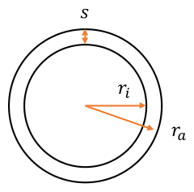

> Übung 6 (SoSe 2026): Kugelförmiger Wassertank, instationäre globale Energiebilanz; Aufgabe mit Lösung des Lehrstuhls.

|  |  |
|------------------------------------------------------------------------------------------------------------|----------------------------------------------------------------------------------------------------------|

Lehrstuhl für Fluidverfahrenstechnik

**Übungsaufgaben Wärmeübertragung**

**mit Lösung**

Tobias Thelen, Torben Schmücker

Sommersemester 2026

# *Inhaltsverzeichnis*

[18 Kugelförmiger Wassertank [53](#kugelförmiger-wassertank)](#kugelförmiger-wassertank)

# Kugelförmiger Wassertank

Susi Sorglos hat einen überirdischen, kugelförmigen Wassertank aus Stahlbeton für die Brauerei Gustav Gerstenkorn projektiert, in dem sich Brauchwasser für die Flaschenreinigung befindet. Der Wärmeübergangskoeffizient an der Außenseite des Tanks zur Umgebung mit der konstanten Temperatur $T_{u} = - 5{^\circ}C$ beträgt $\alpha_{a} = 25\frac{W}{m^{2}K}$. Im Inneren des Tanks liegt durch Konvektion näherungsweise ein idealer Wärmeübergang vor. Örtliche Temperaturunterschiede im Wasser sind vereinfachend ebenso zu vernachlässigen, wie die Wärmespeicherung in der Betonschale. Das Wasser kann als inkompressibles Fluid angenommen werden ($c_{p,W} = c_{v,W}$).

Folgende Größen sind bekannt:

- Wärmeleitfähigkeit des Stahlbetons: $\lambda_{B} = 2,0\frac{W}{mK}$

- Innendurchmesser des Tanks: $d_{i} = 6m$

- Wandstärke: $s = 25cm$

- Isobare Wärmekapazität des Brauchwassers: $c_{p,W} = 4200\frac{J}{kgK}$

- Dichte des Brauchwassers: $\rho_{W} = 1000\frac{kg}{m^{3}}$

Hinweis:

Kugeloberfläche: $A_{Kugel} = 4\pi r^{2}$, Kugelvolumen: $V_{Kugel} = \frac{4}{3}\pi r^{3}$

<u>Aufgabenstellung:</u>

1\. Wie groß ist der auf die innere Tankoberfläche bezogene Wärmedurchgangskoeffizient $k_{i}$?

2\. Bei Betriebsende am Samstag herrscht die Temperatur $T_{0} = 30{^\circ}C$ im Tank. Welche Temperatur $T_{1}$ liegt nach einer Zeitspanne von $\Delta t_{1} = 30h$ am Montag bei Schichtbeginn vor? Nutzen Sie die Beziehungen aus Aufgabenteil 1.

3\. Welche Wärmemenge $Q$ ist erforderliche, um das Wasser wieder auf die Anfangstemperatur $T_{0}$ zu bringen? Welcher Wärmestrom$\ \dot{Q}$ wäre nötig, wenn die Aufheizung in einer Zeitspanne von $\Delta t_{2} = 2h$ erfolgen soll. Welcher Wärmestromdichte $\dot{q}$ entspräche dies, falls die Beheizung durch eine Heizfolie an der Innenseite des Tanks erfolgt?

**<u>Lösung:</u>**

<u>Geg.:</u> Wärmeübergangskoeffizient $\alpha_{a} = 25\frac{W}{m^{2}K}$ ,

Umgebungstemperatur $T_{u} = - 5{^\circ}C$,

> Wärmeleitfähigkeit des Stahlbetons $\lambda_{B} = 2,0\frac{W}{mK}$,
>
> Innendurchmesser des Tanks $d_{i} = 6m$,
>
> Wandstärke $s = 25cm$,
>
> Isobare Wärmekapazität des Brauchwassers $c_{p,W} = 4200\frac{J}{kgK},$
>
> Dichte des Brauchwassers $\rho_{W} = 1000\frac{kg}{m^{3}}$

<u>Annahmen:</u> örtliche Temperaturunterschiede im Wasser sind zu vernachlässigen,

Wärmespeicherung im Beton ist zu vernachlässigen,

Wasser kann als inkompressibles Fluid angenommen werden ($c_{p,W} = c_{v,W}$)

<u>Aufgabenteil 10.1:</u>

<u>Ges.:</u> auf die innere Tankoberfläche bezogene Wärmedurchgangskoeffizient $k_{i}$

| 2D Skizze Kugel: |  |
|------------------|-----------------------------------------------------------------------------------------------------------|

<u>Wärmedurchgang:</u> Wärmeleitung im Kugelmantel und äußere Konvektion.  
Im Inneren idealer Wärmeübergang Vernachlässigung konvektiver Teil $R_{\alpha_{i}}$.  
Wärmedurchgangskoeffizient bezogen auf innere Fläche:

| $$k_{i} = \ \frac{1}{R_{ges}A_{i}}$$ |     |
|--------------------------------------|-----|

Der thermische Widerstand setzt sich zusammen (Reihenschaltung):

| $$R_{ges} = R_{\lambda} + R_{\alpha_{a}}$$ | (18‑1) |
|--------------------------------------------|--------|

Der Widerstand für konv. Wärmeübergang ergibt sich aus:

| $$R_{\alpha_{a}} = \frac{1}{\alpha_{a}\ A_{a}} = \frac{1}{\alpha_{a}\ 4\pi r_{a}^{2}}$$ | (18‑2) |
|-----------------------------------------------------------------------------------------|--------|

Der Wärmeleitungswiderstand durch den Mantel ist definiert durch:

| $$R_{\lambda}: = \frac{\left( T_{i} - T_{a} \right)}{{\dot{Q}}_{\lambda}}$$ | (18‑3) |
|-----------------------------------------------------------------------------|--------|

Und der Wärmestrom wird bestimmt durch (Fourier):

| $${\dot{Q}}_{\lambda} = - \lambda_{B}\ 4\pi r^{2}\frac{dT}{dr}$$ | (18‑4) |
|------------------------------------------------------------------|--------|

Trennung der Variablen (mit Potenzregel für r):

| $${- \frac{{\dot{Q}}_{\lambda}}{\lambda_{B}\ 4\pi}\int_{r_{i}}^{r_{a}}{\frac{1}{r^{2}}dr} = \int_{T_{i}}^{T_{a}}{dT}                              
 }{- \frac{{\dot{Q}}_{\lambda}}{\lambda_{B}\ 4\pi}\ \left\lbrack - \frac{1}{r} \right\rbrack_{r_{i}}^{r_{a}} = \lbrack T\rbrack_{T_{i}}^{T_{a}}}$$  | (18‑5) |
|---------------------------------------------------------------------------------------------------------------------------------------------------|--------|

Grenzen einsetzen und sortieren:

| $$\frac{1}{\lambda_{B}\ 4\pi}\left( \frac{1}{r_{i}} - \frac{1}{r_{a}} \right) = \frac{T_{i} - T_{a}}{{\dot{Q}}_{\lambda}} = R_{\lambda}$$ | (18‑6) |
|-------------------------------------------------------------------------------------------------------------------------------------------|--------|

Für den Wärmedurchgangskoeffizienten schreiben wir:

| $${k_{i} = \frac{1}{\left( R_{\lambda} + R_{\alpha_{a}} \right)A_{i}} = \frac{1}{\left\lbrack \frac{1}{\alpha_{a}4\pi r_{a}^{2}} + \frac{1}{4\pi\lambda_{B}}\left( \frac{1}{r_{i}} - \frac{1}{r_{a}} \right) \right\rbrack 4\pi r_{i}^{2}} 
 }{= \frac{1}{\left\lbrack \frac{1}{\alpha_{a}r_{a}^{2}} + \frac{1}{\lambda_{B}}\left( \frac{1}{r_{i}} - \frac{1}{r_{a}} \right) \right\rbrack r_{i}^{2}}                                                                                    
 }{= \frac{1}{\left\lbrack \frac{1}{25\frac{W}{m^{2}K}\ (3,25m)^{2}} + \frac{1}{2\frac{W}{mK}}\left( \frac{1}{3m} - \frac{1}{3,25m} \right) \right\rbrack(3m)^{2}}                                                                           
 }{= 6,69\frac{W}{m^{2}K}}$$                                                                                                                                                                                                                 | (18‑7) |
|--------------------------------------------------------------------------------------------------------------------------------------------------------------------------------------------------------------------------------------------|--------|

<u>Aufgabenteil 10.2:</u>

<u>Geg.:</u> Temperatur bei Betriebsende $T_{0} = 30{^\circ}C$

<u>Ges.:</u> Temperatur $T_{1}$ nach $\Delta t_{1} = 30h$

Globale instationäre Energiebilanz um das geschlossene System „Tank“ (V =const.):

| $$\frac{dU}{dt} = - {\dot{Q}}_{ab}$$ | (18‑8) |
|--------------------------------------|--------|

…für inkompressible Fluide ($c_{p,W} = c_{v,W}$) und mit der Beziehung aus 10.1 für ${\dot{Q}}_{ab}$:

| $$m_{W}\ c_{p,W}\frac{dT}{dt} = - k_{i}A_{i}\left( T - T_{u} \right)$$ | (18‑9) |
|------------------------------------------------------------------------|--------|

Trennung der Variablen und kürzen:

| $${\int_{T_{0}}^{T_{1}}{\frac{1}{\left( T - T_{u} \right)}dT} = - \frac{k_{i}A_{i}}{m_{W}\ c_{p,W}}\int_{t_{0}}^{t_{1}}{dt}\                                                                            
 }{\ln\left( \frac{T_{1} - T_{u}}{T_{0} - T_{u}} \right) = - \frac{k_{i}4\pi r_{i}^{2}}{\rho_{W}\frac{4}{3}\pi r_{i}^{3}\ c_{p,W}}\Delta t_{1} = \  - \frac{3k_{i}}{\rho_{W}r_{i}c_{p,W}}\Delta t_{1}}$$  | (18‑10) |
|---------------------------------------------------------------------------------------------------------------------------------------------------------------------------------------------------------|---------|

Umstellen nach $T_{1}$:

| $$T_{1} = T_{u} + (T_{0} - T_{u})e^{- \frac{3k_{i}}{\rho_{W}r_{i}c_{p,W}}\Delta t_{1}} = 24,47{^\circ}C$$ | (18‑11) |
|-----------------------------------------------------------------------------------------------------------|---------|

Werte einsetzen:

| $${T_{1} = - 5{^\circ}C + \left( 30{^\circ}C - ( - 5{^\circ}C) \right)e^{- \frac{3 \cdot 6,69\frac{W}{m^{2}K}}{1000\frac{kg}{m^{3}} \cdot 3m \cdot 4200\frac{J}{kgK}}30h \cdot 3600\frac{s}{h}} 
 }{= 24,47{^\circ}C\ }$$                                                                                                                                                                          | (18‑12) |
|-------------------------------------------------------------------------------------------------------------------------------------------------------------------------------------------------|---------|

<u>Aufgabenteil 10.3:</u>

<u>Ges.:</u> Wärmemenge Q für Anfangstemperatur $T_{0} = 30\ {^\circ}C,$

Wärmestrom $\dot{Q}$ für Aufheizen in $\Delta t_{2} = 2h$,

Wärmestromdichte $\dot{q}$

Abgegebene Wärmemenge muss wieder zugeführt werden.

Wärmemenge, um System von Zustand 1 zurück in Zustand 0 zu bringen:

| $$\Delta Q_{10} = \ \Delta U_{10\ }\ \ \ \ \ \ \ \ \ \ \ \ mit\ \Delta U_{10\ } = \rho Vc_{p}\Delta T_{10}$$                                | (18‑13) |
|---------------------------------------------------------------------------------------------------------------------------------------------|---------|
| $${\Delta Q_{10}\  = \rho_{W} \cdot \frac{4}{3}\pi r_{i}^{3} \cdot c_{p,W} \cdot \left( T_{0} - T_{1} \right)                               
 }{\ \ \ \ \ \ \ \ \ \ \ \  = 1000\frac{kg}{m^{3}} \cdot \frac{4}{3}\pi(3m)^{3} \cdot 4200\frac{J}{kgK} \cdot (30{^\circ}C - 24,47{^\circ}C)  
 }{\ \ \ \ \ \ \ \ \ \ \ \  = 2626798715\ J\  ≙ 2626,8\ MJ}$$                                                                                 | (18‑14) |

Berechnung des Wärmestroms:

| $$\dot{Q} = \frac{\Delta Q_{10}}{\Delta t_{10}} = \frac{2626,8\ MJ}{2h \cdot 3600\frac{s}{h}} = 364,83\ kW$$ | (18‑15) |
|--------------------------------------------------------------------------------------------------------------|---------|

Wärmestromdichte berechnen:

| $$\dot{q} = \frac{\dot{Q}}{A_{i}} = \frac{\dot{Q}}{4\pi r_{i}^{2}} = \frac{364,83\ kW}{4\pi{(3m)}^{2}} = 3,23\frac{kW}{m^{2}}$$ | (18‑16) |
|---------------------------------------------------------------------------------------------------------------------------------|---------|
