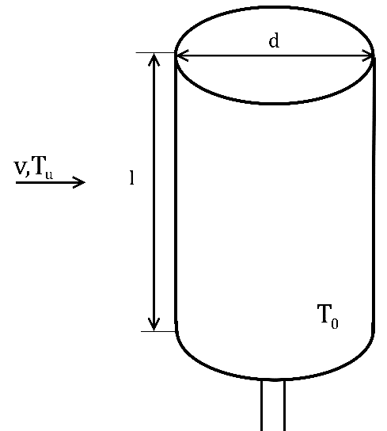
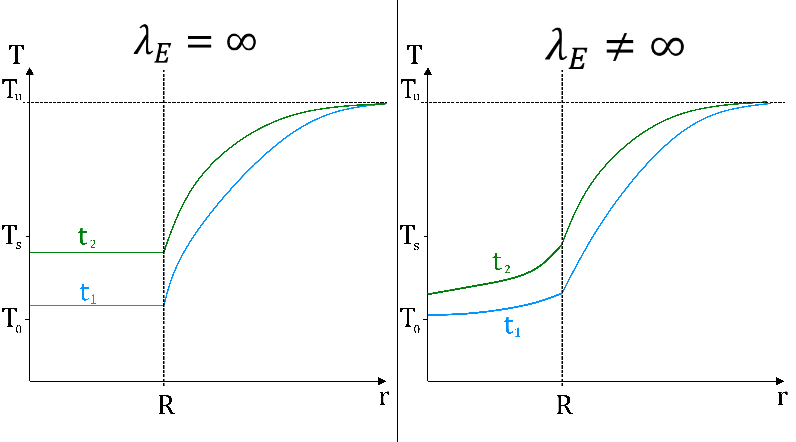
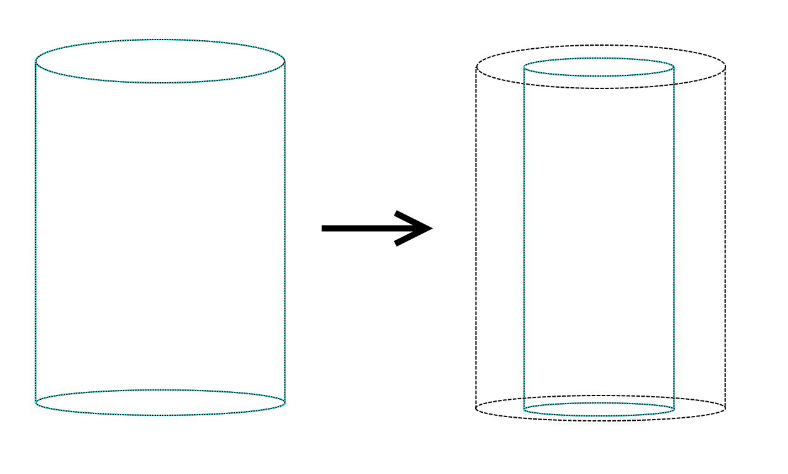

> Übung 7 (SoSe 2026): Eis am Stiel, globale Energiebilanz und Zeit bis zum Schmelzpunkt; Aufgabe mit Lösung des Lehrstuhls.

|  |  |
|------------------------------------------------------------------------------------------------------------|----------------------------------------------------------------------------------------------------------|

Lehrstuhl für Fluidverfahrenstechnik

**Übungsaufgaben Wärmeübertragung**

**mit Lösung**

Tobias Thelen, Torben Schmücker

Sommersemester 2026

# *Inhaltsverzeichnis*

[19 Eis am Stiel [58](#eis-am-stiel)](#eis-am-stiel)

# Eis am Stiel

Ein Speiseeis am Stiel wird aus einer im Freien stehenden Tiefkühltruhe an einem Sommertag entnommen, sofort ausgepackt und senkrecht in die Höhe gehalten. Zu Beginn hat es eine Temperatur von$\ T_{0} = - 17{^\circ}C$, wobei die Umgebungsluft das Eis mit einer Geschwindigkeit von $v = 1\frac{m}{s}$ und einer Temperatur von $T_{u} = 25{^\circ}C$ umströmt.

Hinweis:

- Der Wärmeleitwiderstand des Eises sei gegenüber des Wärmeübergangswiderstands zu vernachlässigen ($\lambda_{E} \rightarrow \infty$).

- Der Wärmeübergangskoeffizient $\alpha_{0}$ sei konstant.

- Es kann die Nußelt-Beziehung für einen senkrecht stehenden Zylinder verwendet werden.

Tabelle 19.1 Stoffdaten

| ***Luft***              |                                                 | ***Eis***              |                                       |
|-------------------------|-------------------------------------------------|------------------------|---------------------------------------|
| Wärmeleitfähigkeit      | $$\lambda_{L} = 25 \cdot 10^{- 3}\frac{W}{mK}$$ | Dichte                 | $$\rho_{E} = 1000\frac{kg}{m³}$$      |
| Dichte                  | $$\rho_{L} = 1,28\frac{kg}{m^{3}}$$             | Isobare Wärmekapazität | $$c_{p,E} = 4000\frac{J}{kgK}$$       |
| Kinematische Viskosität | $$\nu_{L} = 140 \cdot 10^{- 7}\frac{m²}{s}$$    | Spez. Schmelzenthalpie | $$\Delta h_{s,E} = 334\frac{kJ}{kg}$$ |
| Isobare Wärmekapazität  | $$c_{p,L} = 1000\frac{J}{kgK}$$                 |                        |                                       |

<u>Aufgabenstellung:</u>

1\. Berechnen Sie den Wärmeübergangskoeffizienten zu Beginn $t = t_{0}$. Das Eis wird dabei als quer angeströmter Zylinder mit den Maßen $d = 4cm$ und $l = 10cm$ betrachtet. Der Stiel des Eises sowie die Stirnflächen des Zylinders werden vernachlässigt.

2\. Wie lange dauert es, bis die Schmelztemperatur des Eises ($T_{s} = 0{^\circ}C$) durch den konvektiven Wärmeübergang erreicht ist?

3\. Zeichnen Sie qualitativ das Temperaturprofil über den Radius des Zylinder bis in die Luft für zwei Zeiten $t_{2} > t_{1} > t_{0}$ zum einen für den Fall aus Aufgabenteil 2 und zum anderen für den Fall, das $\lambda_{Eis}$ nicht unendlich groß ist. Die Schmelztemperatur soll dabei nicht erreicht sein.

4\. Das Eis beginnt zu schmelzen. Es wird angenommen, dass das geschmolzene Eis unmittelbar nach dem Schmelzen heruntertropft. Der Durchmesser des Zylinders nehme dabei kontinuierlich ab, die Länge $l$ bleibe konstant. Der Wärmeübergangskoeffizient sei trotz der sich verändernden Geometrie konstant. Wie lange dauert es von Beginn des Schmelzens, bis das ganze Eis geschmolzen ist?

5\. Nun herrsche Windstille ($v = \frac{0m}{s},\ T_{u} = 25{^\circ}C$). Ein zweites Eis der gleichen Form wird aus der Eistruhe entnommen und ebenfalls senkrecht in die Höhe gehalten. Wie lange dauert es nun bis das Eis geschmolzen ist?

**<u>Lösung:</u>**

<u>Geg.:</u> Starttemperatur $T_{0} = - 17{^\circ}C,$

Umgebungstemperatur $T_{u} = 25{^\circ}C,$

Geschwindigkeit der Umgebungsluft $v = 1\frac{m}{s},$

> Stoffdaten der Luft: (Wärmeleitfähigkeit $\lambda_{L} = 25 \cdot 10^{- 3}\frac{W}{mK}$, Dichte $\rho_{L} = 1,28\frac{kg}{m^{3}},$ kinematische Viskosität $\nu_{L} = 140 \cdot 10^{- 7}\frac{m²}{s}$, isobare Wärmekapazität $c_{p,L} = 1000\frac{J}{kgK}$)
>
> Stoffdaten des Eises: (Dichte $\rho_{E} = 1000\frac{kg}{m³}$, isobare Wärmekapazität $c_{p,E} = 4000\frac{J}{kgK}$, spez. Schmelzenthalpie $\Delta h_{s,E} = 334\frac{kJ}{kg}$)

<u>Annahmen:</u>

- Wärmeleitwiderstand des Eises ist gegenüber des Wärmeübergangswiderstands zu vernachlässigen ($\lambda_{E} \rightarrow \infty$),

- Wärmeübergangskoeffizient $\alpha_{0}$ ist konstant

- Nußelt-Beziehung für einen senkrecht stehenden Zylinder verwenden

<u>Aufgabenteil 11.1:</u>

<u>Geg.:</u> Durchmesser $d = 4\ cm$, Länge $l = 10\ cm$

<u>Ges.:</u> Wärmeübergangskoeffizient $\alpha_{0}$

<u>Annahmen:</u> Der Stiel des Eises sowie die Stirnflächen des Zylinders werden vernachlässigt

Berechnung der Prandtl-Zahl der Luft:

| $${\Pr_{L} = \frac{\nu_{L}\rho_{L}c_{p,L}}{\lambda_{L}} = \frac{140_{10^{- 7}}\frac{m^{2}}{s}\ 1,28\frac{kg}{m^{3}}\ 1000\frac{J}{kgK}\ }{25_{10 -^{3}}\frac{W}{mK}} 
 }{= 0,7168\ \ }$$                                                                                                                                                     | (19‑1) |
|----------------------------------------------------------------------------------------------------------------------------------------------------------------------|--------|

Für umströmte Zylinder gilt:

| $$L = \frac{\pi}{2}d$$ | (19‑2) |
|------------------------|--------|

Berechnung der Reynolds-Zahl:

| $$Re = \frac{vL}{\nu_{L}} = \frac{v\pi d}{2\nu_{L}} = \frac{1\frac{m}{s}\pi 4cm}{2 \cdot 140_{10^{- 7}}\frac{m^{2}}{s}} = 4488$$ | (19‑3) |
|----------------------------------------------------------------------------------------------------------------------------------|--------|

Für die Nußelt-Korrelation für querumströmte Zylinder bei laminarer Strömung müssen die Bedingungen $Re < 10^{5}$ und $Pr > 0,5$ erfüllt sein. Die Bedingungen sind erfüllt:

| $$Nu = 0,664\ \sqrt{Re} \cdot \sqrt[3]{\Pr}$$              | (19‑4) |
|------------------------------------------------------------|--------|
| $$Nu = 0,664\ \sqrt{4488} \cdot \sqrt[3]{0,7168} = 39,81$$ | (19‑5) |

Daraus können wir den Wärmeübergangskoeffizienten bestimmen:

| $$\alpha_{0} = \frac{Nu\ \lambda_{L}}{L} = \frac{2\ Nu\ \lambda_{L}}{\pi d} = \frac{2 \cdot 39,81 \cdot 25_{10 -^{3}}\frac{W}{mK}}{\pi \cdot 4cm} = 15,84\frac{W}{m^{2}K}$$ | (19‑6) |
|-----------------------------------------------------------------------------------------------------------------------------------------------------------------------------|--------|

<u>Aufgabenteil 11.2:</u>

<u>Ges.:</u> Zeit, bis Schmelzpunkt erreicht ist

Globale Energiebilanz um den Raum des Eises:

| $$\frac{dU}{dt} = {\dot{Q}}_{\alpha_{0}}$$ | (19‑7) |
|--------------------------------------------|--------|

Das Eis erwärmt sich durch die Außenluft (konvektiver Wärmeübergang):

| $$m_{E}c_{p,E}\frac{dT}{dt} = \alpha_{0}A\left( T_{u} - T \right)$$ | (19‑8) |
|---------------------------------------------------------------------|--------|

Trennung der Variablen und A sowie mE durch entsprechende Ausdrücke ersetzen:

| $m_{E} = \rho\frac{\pi}{4}d^{2}L$ und $A = \pi dL$                                                                                                                                                                               | (19‑9)  |
|----------------------------------------------------------------------------------------------------------------------------------------------------------------------------------------------------------------------------------|---------|
| $$\int_{T_{0}}^{T_{s}}{\frac{1}{\left( T - T_{u} \right)}dT} = - \frac{\alpha_{0}\pi dl}{\rho_{E}\frac{\pi}{4}d^{2}l\ c_{p,E}}\int_{t_{0}}^{t_{s}}{dt} = \  - \frac{{4\alpha}_{0}}{\rho_{E}d\ c_{p,E}}\int_{t_{0}}^{t_{s}}{dt}$$ | (19‑10) |

Integration:

| $$\ln\left( \frac{T_{S} - T_{u}}{T_{0} - T_{u}} \right) = - \frac{4\alpha_{0}}{\rho_{E}dc_{p,E}}(t_{s} - t_{0})$$ | (19‑11) |
|-------------------------------------------------------------------------------------------------------------------|---------|

Einsetzen der Grenzen und Gleichung sortieren:

| $${t_{s} = t_{0} - \ln\left( \frac{T_{s} - T_{u}}{T_{0} - T_{u}} \right) \bullet \frac{\rho_{E}dc_{p,E}}{4\alpha_{0}}                                                       
 }{= 0s - \ln\left( \frac{0{^\circ}C - 25{^\circ}C}{- 17{^\circ}C - 25{^\circ}C} \right)\frac{1000\frac{kg}{m^{3}}\ 0,04m\ 4000\frac{J}{kgK}}{4 \cdot 15,84\frac{W}{m^{2}K}}  
 }{= 1310s\  ≙ 21,8\ min}$$                                                                                                                                                   | (19‑12) |
|-----------------------------------------------------------------------------------------------------------------------------------------------------------------------------|---------|

<u>  
</u>

<u>Aufgabenteil 11.3</u>

<u>Aufgabenteil 11.4</u>

<u>Ges.:</u> Zeit, bis das Eis aufgeschmolzen ist

Energiebilanz:

| $$\frac{dU}{dt} = {\dot{Q}}_{\alpha_{0}}$$ | (19‑13) |
|--------------------------------------------|---------|

Die Systemgrenze bleibt auf dem Rand unseres Eises. Dadurch schrumpft unser System mit dem Schmelzen des Eises.

Die Energiebilanz setzt sich zusammen aus: (da V nicht konstant Enthalpiegleichung)

| $$\frac{dH}{dt} = \frac{d\left( mc_{p}T \right)}{dt} - \Delta h_{s,E}\frac{dm}{dt}$$ | (19‑14) |
|--------------------------------------------------------------------------------------|---------|

Da der Phasenwechsel (Schmelzvorgang) **isotherm** abläuft, ist der erste Term =0, da $\frac{dT}{dt} = 0$ ist. Die Enthalpie verändert sich in diesem Falls also ausschließlich durch den Phasenwechsel.

| $$\frac{dH}{dt} = - \Delta h_{s,E}\frac{dm}{dt} = - \Delta h_{s,E}\frac{d\left( \rho_{E}\pi r^{2}l \right)}{dt} = - \Delta h_{s,E} \bullet \rho_{E} \bullet \pi \bullet l\frac{dr^{2}}{dt}$$ | (19‑15) |
|----------------------------------------------------------------------------------------------------------------------------------------------------------------------------------------------|---------|

Hier ist $r = r(t)$, also eine Funktion der Zeit. Somit muss die Kettenregel berücksichtigt werden:

| $$\frac{d\left( r^{2} \right)}{dt} = 2r \cdot \frac{dr}{dt}$$ | (19‑16) |
|---------------------------------------------------------------|---------|

Das führt auf:

| $$\frac{dH}{dt} = - \Delta h_{s,E}\rho_{E}\pi l \cdot 2r \cdot \frac{dr}{dt} = {\dot{Q}}_{\alpha_{0}}$$ | (19‑17) |
|---------------------------------------------------------------------------------------------------------|---------|

Für die Wärmezufuhr durch Konvektion setzen wir das Newton’sche Abkühlungsgesetz ein:

| $$- \Delta h_{s,E} \bullet \rho_{E} \bullet 2\pi rl\frac{dr}{dt} = 2\pi rl \bullet \alpha_{0}\left( T_{u} - T_{s} \right)$$ | (19‑18) |
|-----------------------------------------------------------------------------------------------------------------------------|---------|

Kürzen und Trennung der Variablen liefert:

| $$\frac{- \Delta h_{s,E}\rho_{E}}{\alpha_{0}\left( T_{u} - T_{s} \right)}\int_{r_{0}}^{r = 0m}{dr} = \int_{t_{0}}^{t_{1}}{dt}$$ | (19‑19) |
|---------------------------------------------------------------------------------------------------------------------------------|---------|

Integrieren und Grenzen einsetzen:

| $$\frac{\Delta h_{s,E}\rho_{E}}{\alpha_{0}\left( T_{u} - T_{s} \right)}r_{0} = t_{1} - t_{0}$$ | (19‑20) |
|------------------------------------------------------------------------------------------------|---------|

Umstellen und einsetzen liefert:

<table>
<colgroup>
<col style="width: 71%" />
<col style="width: 28%" />
</colgroup>
<thead>
<tr class="header">
<th>
$${t_{1} = t_{0} + \frac{\Delta h_{s,E}\rho_{E}r_{0}}{\alpha_{0}\left( T_{u} - T_{s} \right)}
}{\ \ \ \ \ \  = 0s + \frac{334\frac{kJ}{kgK}1000\frac{kg}{m^{3}}0,02m}{15,84\frac{W}{m^{2}K}\ (25{^\circ}C - 0{^\circ}C)} = 16869s ≙ 4,7h}$$

<strong>Zeit ist unrealistisch! Diskussion am Ende!</strong>
</th>
<th>(19‑21)</th>
</tr>
</thead>
<tbody>
</tbody>
</table>

<u>Aufgabenteil 11.4 (alternative Formulierung)</u>

<u>Ges.:</u> Zeit, bis das Eis aufgeschmolzen ist

Die Systemgrenze bleibt auf dem Rand unseres Eises. Dadurch schrumpft unser System mit dem Schmelzen des Eises. Es wird lediglich die Enthalpie des festen Eises (f) bilanziert, da das flüssige Eis (fl) unmittelbar das Kontrollvolumen verlässt.

Enthalpiebilanz (V nicht konstant):

| $$\frac{dH_{f}}{dt} = - {\dot{H}}_{fl,ab} + {\dot{Q}}_{\alpha_{0}}$$ | (19‑13) |
|----------------------------------------------------------------------|---------|

Die Enthalpie der festen Phase lässt sich durch beschreiben (dp=0):

| $$\frac{dH_{f}}{dt} = \frac{d\left( m_{f}h_{f} \right)}{dt}$$ | (19‑14) |
|---------------------------------------------------------------|---------|

Durch Anwendung der Produktregel sowie Einsetzen der bekannten Beziehungen für ${\dot{H}}_{fl,ab}$ und ${\dot{Q}}_{\alpha_{0}}$ erhält man:

| $\frac{{dm}_{f}}{dt}h_{f} + \frac{dh_{f}}{dt}m_{f} = - \frac{dm_{fl}}{dt}h_{fl} + \alpha_{0}A(T_{u} - T_{S}$) | (19‑15) |
|---------------------------------------------------------------------------------------------------------------|---------|

Über die Massenbilanz des Kontrollraumes lässt sich herleiten:

| $\frac{{dm}_{f}}{dt} = - {\dot{m}}_{aus} = - \frac{dm_{fl}}{dt}$ | (19‑16) |
|------------------------------------------------------------------|---------|

Die Schmelzenthalpie ist definiert als:

| $\Delta h_{s,E} = h_{fl} - h_{f}$ | (19‑17) |
|-----------------------------------|---------|

Einsetzen von (19-16) und (19-17) in (19-15) ergibt:

| $\frac{{dm}_{f}}{dt}( - \Delta h_{s,E}) = \alpha_{0}A(T_{u} - T_{S}$) | (19‑18) |
|-----------------------------------------------------------------------|---------|

Einsetzen der Formel für Masse und Oberfläche des Zylinders:

| $\frac{d(\rho_{E\ } \cdot \pi \cdot r^{2} \cdot l)}{dt}( - \Delta h_{s,E}) = \alpha_{0} \cdot 2\pi rl \cdot (T_{u} - T_{S}$) | (19‑19) |
|------------------------------------------------------------------------------------------------------------------------------|---------|

Hier ist $r = r(t)$, also eine Funktion der Zeit. Somit muss die Kettenregel berücksichtigt werden:

| $$\frac{d\left( r^{2} \right)}{dt} = 2r \cdot \frac{dr}{dt}$$ | (19‑20) |
|---------------------------------------------------------------|---------|

Das führt auf:

| $\rho_{E\ } \cdot \pi l2r \cdot \frac{dr}{dt}\left( - \Delta h_{s,E} \right) = \alpha_{0} \cdot 2\pi rl \cdot (T_{u} - T_{S}$) | (19‑21) |
|--------------------------------------------------------------------------------------------------------------------------------|---------|

Kürzen und Trennung der Variablen liefert:

| $$\frac{- \Delta h_{s,E}\rho_{E}}{\alpha_{0}\left( T_{u} - T_{s} \right)}\int_{r_{0}}^{r = 0m}{dr} = \int_{t_{0}}^{t_{1}}{dt}$$ | (19‑22) |
|---------------------------------------------------------------------------------------------------------------------------------|---------|

Integrieren und Grenzen einsetzen:

| $$\frac{\Delta h_{s,E}\rho_{E}}{\alpha_{0}\left( T_{u} - T_{s} \right)}r_{0} = t_{1} - t_{0}$$ | (19‑23) |
|------------------------------------------------------------------------------------------------|---------|

Umstellen und einsetzen liefert:

<table>
<colgroup>
<col style="width: 71%" />
<col style="width: 28%" />
</colgroup>
<thead>
<tr class="header">
<th>
$${t_{1} = t_{0} + \frac{\Delta h_{s,E}\rho_{E}r_{0}}{\alpha_{0}\left( T_{u} - T_{s} \right)}
}{\ \ \ \ \ \  = 0s + \frac{334\frac{kJ}{kgK}1000\frac{kg}{m^{3}}0,02m}{15,84\frac{W}{m^{2}K}\ (25{^\circ}C - 0{^\circ}C)} = 16869s ≙ 4,7h}$$

<strong>Zeit ist unrealistisch! Diskussion am Ende!</strong>
</th>
<th>(19‑24)</th>
</tr>
</thead>
<tbody>
</tbody>
</table>

<u>Aufgabenteil 11.5:</u>

<u>Geg.:</u> Windgeschwindigkeit $v = 0\frac{m}{s}$, Umgebungstemperatur $T_{u} = 25{^\circ}C$

<u>Ges.:</u> Zeit, bis das Eis aufgeschmolzen ist

Es herrsche nun Windstille: keine erzwungene Konvektion, sondern nun freie Konvektion

Daraus folgt, wir müssen eine andere Nußelt-Korrelation wählen: Freie Konvektion – senkrechter Zylinder:

| $${Nu = 0,435\frac{l}{d} + Nu_{platte,senkr.}                                                                                                                                                                  
 }{Nu = 0,435\frac{l}{d} + \left\{ 0,825 + 0,387\left\lbrack Gr\ \Pr_{L}\ \left( 1 + \left( \frac{0,492}{\Pr_{L}\ } \right)^{\frac{9}{16}} \right)^{\frac{- 16}{9}} \right\rbrack^{\frac{1}{6}} \right\}^{2}}$$  | (19‑22) |
|----------------------------------------------------------------------------------------------------------------------------------------------------------------------------------------------------------------|---------|

Dazu müssen wir zunächst die Grashof-Zahl berechnen (Achtung: $L = l$, da Korrelation für Platte):

| $${Gr = \frac{g\beta_{th}\Delta TL^{3}}{\nu_{L}^{2}} = \frac{g\frac{1}{T_{u}}\left( T_{u} - T_{0} \right)l^{3}}{\nu_{L}^{2}}                                                                           
 }{\ \ \ \ \ \ \ \  = \frac{9,81\frac{m}{s^{2}}\frac{1}{298,15K}\left( 25{^\circ}C - ( - 17{^\circ}C) \right)(0,1m)^{3}}{\left( 140 \cdot 10^{- 7}\frac{m^{2}}{s} \right)^{2}\ } = 7,05 \cdot 10^{6}}$$  | (19‑23) |
|--------------------------------------------------------------------------------------------------------------------------------------------------------------------------------------------------------|---------|
| $$Gr \cdot Pr = 7,05 \cdot 10^{6} \cdot 0,7168 = 5,054 \cdot 10^{6}$$                                                                                                                                  | (19‑24) |

Die Bedingungen $10^{- 1} < Gr\ Pr < 10^{12}$ sowie $10^{- 3} < \Pr_{L}$ für die Korrelation sind erfüllt.

| $${Nu = 0,435\frac{0,1m}{0,04m} + \left\{ 0,825 + 0,387\left\lbrack {5,054}_{10^{6}}\ \left( 1 + \left( \frac{0,492}{0,7168} \right)^{\frac{9}{16}} \right)^{\frac{- 16}{9}} \right\rbrack^{\frac{1}{6}} \right\}^{2} 
 }{= 26,873}$$                                                                                                                                                                                                          | (19‑25) |
|-----------------------------------------------------------------------------------------------------------------------------------------------------------------------------------------------------------------------|---------|

Daraus berechnen wir unser $\alpha_{0}$ für freie Konvektion:

| $$\alpha_{0} = \frac{Nu \cdot \lambda_{L}}{l} = \frac{26,873 \cdot 25_{10^{- 3}}\frac{W}{mK}}{0,1m} = 6,718\frac{W}{m^{2}K}$$ | (19‑26) |
|-------------------------------------------------------------------------------------------------------------------------------|---------|

Die Gleichung (19‑21) aus Aufgabenteil 10.4 können wir nun verwenden, um die Schmelzdauer zu berechnen.

| $$t_{1} = t_{0} + \frac{\Delta h_{s,E}\rho_{E}r_{0}}{\alpha_{0}\left( T_{u} - T_{s} \right)}$$ | (19‑27) |
|------------------------------------------------------------------------------------------------|---------|

Werte einsetzen:

| $$t_{1} = 0s + \frac{334\frac{kJ}{kgK}1000\frac{kg}{m^{3}}0,02m}{6,718\frac{W}{m^{2}K}\ (25{^\circ}C - 0{^\circ}C)} = 39774s ≙ 11h$$ | (19‑28) |
|--------------------------------------------------------------------------------------------------------------------------------------|---------|

**Die berechneten Zeiten sind unrealistisch! Warum?**

Mögliche Gründe:

- Nusselt Korrelation ungeeignet, querumströmter Zylinder abgeleitet von ebener Platte nur $L_{ch}$ angepasst, resultierendes alpha zu klein

- Verwendete Annahmen:

  - Vernachlässigung der Wärmeleitung im Eis

  - Beim Schmelzvorgang ändert sich nur r nicht aber L des Eises

  - Konstantes alpha beim Schmelzvorgang trotz Geometrieveränderung
