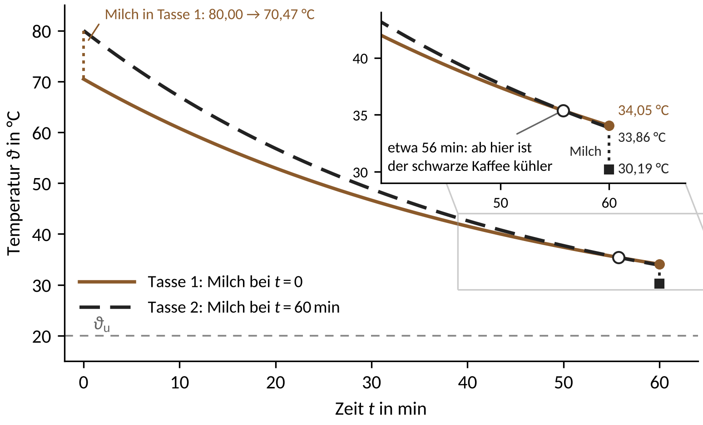

::: center
**[Tutorium 5: Wärmebilanzen (instationär global), Lösung]{.underline}**
:::

**[Ausgangssituation]{.underline}**

Sonntagmorgen in der WG-Küche: Sie haben Filterkaffee gekocht und zwei gleiche Tassen mit je 200 ml gefüllt. Da klingelt das Telefon, und das Gespräch wird eine Stunde dauern. Ihr Mitbewohner gießt seine Milch sofort in den Kaffee (Tasse 1). Sie stellen Ihre Tasse daneben und wollen die Milch erst nach dem Telefonat hineingießen (Tasse 2), damit der Kaffee „länger heiß bleibt“. Die Milch kommt in beiden Fällen direkt aus dem Kühlschrank.

{width=92%}

**Abb. 1:** Die beiden Tassen

**[Frage 1]{.underline}** (Vorab-Frage)

Ihr Mitbewohner meint: „Ob man die Milch sofort oder später hineingießt, ist egal. Die Energie bleibt ja erhalten.“ Welche Tasse ist nach einer Stunde wärmer: Tasse 1, Tasse 2, oder sind beide gleich warm? Notieren Sie Ihre Vermutung mit einem Satz Begründung, bevor Sie Aufgabe 1 rechnen.

**[Aufgabe 1]{.underline}** (neu)

Um die Frage zu klären, messen Sie nach 10 Minuten die Temperatur in Tasse 2 (noch ohne Milch).

**Annahmen:**

- Der Tasseninhalt ist ideal durchmischt, die Milch mischt sich sofort und ohne Wärmeverlust.
- Die Wärmekapazität der Tasse wird außer in Teil g vernachlässigt.
- Die gesamte Wärmeabgabe (auch durch Strahlung und Verdunstung) ist $\dot{Q}_{ab} = kA\,(\vartheta - \vartheta_u)$ mit konstantem $kA$; die verdunstete Masse wird vernachlässigt.
- Kaffee (Stoffdaten von Wasser) und Milch sind inkompressibel ($c_p = c_v$); die Stoffdaten sind konstant.

**Gegebene Größen:**

| **Kaffee** | | **Milch** | |
|:-------------------------------------|:-------------------------------------------|:-------------------------------------|:-------------------------------------------|
| Volumen | $V_K = 200\,\mathrm{ml}$ | Volumen | $V_M = 30\,\mathrm{ml}$ |
| Dichte | $\rho_K = 1000\,\mathrm{kg/m^3}$ | Dichte | $\rho_M = 1030\,\mathrm{kg/m^3}$ |
| Spez. Wärmekapazität | $c_{p,K} = 4{,}18\,\mathrm{kJ/(kg\,K)}$ | Spez. Wärmekapazität | $c_{p,M} = 3{,}94\,\mathrm{kJ/(kg\,K)}$ |
| Anfangstemperatur | $\vartheta_{K,0} = 80\,\mathrm{°C}$ | Temperatur | $\vartheta_M = 5\,\mathrm{°C}$ |
| **Umgebung** | | **Messung in Tasse 2** | |
| Temperatur | $\vartheta_u = 20\,\mathrm{°C}$ | nach 10 min | $\vartheta_K(10\,\mathrm{min}) = 67\,\mathrm{°C}$ |
| **Milch in Teil f** | | **Becher in Teil g** | |
| Temperatur | $\vartheta_{M,h} = 60\,\mathrm{°C}$ | Masse | $m_B = 300\,\mathrm{g}$ |
| | | Spez. Wärmekapazität | $c_B = 0{,}85\,\mathrm{kJ/(kg\,K)}$ |

**Aufgabenstellung:**

a) Bestimmen Sie mit einer Energiebilanz die Mischtemperatur $\vartheta_{1,0}$ direkt nach dem Zugießen der Milch in Tasse 1.\
   $\vartheta_{1,0} = 70{,}47\,\mathrm{°C}$

b) Zeichnen Sie den Bilanzraum um den Inhalt von Tasse 1 in Abb. 1 ein. Vereinfachen Sie die allgemeine Energiebilanz (Foliensatz 05, Folie 8) zur globalen instationären Bilanz für den Inhalt einer Tasse und begründen Sie, welche Terme entfallen. Lösen Sie sie durch Trennung der Variablen für $T(t = 0\,\mathrm{s}) = T_0$.\
   $T(t) = T_u + (T_0 - T_u)\cdot \exp\left(-\frac{kA}{m\,c_p}\,t\right)$

c) Bestimmen Sie $kA$ aus der Messung in Tasse 2. Welche Annahme brauchen Sie, um diesen Wert auch für Tasse 1 zu verwenden, und ist sie plausibel?\
   $kA = 0{,}3402\,\mathrm{W/K}$

d) Berechnen Sie $\vartheta_1$ und $\vartheta_2$ nach 60 Minuten (Tasse 2 direkt nach dem Zugießen). Welches $m\,c_p$ setzen Sie jeweils ein? Welche Tasse ist wärmer?\
   $34{,}05\,\mathrm{°C}$ und $30{,}19\,\mathrm{°C}$ (Zuordnung selbst bestimmen)

e) Berechnen Sie die Wärme, die jede Tasse in 60 Minuten an die Umgebung abgibt. Zeigen Sie, dass $Q_2 - Q_1$ den Temperaturunterschied aus d) erklärt. Wo liegt der Denkfehler Ihres Mitbewohners?\
   $Q_1 = 34{,}88\,\mathrm{kJ}$, $\quad Q_2 = 38{,}57\,\mathrm{kJ}$

f) Am nächsten Tag gibt es Milchkaffee: Die Milch wird je Tasse kurz vorher auf $\vartheta_{M,h}$ erwärmt und untergerührt (gleiche Masse und Stoffdaten). Welche Tasse ist nach 60 Minuten wärmer? Sagen Sie es mit kurzer Begründung voraus, prüfen Sie dann mit den Gleichungen aus d) und erklären Sie das Ergebnis.\
   $35{,}99\,\mathrm{°C}$ und $37{,}18\,\mathrm{°C}$ (Zuordnung selbst bestimmen)

g) *Vertiefung:* Die Tassen sind vorgewärmte Keramikbecher, die immer die Temperatur ihres Inhalts haben, auch beim Zugießen der Milch. Passen Sie Bilanzraum und Bilanz aus b) an, bestimmen Sie $kA$ neu und berechnen Sie $\vartheta_1$ und $\vartheta_2$ wie in d). Gilt die Aussage aus d) weiter?\
   $kA = 0{,}4440\,\mathrm{W/K}$, $\quad\vartheta_1 = 34{,}04\,\mathrm{°C}$, $\quad\vartheta_2 = 30{,}96\,\mathrm{°C}$

::: seitenumbruch
:::

**[Versuch zu Aufgabe 1]{.underline}** (im Tutorium, läuft neben der Rechnung)

Drei gleiche, vorgewärmte Becher mit je 200 ml heißem Wasser oder Kaffee und je 30 ml Milch: Becher 1 bekommt die Milch sofort, Becher 2 und 3 erst nach 40 Minuten (Milch aus der Kühltasche bzw. aus einem Glas mit etwas Abstand zu den Bechern). Nach 10 Minuten werden Becher 2 und 3 gemessen.

1. Bestimmen Sie $kA$ wie in Teil c (ohne Becher) aus dem Mittelwert der beiden Messungen und sagen Sie mit den Gleichungen aus d) die Temperaturen nach 40 Minuten voraus (Becher 3 mit Milch bei Raumtemperatur).
2. Ist der gemessene Unterschied zwischen Becher 1 und 2 größer als die Messunsicherheit? Nennen Sie zwei Gründe für Abweichungen vom Modell.

| Becher | Start $\vartheta(0)$ | $\vartheta(10\,\mathrm{min})$ | Milch $\vartheta_M$ | Vorhersage $\vartheta(40\,\mathrm{min})$ | Messung $\vartheta(40\,\mathrm{min})$ |
|:----------------------------------------------|:---------------------|:-----------------------|:--------------------|:------------------------|:------------------------|
| 1: Milch sofort | | | | | |
| 2: Milch nach 40 min aus der Kühltasche | | | | | |
| 3: Milch nach 40 min aus dem Glas | | | | | |

Raumtemperatur: \_\_\_\_\_\_\_\_\_\_ °C

Mischtemperatur Becher 1: \_\_\_\_\_\_\_\_\_\_ °C

$kA$ aus Becher 2 und 3: \_\_\_\_\_\_\_\_\_\_ W/K

::: seitenumbruch
:::

**[Lösung]{.underline}**

**[Frage 1]{.underline}**

Tasse 1 (Milch sofort) ist nach einer Stunde wärmer: 34,05 °C gegenüber 30,19 °C. Das Argument des Mitbewohners trägt nicht: Erhalten bleibt die Energie von Kaffee, Milch und Umgebung zusammen; wie viel Wärme an die Umgebung geht, hängt vom Temperaturverlauf ab (Aufgabe 1, Teile d und e).

**[Aufgabe 1]{.underline}**

**Geg.:** Größen aus der Tabelle, daraus

$m_K = \rho_K V_K = 0{,}200\,\mathrm{kg}$, $\quad m_M = \rho_M V_M = 0{,}0309\,\mathrm{kg}$,

$m_K c_{p,K} = 836{,}0\,\mathrm{J/K}$, $\quad m_M c_{p,M} = 121{,}7\,\mathrm{J/K}$

**Ges.:** $\vartheta_{1,0}$, $kA$, $\vartheta_1$ und $\vartheta_2$ nach 60 min, $Q_1$ und $Q_2$; dazu $\vartheta_1$ und $\vartheta_2$ mit erwärmter Milch (f) sowie $kA$, $\vartheta_1$ und $\vartheta_2$ mit Becher (g)

**Skizze:** Bilanzraum um den Tasseninhalt (Abb. L1)

**Annahmen:** siehe Aufgabe

**Ansatz:** Energiebilanz für das Mischen (a) und globale instationäre Energiebilanz um das geschlossene System „Tasseninhalt“ (b bis e)

{width=50%}

**Abb. L1:** Bilanzraum um den Tasseninhalt (in Teil g: Inhalt und Becher)

**a)** Energiebilanz um Kaffee und Milch zusammen (geschlossenes System, keine Wärmeabgabe während des Mischens): Die innere Energie bleibt gleich, $U_{nachher} = U_{vorher}$.
$$m_K c_{p,K}\,(T_{1,0} - T_{K,0}) + m_M c_{p,M}\,(T_{1,0} - T_M) = 0$$

Umstellen nach $T_{1,0}$ und Werte einsetzen:
$$T_{1,0} = \frac{m_K c_{p,K}\,T_{K,0} + m_M c_{p,M}\,T_M}{m_K c_{p,K} + m_M c_{p,M}}$$
$$T_{1,0} = \frac{836{,}0\,\mathrm{J/K} \cdot 353{,}15\,\mathrm{K} + 121{,}7\,\mathrm{J/K} \cdot 278{,}15\,\mathrm{K}}{957{,}7\,\mathrm{J/K}} = 343{,}62\,\mathrm{K} = 70{,}47\,\mathrm{°C}$$

**b)** Allgemeine Energiebilanz (Foliensatz 05, Folie 8, mit den Enthalpieströmen wie in Gl. (4-1) der Einleitung zum bisherigen Tutorium 5):
$$\frac{dU}{dt} = \dot{H}_{zu} - \dot{H}_{ab} + \dot{Q}_{zu} - \dot{Q}_{ab} + \dot{Q}_{KV}$$

Für den Tasseninhalt entfallen $\dot{H}_{zu} = \dot{H}_{ab} = 0$ (geschlossenes System; die verdunstete Masse wird vernachlässigt, die mit dem Dampf abgeführte Energie steckt pauschal in $kA$), $\dot{Q}_{zu} = 0$ (der gesamte Austausch mit der Umgebung steckt in $\dot{Q}_{ab}$) und $\dot{Q}_{KV} = 0$ (keine Wärmequelle). Mit $dU = m\,c_v\,dT = m\,c_p\,dT$ (inkompressibel, $V = \mathrm{const.}$) und $\dot{Q}_{ab} = kA\,(T - T_u)$ ergibt sich die globale instationäre Energiebilanz:
$$m\,c_p\,\frac{dT}{dt} = -kA\,(T - T_u)$$

Trennung der Variablen und Integration von $t = 0\,\mathrm{s}$ ($T = T_0$) bis $t$:
$$\int_{T_0}^{T} \frac{dT}{T - T_u} = -\frac{kA}{m\,c_p} \int_0^{t} dt \quad\Rightarrow\quad \ln\frac{T - T_u}{T_0 - T_u} = -\frac{kA}{m\,c_p}\,t$$

Umstellen nach $T$:
$$T(t) = T_u + (T_0 - T_u)\cdot \exp\left(-\frac{kA}{m\,c_p}\,t\right)$$

Für Tasse 1 gilt $m\,c_p = m_K c_{p,K} + m_M c_{p,M}$, für Tasse 2 bis zum Zugießen $m\,c_p = m_K c_{p,K}$. Da nur Temperaturdifferenzen vorkommen, darf man auch mit $\vartheta$ in °C rechnen.

**c)** Lösung aus b) für den Kaffee ohne Milch nach $kA$ umstellen und die Messung in Tasse 2 einsetzen:
$$kA = -\frac{m_K c_{p,K}}{t}\,\ln\frac{T_K(t) - T_u}{T_{K,0} - T_u} =-\frac{836{,}0\,\mathrm{J/K}}{600\,\mathrm{s}}\,\ln\frac{47\,\mathrm{K}}{60\,\mathrm{K}} = 0{,}3402\,\mathrm{W/K}$$

Annahme für Tasse 1: $kA$ ist mit und ohne Milch gleich. Das ist plausibel, weil es dieselbe Tasse mit derselben freien Oberfläche ist, über die Strahlung und Verdunstung laufen (dafür genügt eine qualitative Begründung; die folgenden Zahlen sind für die Besprechung). Mit Milch steht der Inhalt aber höher (bei 8 cm Innendurchmesser 4,6 statt 4,0 cm), die wärmeabgebende Fläche wächst um 7,5 %; $kA$ ist in Tasse 1 also eher um 3 bis 5 % größer. Dann sinkt der Unterschied aus d) auf 3,32 bis 2,98 K; umkehren würde ihn erst ein um 25 % größeres $kA$ (mit Becher 19 %). Die Messung kalibriert das Modell; ob $kA$ auch für den Milchkaffee gilt, zeigt erst eine eigene Messung.

Zur Einordnung: Zeitkonstante $\tau = m\,c_p/kA$ ohne Milch $41{,}0\,\mathrm{min}$, mit Milch $46{,}9\,\mathrm{min}$; nach der Zeit $\tau$ hat der schwarze Kaffee noch 42,1 °C. Das passt zu Messungen an einem offenen, nicht umgerührten Keramikbecher ($\tau \approx 41\,\mathrm{min}$ aus der Steigung in Abb. 6 bei Ferreira 2025). Bezogen auf rund 201 cm² Oberfläche ist $kA/A \approx 17\,\mathrm{W/(m^2\,K)}$: freie Konvektion, Strahlung und Verdunstung zusammen.

**d)** Tasse 1: Anfangsbedingung $T(0\,\mathrm{s}) = T_{1,0}$ und $m\,c_p = m_K c_{p,K} + m_M c_{p,M}$:
$$T_1 = T_u + (T_{1,0} - T_u)\cdot \exp\left(-\frac{kA\,t}{m_K c_{p,K} + m_M c_{p,M}}\right)$$
$$T_1 = 293{,}15\,\mathrm{K} + 50{,}47\,\mathrm{K} \cdot 0{,}2783 = 307{,}20\,\mathrm{K} = 34{,}05\,\mathrm{°C}$$

Tasse 2: erst Abkühlen mit $m\,c_p = m_K c_{p,K}$, dann Mischen wie in a):
$$T_K(60\,\mathrm{min}) = T_u + (T_{K,0} - T_u)\cdot \exp\left(-\frac{kA\,t}{m_K c_{p,K}}\right)$$
$$T_K(60\,\mathrm{min}) = 293{,}15\,\mathrm{K} + 60{,}00\,\mathrm{K} \cdot 0{,}2310 = 307{,}01\,\mathrm{K} = 33{,}86\,\mathrm{°C}$$
$$T_2 = \frac{m_K c_{p,K}\,T_K(60\,\mathrm{min}) + m_M c_{p,M}\,T_M}{m_K c_{p,K} + m_M c_{p,M}}$$
$$T_2 = \frac{836{,}0\,\mathrm{J/K} \cdot 307{,}01\,\mathrm{K} + 121{,}7\,\mathrm{J/K} \cdot 278{,}15\,\mathrm{K}}{957{,}7\,\mathrm{J/K}} = 303{,}34\,\mathrm{K} = 30{,}19\,\mathrm{°C}$$

Tasse 1 ist wärmer, Tasse 2 um $3{,}85\,\mathrm{K}$ kühler.

Zur Einordnung: Liegt die Messung 1 K daneben (66 oder 68 °C), ändert sich $kA$ um rund 9 % und beide Endtemperaturen um rund 1,6 K, der Unterschied aber nur um 0,03 K (3,82 bzw. 3,86 K). Die Aussage „Tasse 1 ist wärmer“ hängt also nicht an der genauen Messung, die Absolutwerte schon.

**e)** Die abgegebene Wärme folgt aus der Energiebilanz über die Abkühlzeit:
$$Q_1 = (m_K c_{p,K} + m_M c_{p,M})\,(T_{1,0} - T_1) = 957{,}7\,\mathrm{J/K} \cdot 36{,}42\,\mathrm{K} = 34{,}88\,\mathrm{kJ}$$
$$Q_2 = m_K c_{p,K}\,(T_{K,0} - T_K(60\,\mathrm{min})) = 836{,}0\,\mathrm{J/K} \cdot 46{,}14\,\mathrm{K} = 38{,}57\,\mathrm{kJ}$$

Kontrolle: Beide Tassen enthalten am Ende dieselbe Menge Kaffee und Milch. Der Temperaturunterschied folgt allein aus der Mehrabgabe: $(Q_2 - Q_1)/(m_K c_{p,K} + m_M c_{p,M}) = 3{,}85\,\mathrm{K}$, wie in d).

Erklärung: Der Wärmestrom $\dot{Q}_{ab} = kA\,(T - T_u)$ ist umso größer, je heißer der Tasseninhalt ist. Der Kaffee in Tasse 2 startet ohne Milch heißer (Wärmestrom am Anfang 20,4 W gegenüber 17,2 W in Tasse 1) und bleibt es bis etwa 56 min (Abb. L2). Er gibt deshalb mehr Wärme ab. Wärme ist eine Prozessgröße: Wie viel abgegeben wird, hängt vom Temperaturverlauf ab, nicht nur von Anfangs- und Endzustand. Der Denkfehler des Mitbewohners: Erhalten bleibt die Energie von Tasseninhalt und Umgebung zusammen, nicht die des Tasseninhalts. Wer seinen Kaffee später möglichst warm trinken will, gibt die Milch sofort hinein.

{width=78%}

**Abb. L2:** Temperaturverlauf beider Tassen (Ausschnitt: Schnittpunkt bei etwa 56 min)

**f)** Rechnung wie in a) und d), nur mit $T_{M,h} = 333{,}15\,\mathrm{K}$ statt $T_M$:
$$T_{1,0} = \frac{m_K c_{p,K}\,T_{K,0} + m_M c_{p,M}\,T_{M,h}}{m_K c_{p,K} + m_M c_{p,M}} = 350{,}61\,\mathrm{K}$$
$$T_1 = T_u + (T_{1,0} - T_u)\cdot 0{,}2783 = 309{,}14\,\mathrm{K} = 35{,}99\,\mathrm{°C}$$
$$T_2 = \frac{m_K c_{p,K}\,T_K(60\,\mathrm{min}) + m_M c_{p,M}\,T_{M,h}}{m_K c_{p,K} + m_M c_{p,M}} = 310{,}33\,\mathrm{K} = 37{,}18\,\mathrm{°C}$$

Jetzt ist Tasse 2 um 1,19 K wärmer. Erklärung: Die Milch wirkt zweimal. Während der 60 Minuten macht sie Tasse 1 träger (mehr Wärmekapazität), das spricht immer für „sofort“. Beim späten Zugießen bringt sie ihre eigene Temperatur mit: Kalte Milch kühlt Tasse 2 dann stärker ab, warme Milch wärmt sie stärker auf. Bei 60 °C überwiegt der zweite Effekt.

Zur Erklärung (die Zerlegung ist nicht verlangt): Zieht man die Ergebnisse aus d) voneinander ab, ergeben sich die beiden Anteile
$$\vartheta_1 - \vartheta_2 = \underbrace{\frac{m_K c_{p,K}\,(\vartheta_{K,0} - \vartheta_u)\,(e_G - e_K)}{m_K c_{p,K} + m_M c_{p,M}}}_{\text{Kaffee-Effekt}} + \underbrace{\frac{m_M c_{p,M}\,(\vartheta_M - \vartheta_u)\,(e_G - 1)}{m_K c_{p,K} + m_M c_{p,M}}}_{\text{Milch-Effekt}}$$

mit $e_G = \exp(-kA\,t/(m_K c_{p,K} + m_M c_{p,M})) = 0{,}2783$ und $e_K = \exp(-kA\,t/(m_K c_{p,K})) = 0{,}2310$. Kaffee-Effekt 2,48 K; Milch-Effekt 1,38 K für kalte Milch (für „sofort“), −3,67 K für erwärmte Milch (für „später“).

**g)** Der Bilanzraum umfasst jetzt Inhalt und Becher (Abb. L1): Kaffee und vorgewärmter Becher bilden eine gemeinsame Speicherkapazität, auch beim Zugießen der Milch. Das ist gerechtfertigt, weil die Widerstände innen (Kaffee zur Wand) und in der dünnen Keramikwand klein sind gegenüber dem Widerstand außen zur Luft. $C_B = m_B c_B = 0{,}300\,\mathrm{kg} \cdot 850\,\mathrm{J/(kg\,K)} = 255{,}0\,\mathrm{J/K}$ (30,5 % von $m_K c_{p,K}$). Messung in Tasse 2 wie in c), jetzt mit $m_K c_{p,K} + C_B$:
$$kA = -\frac{m_K c_{p,K} + C_B}{t}\,\ln\frac{T_K(t) - T_u}{T_{K,0} - T_u} = -\frac{1091{,}0\,\mathrm{J/K}}{600\,\mathrm{s}}\,\ln\frac{47\,\mathrm{K}}{60\,\mathrm{K}} = 0{,}4440\,\mathrm{W/K}$$

$kA$ ist ein an die Messung angepasster Modellparameter: In c) musste es auch die Wärme erklären, die der Becher abgegeben hat; mit Becher im Bilanzraum ist es um 31 % größer. Die Zeitkonstante $\tau = (m_K c_{p,K} + C_B)/kA = 41{,}0\,\mathrm{min}$ bleibt gleich.

Tasse 1: Mischen mit Becher (er hat vorher die Kaffeetemperatur), dann Abkühlen:
$$T_{1,0} = \frac{(m_K c_{p,K} + C_B)\,T_{K,0} + m_M c_{p,M}\,T_M}{m_K c_{p,K} + C_B + m_M c_{p,M}} = 345{,}62\,\mathrm{K}$$
$$T_1 = T_u + (T_{1,0} - T_u)\cdot \exp\left(-\frac{kA\,t}{m_K c_{p,K} + C_B + m_M c_{p,M}}\right)$$
$$T_1 = 293{,}15\,\mathrm{K} + 52{,}47\,\mathrm{K} \cdot 0{,}2676 = 307{,}19\,\mathrm{K} = 34{,}04\,\mathrm{°C}$$

Dass $\vartheta_1$ fast gleich bleibt (34,04 statt 34,05 °C), liegt an zwei Effekten, die sich fast aufheben: Die Mischtemperatur steigt (72,47 statt 70,47 °C), die Zeitkonstante von Tasse 1 sinkt (45,5 statt 46,9 min).

Tasse 2: Der schwarze Kaffee kühlt mit derselben Zeitkonstante ab wie in der Messung, also wie in d) auf $T_K(60\,\mathrm{min}) = 307{,}01\,\mathrm{K}$. Dann Mischen mit Becher:
$$T_2 = \frac{(m_K c_{p,K} + C_B)\,T_K(60\,\mathrm{min}) + m_M c_{p,M}\,T_M}{m_K c_{p,K} + C_B + m_M c_{p,M}} = 304{,}11\,\mathrm{K} = 30{,}96\,\mathrm{°C}$$

Die Aussage aus d) gilt weiter, der Unterschied sinkt aber von 3,85 K auf 3,08 K. Beide Anteile aus der Zerlegung in f) werden kleiner: Die Milch erhöht die Wärmekapazität nur noch um 11 % statt 15 % (Kaffee-Effekt 1,98 statt 2,48 K), und der Becher gibt beim Mischen Wärme an die kalte Milch ab und dämpft den Mischsprung (Milch-Effekt 1,10 statt 1,38 K).

```{=latex}
\needspace{7\baselineskip}
```

**[Quellen der Arbeitswerte]{.underline}**

- Kaffee: gebrüht bei etwa 93 °C, in der Glaskanne einer Haushaltsmaschine bis etwa 11 K kälter, beim Eingießen 2 bis 5 K kälter (Abraham & Diller 2019, J. Food Sci. 84(8), 2011 bis 2014, Tab. 1); 80 °C liegen in diesem Bereich und im Servierbereich 71 bis 85 °C (Brown & Diller 2008, Burns 34(5), 648 bis 654, doi:10.1016/j.burns.2007.09.012). Stoffwerte wie Wasser (SCA, Gehalt an gelösten Stoffen 1,15 bis 1,35 %).
- Milch: Kühlschrank höchstens 7 °C, besser unter 5 °C (Bundesinstitut für Risikobewertung, 2023); im Mittel 31 g Milch je Tasse (FSANZ 2011); Dichte 1027 bis 1033 kg/m³ (Goff, Dairy Science and Technology); $c_p$ wie in Tutorium 8 (Quelle dort).
- Abkühlung: offener, nicht umgerührter Keramikbecher, $\tau \approx 41\,\mathrm{min}$ aus der Steigung 0,0241 1/min in Abb. 6 (Ferreira 2025, Forced convection and the coffee cup, Phys. Educ. 60, 035001, doi:10.1088/1361-6552/adb6ea); Haushaltsbecher kühlen je nach Form und Füllung auch schneller ab ($\tau \approx 20$ bis 40 min), die Aussage hängt davon kaum ab. Verdunstung bei 79 °C 12,0 von 22,7 W (Condoret 2007, Teaching transport phenomena around a cup of coffee, Chem. Eng. Educ. 41, 137, Tab. 2; nicht frei einsehbar); als zweiter Beleg senkt ein Deckel das scheinbare $kA$ um 44 % (Ferreira 2025, Abb. 6).
- Erwärmte Milch 55 bis 65 °C (Thermoplan, Coffee knowledge: milk); Keramikbecher 300 g mit 0,85 kJ/(kg·K) als Arbeitswert (Schätzung).
- Hauptaussage: Rees & Viney (1988), On cooling tea and coffee, Am. J. Phys. 56(5), 434 bis 437, doi:10.1119/1.15572.
- Rechenskript: nachrechnung_kaffee.py mit kaffee_modell.py.

