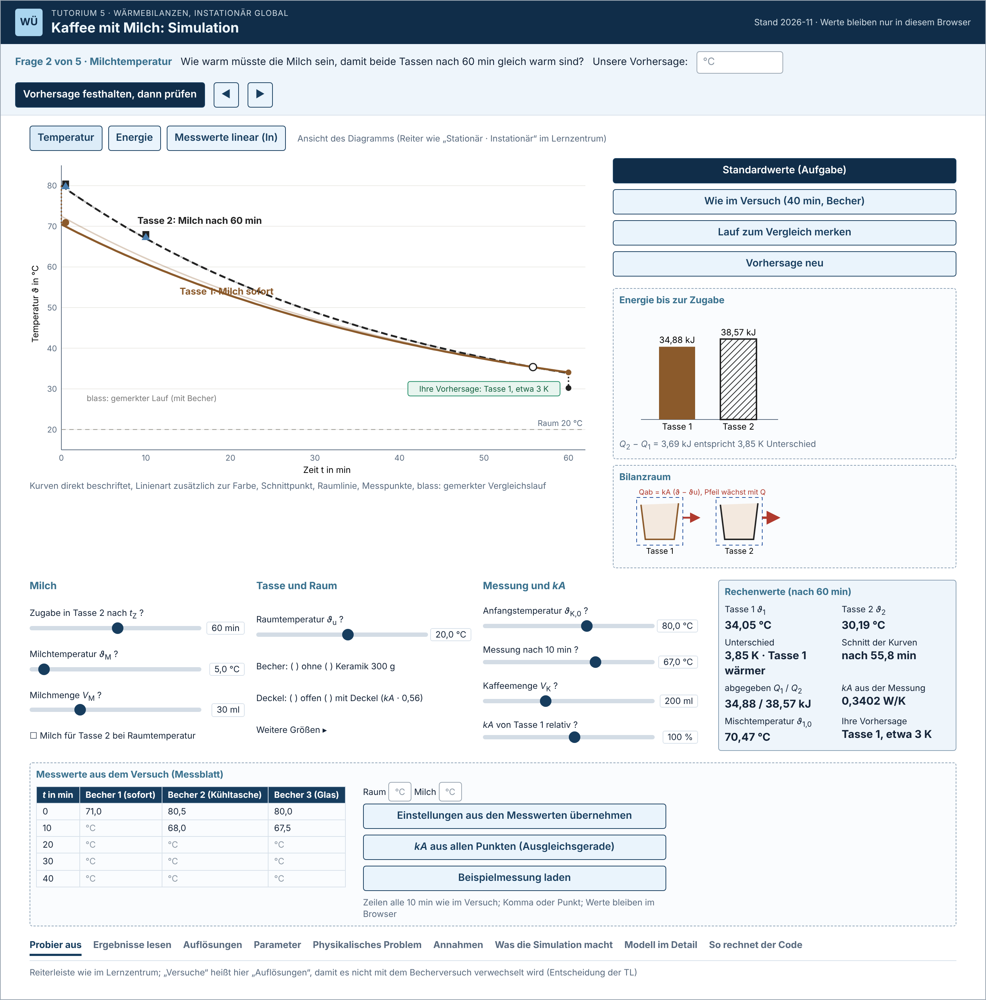
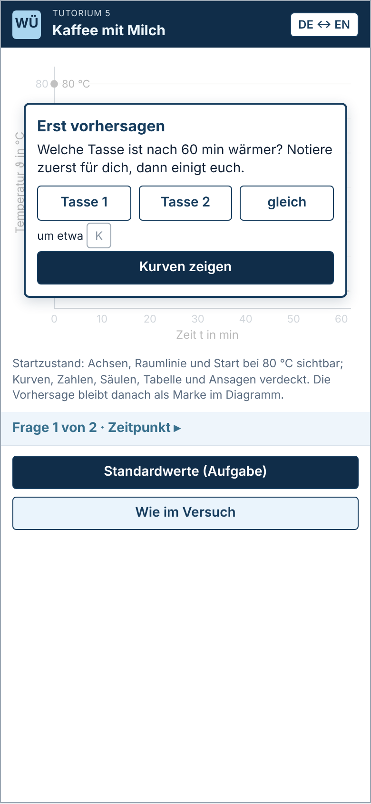
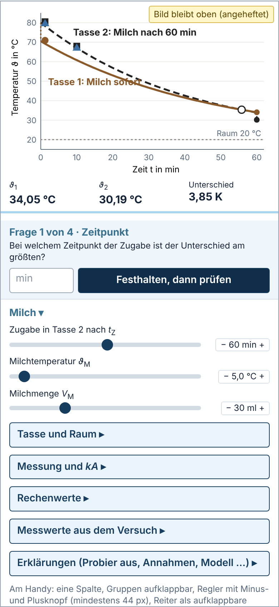
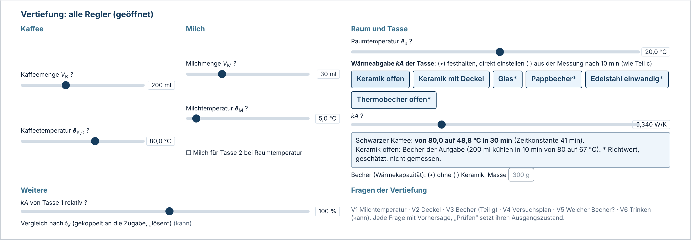

# Konzept: Simulation „Kaffee mit Milch“ als eigene Website

> **Fassung 2 vom 04.11.2026** (Fassung 1: Commit 6ccb792). Phase 1 nach `simulation/AUFTRAG_Simulation_Kaffee.md`, geschrieben von Claude (Cloud-Sitzung). Fassung 2 arbeitet die Prüfung durch Codex (Rolle X4, `simulation/X4_CODEX_KONZEPT.md`, Befunde K1 bis K11) und die Entscheidungen der Tutoriumsleitung (TL) vom 04.11.2026 ein (`simulation/X4_ENTSCHEIDUNGSVORLAGE.md`). **Änderungen gegenüber Fassung 1 sind mit *(F2: Grund)* gekennzeichnet**; Grund ist ein Befund (K1 bis K11), eine Entscheidung (E1 bis E8) oder ein Auftrag der TL (TL). Abschnitt 0 listet alle Änderungen. Belege und Rechnungen: `simulation/recherche/` (R1, R2, R3, Nachrechnungen in `claude_nachrechnung/`, `claude_x4/`, `claude_f2/`). Skizzen: `simulation/skizzen/`. Diese Fassung ist die Bauvorgabe für Codex (Rolle S-Bau).

## 0 Änderungen gegenüber Fassung 1

| Nr. | Änderung | Abschnitte | Grund |
|:--|:--|:--|:--|
| F2-1 | Ein schlanker **Pflichtweg** von etwa 10 min (Start mit Energie-Erklärung, Frage 1 Zeitpunkt, Frage 2 Versuch); alles Weitere ist **Vertiefung**. Stufen muss, sollte, kann neu zugeordnet. | 2, 3, 4, 5, 6 | K7, TL |
| F2-2 | Ansprache „du“ in allen Texten der Website, in beiden Sprachen; das Aufgabenblatt bleibt beim „Sie“. **Geänderte Texte der TL:** Fragenanfang „Sagen Sie erst zu zweit voraus und notieren Sie …“ (D124) wird „Notiere zuerst für dich …, dann einigt euch zu zweit.“; die Ausgangssituation (A.5) ist in du-Form nacherzählt statt wörtlich zitiert. | 6, Anhang A | E5, E7 |
| F2-3 | Deutsch und Englisch mit Umschalter wie im Lernzentrum; Glossar in Anhang C. | 4, 9, Anhang C | E3 |
| F2-4 | Seite bis zum Sitzungstag nur für die TL sichtbar, Codex schaltet sie am Tag öffentlich; die Startkarte bleibt. | 3, 9.6, 12 | E2, K10 |
| F2-5 | Versuch bis 60 min, die Messung endet mit der Milchzugabe in Becher 2; Messblatt mit festen Zeilen bis „60 min nach der Milch“. | 3, 4, 5, 6 | E8, K5 |
| F2-6 | Energie: Säulen im Pflichtweg mit vollständiger Bilanz (Milchbeitrag bei verschiedenen Milchtemperaturen); Ansicht „Wärmestrom“ nur Vertiefung, mit getrennten Teilflächen vor und nach dem Schnitt. | 2, 4, 8.2 | K1, K2 |
| F2-7 | Aussagen zum Schnittpunkt und zum Abklingen nur bei gleichem *kA*; Vergleichszeitpunkt an die Zugabe gekoppelt. | 4, 8, Anhang A | K3 |
| F2-8 | Ausgleichsgerade nur Vertiefung, *kA* ohne „±“; gemessener Wert bleibt sichtbar. | 4, 8.2 | K4 |
| F2-9 | Frage „Versuch“ offen formuliert, kein vorgegebenes Ergebnis, kein automatischer Ursachenhinweis. | 6, 8.2 | K6 |
| F2-10 | Vorhersagesperre für alle Ausgaben; Antworten nur in den gesperrten Auflösungen; Zustände je Frage. | 4, 6, Anhang A | K10 |
| F2-11 | Handy: Anheften aus bei Bildschirmtastatur, mehr Prüfbreiten und Zoomstufen, VoiceOver und TalkBack; Projektvorgaben als solche gekennzeichnet. | 4, 10 | K8 |
| F2-12 | Literatur korrigiert (Adams, Paulson und Wieman 2008; D'Angelo; Reglerzahl; Arbeitswerte aus der Lösung gekennzeichnet). | 4.4, Anhang B | K9 |
| F2-13 | Annahmen vorsichtiger formuliert; Rechnen ohne Speicher im Browser. | 9.3, Anhang A.6 | K11 |
| F2-14 | **Neu in der Vertiefung:** Regler für Kaffee- und Milchmenge, Kaffee- und Milchtemperatur, Raumtemperatur und *kA* der Tasse direkt, mit Voreinstellungen (Keramik offen, Keramik mit Deckel, Glas, Pappbecher, Edelstahl, Thermobecher offen), kurzer Erklärung und Anzeige „von … auf … °C in 30 min“. Der Deckel ist jetzt eine Voreinstellung statt eines eigenen Schalters. | 4, 5, 8.2 (M8) | TL |
| F2-15 | **Fachlicher Befund:** Wird *kA* aus derselben Messung „67 °C nach 10 min“ bestimmt, ändern Kaffeemenge, Kaffee- und Raumtemperatur auch *kA* (heißerer Kaffee wäre nach 60 min kälter). Deshalb ist „*kA* festhalten“ der Standard; „aus der Messung“ nur nach Übernahme von Messwerten und in Frage V3. | 8.2 (M8), 8.5 | Claude, Testfälle T9 |
| F2-16 | Kann-Ideen der TL geprüft, je mit Empfehlung (Trinkzeit bis 60 °C, zwei freie Tassen, Becher kalt, Milchart, Wärmestrom-Pfeile, CSV). | 4.3, 8.4 | TL |
| F2-17 | Entfällt oder herabgestuft: Fragen „Milchtemperatur“ und „Deckel“ als Pflicht (jetzt V1, V2); stufenweise Freischaltung von Reglern nach Fragen (Pflichtweg hat nur einen Regler); Bilanzraum-Skizze und Ausgleichsgerade von muss auf sollte; Kurven nach der Zugabe auf kann (Messung endet mit der Zugabe); Bechermaterial M5 (nur noch *kA*-Voreinstellungen und Bechermasse); Druckansicht auf kann. | 4, 8.2 | K7, E8, TL |

## Kurzfassung

- **Ziel:** eigene Website mit festem Link, Aussehen und Ablauf wie die Simulationsseiten des Lernzentrums, Deutsch und Englisch, offline als eine Datei lauffähig. Modell unverändert aus `kaffee_modell.py`; Erweiterungen nur mit Herleitung und Testfall. *(F2: E3)*
- **Pflichtweg (etwa 10 min):** Startkarte mit Vorhersage und Erklärung über die abgegebene Wärme, Frage 1 Zeitpunkt (ein Regler), Frage 2 Versuch (Kurswerte über den Link der TL). **Vertiefung:** sechs weitere Fragen und alle Regler, darunter *kA* mit Voreinstellungen. *(F2: K7, TL)*
- **Didaktischer Kern:** erst vorhersagen, dann prüfen; Messwerte und Modell in einem Diagramm; Energie als Säulen. Belege meist mittel, Barrierefreiheit stark (WCAG 2.2).
- **Fachlich bestätigt:** Bei gleichem *kA* liegt der größte Unterschied am Schnittpunkt der Kurven und ist bei jedem *kA* 3,86 K; ein Deckel verschiebt ihn nur (56 auf 100 min), ein schwerer Becher verkleinert ihn (3,09 K).
- **Zugang:** bis zum Sitzungstag nur für die TL, am Tag öffentlich; Startkarte verrät nichts vor der eigenen Vorhersage. *(F2: E2)*
- **Nächster Schritt:** Bau durch Codex (Rolle S-Bau), dann Abnahme durch Claude.

## 1 Ausgangslage

**Heutiges Werkzeug.** `Kaffee_Simulation.html` (Zweig `claude/kaffee-pruefung-sgvo1r`, `ergebnisse/kaffee/fertig/`, 30 KB, eine Datei, offline): Diagramm beider Tassen mit Schnittpunkt und Raumlinie, Kennzahlen, sechs Regler und zwei Schalter, fünf weitere Größen aufklappbar, Messwerte aus dem Versuch als Punkte (einzeln eingetragen, im Browser gespeichert), Übernahme in die Einstellungen, vier Fragen mit Vorhersage zu zweit (D114, D116, D124). Das Modell steht zwischen `MODELL-ANFANG` und `MODELL-ENDE` und entspricht `rechne()` und `zwei_tassen()` aus `kaffee_modell.py`; Codex hat es in X3 an 9338 Kurvenwerten bestätigt, die sechs Befunde sind behoben (D116).

**Was bleibt.** Das Modell, die Gültigkeitsprüfungen (ungültige Einstellung blendet Ergebnisse aus), die geprüfte Übernahme der Messwerte (ungerundet oder gar nicht), die Zahleneingabe mit Komma und Punkt, die Fragen mit Vorhersage und die Testskripte (`test_simulation.py`, `browsertest.js`) als Grundlage der neuen Tests.

**Was fehlt oder stört** (eigene Sichtung und X3): (1) lange Spalte, am Handy sieht man die Wirkung eines Reglers nicht (X3: „Die mobile Bedienung benötigt zusätzliche Scrollwege“); (2) Frage 4 ohne eigene Messwerte nicht lösbar, Eintippen kostet zu viel Zeit; (3) die Energie (Kern des Denkfehlers „Die Energie bleibt ja erhalten“) erscheint nur als zwei Zahlen; (4) die Seite verrät die Antwort auf die Vorab-Frage sofort; (5) Vorhersagen nur auf Papier; (6) Aussehen und Ablauf weichen vom Lernzentrum ab.

**Vorbild Lernzentrum** (öffentliche Werkstatt-Seite <https://waermeuebertragung-werkstatt.qarri196.chatgpt.site>, am 04.11.2026 bei 1366 und 390 px angesehen): Schrift Fira Sans; Farben Marine `#102d49` und `#173d5e`, Überschriften `#39718e`, Text `#142337`, Nebentext `#5a6b7f`, Linien `#d8e1ea`, Flächen `#eef5fb`; Ecken 4 px. Über der Simulation Umschaltknöpfe, darunter Bild links (bis 780 px) und Knöpfe rechts, Regler mit Zahlenfeld und Fragezeichen-Hilfe in drei Spalten, Kasten „Rechenwerte“ rechts daneben, dann die Reiterleiste mit neun Reitern (deutsch: Probier aus · Ergebnisse lesen · Versuche · Parameter · Physikalisches Problem · Annahmen · Was die Simulationen machen · Modell im Detail · So rechnet der Code; englisch: Try it · Read the results · Experiments · Parameters · Physical problem · Assumptions · What the simulations do · Model in detail · How the code calculates). Die Auflösung erscheint erst nach dem Aufklappen. Umschalter „DE ↔ EN“ im Kopf. Am Handy ist das Diagramm ein verkleinertes Rasterbild mit sehr kleiner Schrift. Das Lernzentrum duzt. *(F2: E3, E5: englische Reiternamen am 04.11.2026 nachgesehen)*

## 2 Lernziele der Simulation

Passend zu Tutorium 5 (instationäre globale Bilanz) und zu Lernziel 2 der Variante B (D120). Ein Verb je Ziel. Nach der Simulation kannst du … *(F2: E5)*

1. erklären, warum Tasse 1 trotz Energieerhaltung wärmer ist, mit der Wärme, die beide Tassen bis zur Zugabe abgeben. Bei gleicher Milchtemperatur gilt $Q_2 - Q_1 = (m_\mathrm{K} c_{p,\mathrm{K}} + m_\mathrm{M} c_{p,\mathrm{M}})(\vartheta_1 - \vartheta_2)$ (Teil e); allgemein kommt der Milchbeitrag $m_\mathrm{M} c_{p,\mathrm{M}}(\vartheta_\mathrm{M1} - \vartheta_\mathrm{M2})$ dazu (Abschnitt 8.2, M3). *(F2: K2)* **Pflichtweg: Start.**
2. die Wirkung des Zeitpunkts der Zugabe auf den Unterschied der Tassen mit dem Wärmestrom $\dot{Q}_\mathrm{ab} = kA\,(\vartheta - \vartheta_\mathrm{u})$ begründen. **Pflichtweg: Frage 1;** Milchtemperatur, Deckel, Becher und andere Tassen in der Vertiefung. *(F2: K7)*
3. Abweichungen zwischen deinen Messwerten und dem Modell beschreiben und mit den Annahmen des Modells begründen (wie Lernziel 2 der Variante B). **Pflichtweg: Frage 2.** *(F2: K6)*

Vertiefung: *kA* aus einer ganzen Messreihe bestimmen (Ausgleichsgerade von $\ln\frac{\vartheta - \vartheta_\mathrm{u}}{\vartheta_0 - \vartheta_\mathrm{u}}$ über $t$).

## 3 Ablauf in der Sitzung

*(F2: K7, E2, E8: neu gefasst)* Minute 75 bis 90 nach dem Zeitplan der Hinweise (D110), zu zweit, ein Gerät je Paar. Der Versuch läuft bis 60 min und endet mit der Milchzugabe in Becher 2 (bei *t* = 0 in Minute 5 also in Minute 65). Die TL trägt die Messreihe des Kurses zwischen Minute 65 und 75 einmal ins Messblatt ein und erzeugt den Link mit den Kurswerten.

| Minute | Studierende (zu zweit) | Tutoriumsleitung |
|:--|:--|:--|
| 75 | Seite über den QR-Code öffnen | QR-Code der Seite und Link mit den Kurswerten zeigen |
| 75 bis 77 | **Start:** jede und jeder notiert eine Vorhersage, das Paar einigt sich und hält sie fest; Kurven und Energiesäulen erscheinen; Auftrag „Erklärt den Unterschied mit *Q*₁ und *Q*₂.“ | ein Paar erklären lassen |
| 77 bis 81 | **Frage 1 Zeitpunkt:** Vorhersage, dann mit dem einzigen Regler prüfen | Vorhersagen abfragen (Handzeichen), ein Paar mit abweichender Vorhersage begründen lassen (wie D124) |
| 81 bis 85 | **Frage 2 Versuch:** Kurswerte laden, Lage der Punkte beschreiben, eine Ursache und eine prüfende Messung nennen | zwei Paare erklären lassen |
| 85 bis 90 | Zusammenfassung | Kernsatz: „Wer heißer ist, gibt mehr Wärme ab; deshalb Milch sofort.“ |
| für Schnelle | Vertiefung V1 bis V6 | |

**Zeitbedarf:** etwa 10 min für den Pflichtweg; das ist eine Schätzung. Vor dem Einsatz mit zwei Studierenden am Handy stoppen, vom Öffnen der Seite bis zur gemeinsamen Erklärung (Prüfplan, Abschnitt 10). *(F2: K7)* Fehlen Messwerte (Versuch ausgefallen), entfällt Frage 2 sichtbar; im Pflichtweg gibt es keine erfundenen oder berechneten Ersatzdaten.

**Zugang:** Bis zum Sitzungstag ist die Seite nur für die TL sichtbar; Codex schaltet sie am Sitzungstag öffentlich. Die Startkarte bleibt, damit auch später (Nachbereitung, nächste Semester) das Ergebnis erst nach einer eigenen Vorhersage erscheint. *(F2: E2)*

**Außerhalb der Sitzung** (Nachbereitung, Selbstlernen): Pflichtweg und Vertiefung funktionieren allein; die Auflösungen erscheinen erst nach einer festgehaltenen Vorhersage.

## 4 Anforderungen mit Beleg

Stufen: **muss** = Pflichtweg und Grundlagen (ohne das wird nicht eingesetzt), **sollte** = Vertiefung, **kann** = wenn Zeit bleibt. *(F2: K7)* Belege: R1 = `recherche/R1_Lernen_mit_Simulationen.md` (Folgerungen A1 bis A10), R2 = `recherche/R2_Gestaltung_Bedienbarkeit.md` (F1 bis F15, Quellen Q1 bis Q37), R3 = `recherche/R3_Fach_und_Modell.md`, X3 und X4 = Prüfberichte von Codex. Stärke: stark (Norm oder Volltext mit klarer Aussage), mittel (Volltext, Übertrag nötig), schwach (Festlegung, Abstract, Erfahrung). Keine didaktische Anforderung ist stark belegt; die Studien betreffen meist Demonstrationen, Schulklassen oder andere Fächer (Abschnitt 4.4). „Projektvorgabe“ heißt: strenger als die Norm, bewusst so festgelegt. *(F2: K8)*

### 4.1 Muss

| Nr. | Anforderung (prüfbar) | Beleg (Stärke) | Prüfung |
|:--|:--|:--|:--|
| M-1 | **Modelltreue.** Grundmodell unverändert aus `kaffee_modell.py` (Block `MODELL` wie im geprüften Werkzeug); jede angezeigte Zahl aus diesem Modell oder einer Erweiterung aus Abschnitt 8.2 mit Testfall. | Auftrag, D114, X3 (stark) | Tests gegen `kaffee_modell.py` und gegen Abschnitt 8 |
| M-2 | **Startzustand ohne Ergebnis.** Vor der ersten Vorhersage zeigt die Seite keine Kurven, keine Rechenwerte, keine Säulen, keine Wertetabelle, keine Statusansage und keinen Text mit Ergebnissen; die Vorhersage (Tasse 1, Tasse 2, gleich; Unterschied in K) wird festgehalten, dann sofort aufgedeckt und bleibt als beschriftete Marke im Diagramm. *(F2: K10)* | R1 A1: Crouch et al. 2004 (Vorhersagen 77 % richtige Ergebnisse gegen 61 % ohne Demonstration und 70 % beim bloßen Beobachten, h = 0,35, kostet 2 min; an der Quelle nachgesehen), Brod 2021, Adams, Paulson und Wieman 2008 (mittel; keine Studie prüft genau das Verbergen in einer Simulation) *(F2: K9)* | Browsertest: kein Ergebnis im DOM, in Tabellen, `aria-live` und Texten vor der Vorhersage |
| M-3 | **Vorhersage vor jedem Prüfen, Zustände je Frage.** Jede Frage hat die Zustände ungesehen, vorhergesagt, geprüft; zu jedem gehören festgelegte Ausgangsparameter. „Festhalten, dann prüfen“ setzt den Ausgangszustand und sagt das an. Danach der Auftrag „Stimmt eure Vorhersage? Erklärt zu zweit, warum.“ Antworten stehen nur in den gesperrten Auflösungen. *(F2: K10)* | R1 A1, A2: Alfieri et al. 2011 (eingeforderte Erklärungen d = 0,36), Crouch et al. 2004 (nur 30 % richtige Erklärungen trotz Vorhersage), Chi und Wylie 2014; X3 Befund 4; D124 (mittel) | Browsertest je Frage und Zustand |
| M-4 | **Fachliche Fragen statt Klickanleitung;** Regler nur über physikalisch sinnvolle Bereiche. | R1 A5: Adams, Paulson und Wieman 2008, Podolefsky, Perkins und Adams 2010 (implizites Gerüst), Alfieri et al. 2011 (reines Entdecken d = −0,38) (mittel) | Durchsicht |
| M-5 | **Sofortige Rückmeldung.** Kurven und Rechenwerte folgen dem Regler ohne Knopf „Berechnen“ innerhalb 100 ms. | R1 A6: Adams et al. 2008a/b; R2 F13: Nielsen 1993/2014 (mittel) | Zeitmessung im Browsertest |
| M-6 | **Frage, Vorhersage und Diagramm zugleich sichtbar.** Laptop: Frageleiste über dem Diagramm. Handy: Diagramm mit drei Kernzahlen angeheftet (höchstens 45 % der sichtbaren Höhe, nur hochkant, abschaltbar, **aus, sobald die Bildschirmtastatur offen ist oder die sichtbare Höhe zu klein wird**), Frage direkt darunter. Fokus nie vollständig verdeckt (WCAG 2.4.11); Projektvorgabe: der ganze fokussierte Regler bleibt sichtbar. *(F2: K8)* | R2 F9, F15: WCAG 2.4.11 (stark), Mayer 2024 räumliche Nähe (Übertrag, mittel); X3 | Browsertest 390 px mit geöffnetem Zahlenfeld |
| M-7 | **Messblatt nach dem Versuchsprotokoll.** Feste Zeilen 0, 10, 20, 30, 40, 50, „60 vor der Milch“, „60 nach der Milch“; Spalten Becher 1 (Milch sofort) und Becher 2 (Milch nach 60 min), Becher 3 (Milch bei Raumtemperatur) zuschaltbar, falls die TL ihn misst; Raum- und Milchtemperatur; Häkchen „mit Deckel gemessen“ (dann kein zusätzlicher Deckelfaktor). Übernahme wie D116 (ungerundet oder gar nicht) mit dem Mittel der Becher ohne Milch bei 0 und 10 min als erklärte Vereinfachung (gleiche Startwerte, gleiches *kA*). In den Schwarzkaffee-Fit gehen nur Zeilen vor der Milch. Wird Becher 3 gezeigt, hat das Diagramm bei der Zugabe zwei Mischsprünge (Becher 2 mit kalter Milch, Becher 3 mit Milch bei Raumtemperatur). *(F2: E8, K5, K2)* | R1 A3: Holmes, Wieman und Bonn 2015 (mittel); X4; Versuchsplan der TL | Browsertest mit Komma, Punkt, Lücken, Unsinn, verschiedenen Startwerten, beiden 60-min-Zeilen |
| M-8 | **Pflichtweg mit einem Regler.** Sichtbar ist nur „Zugabe in Tasse 2 nach $t_\mathrm{Z}$“; alle weiteren Regler und Fragen öffnen sich über „Vertiefung“. *(F2: K7; ersetzt die Freischaltung nach Fragen)* | R1 A4: Adams et al. 2008b beobachtet eine Hemmschwelle bei mehr als drei Gruppen mit je etwa drei Elementen (Interviews, mittel) *(F2: K9)*; R2 F14: Sweller, van Merriënboer und Paas 2019 (mittel) | Browsertest: im Pflichtweg genau ein Regler |
| M-9 | **Kurze Beschriftungen, keine nackten Abkürzungen** („Milchtemperatur $\vartheta_\mathrm{M}$“, „Wärmeabgabe *kA*“); Erklärungen in den Reitern und der Fragezeichen-Hilfe. | R1 A7: Adams et al. 2008b (mittel) | Durchsicht |
| M-10 | **Farbe nie allein, Kontrast.** Text mindestens 4,5:1, Kurven, Punkte, Raumlinie, Regler, Fokus mindestens 3:1; Tasse 1 durchgezogen, Tasse 2 gestrichelt, Becher 3 strichpunktiert, Raum gepunktet; Punkte Kreis, Quadrat, Dreieck. Palette nach R2 C3 (Becher 3 `#3d70a3`, Raumlinie `#8a8984`, kein Rot im Diagramm, Marken über Form und Text). | R2 F1 bis F3: WCAG 2.2 1.4.1, 1.4.3, 1.4.11 (stark); Okabe und Ito 2008; `r2_kontrast.py` | `r2_kontrast.py` für jede Farbe; Graustufenbild |
| M-11 | **Direkte Beschriftung** der Kurven am Kurvenzug, kollisionsfrei auch bei fast gleichen Kurven; Schnittpunkt markiert und beschriftet; eine kleine Legende nur für die Formen der Messpunkte. *(F2: K8, K9)* | R2 F4: Okabe und Ito 2008 (mittel); Huestegge und Philipp 2011 nur für räumlich passende Beschriftung (X4: nur Abstract erreichbar) | Bildschirmfotos |
| M-12 | **Regler bedienbar ohne Ziehen.** Natives `input type="range"` mit sichtbarem Label, Wert mit Einheit, `aria-valuetext`; Plus und Minus; Zahlenfeld `type="text"` mit `inputmode="decimal"`, Komma und Punkt in beiden Sprachen; Pfeiltasten, Bild auf/ab, Pos1/Ende. | R2 F6: WCAG 2.1.1, 2.5.7, 4.1.2, APG Slider, GOV.UK (stark) | Tastaturtest, axe |
| M-13 | **Ziele und Schrift.** Trefferflächen mindestens 24 × 24 px (WCAG 2.5.8), Projektvorgabe 44 × 44 px; Eingabefelder mindestens 16 px Schrift; Zoom nicht gesperrt. *(F2: K8)* | R2 F5, F7: WCAG 2.5.8 (stark für 24 px); Apple HIG, Android (mittel, keine CSS-px-Norm) | Browsertest misst Größen |
| M-14 | **Umbruch.** Bei 320 bis 767 px eine Spalte, kein waagerechtes Scrollen; dazwischen (768 bis 1023 px) zwei Spalten ohne Überlappung; Diagramm in tatsächlicher Breite gezeichnet. *(F2: K8)* | R2 F8: WCAG 1.4.10 (stark); Beobachtung am Lernzentrum | `scrollWidth` bei 320, 390, 768, 1024, 1366 px, 200 % Text, 400 % Zoom |
| M-15 | **Bildschirmleser.** Diagramm als `figure` mit Namen, wechselnder Kurzbeschreibung und aufklappbarer Wertetabelle; Kernzahlen nach dem Loslassen über `role="status"`; sichtbarer Fokus 2 px; Sprache der Seite (`lang`) folgt dem Umschalter. *(F2: E3)* | R2 F10 bis F12: WCAG 1.1.1, 3.1.1, 4.1.3, 2.4.7, W3C Complex Images, Watson 2017 (stark) | axe, Tastaturtest, VoiceOver und TalkBack am Gerät *(F2: K8)* |
| M-16 | **Gültigkeit.** Ungültige Einstellungen blenden Diagramm und Zahlen sichtbar aus (D116). | X3 Befund 2 (stark, Erfahrung) | bestehende Tests übernehmen |
| M-17 | **Offline und ohne fremde Server.** Eine Datei, die ohne Netz läuft; keine Anfragen an andere Adressen, keine Zählpixel, keine Links nach außen in der Simulationsansicht. Ist der Speicher im Browser gesperrt oder fehlt er (`file:`, private Fenster), rechnet die Seite weiter, hält Werte nur im Arbeitsspeicher und sagt das. *(F2: K11)* | Auftrag; R2 F15; Sana, Weston und Cepeda 2013 (mittel); MDN zu `localStorage` (X4) | Netzwerkprotokoll (0 fremde Anfragen), Test mit gesperrtem Speicher und mit der Offline-Datei |
| M-18 | **Aufbau wie das Lernzentrum**, mit Umschalter „DE ↔ EN“ im Kopf; Reiterleiste mit neun Reitern (APG Tabs); am Handy Akkordeon. *(F2: E3)* | Auftrag; R2 F15: APG Tabs, Sunwall 2024 (mittel) | Bildschirmfotos neben dem Lernzentrum |
| M-19 | **Sprachen.** Deutsch und Englisch vollständig; Ansprache „du“ bzw. „you“; keine Gedankenstriche; Formelzeichen und Indizes in beiden Sprachen wie in Vorlesung und Aufgabe (Ä24, Glossar Anhang C); Zahlen im Deutschen mit Dezimalkomma, im Englischen mit Dezimalpunkt; Wahl der Sprache bleibt beim Neuladen erhalten und lässt sich über `?lang=en` vorgeben. *(F2: E3, E5)* | Auftrag, Ä24, D113, Entscheidungen der TL | Test: jeder Textschlüssel in beiden Sprachen; Zeichen U+2013 und U+2014 verboten |
| M-20 | **Energie bis zur Zugabe als Säulen** $Q_1$, $Q_2$ auf gemeinsamer Nulllinie mit Werten; darunter der Satz „$Q_2 - Q_1$ = … kJ entspricht … K Unterschied“; bei verschiedenen Milchtemperaturen mit Milchbeitrag (Abschnitt 8.2, M3). *(F2: K2; Bilanzraum-Skizze jetzt S-5)* | Lernziel 1; Teil e; R2 Q13/Q14: Cleveland und McGill 1984 über Heer und Bostock 2010 (mittel) | Zahlen gegen 8.2, Pflichttest Milch für Tasse 2 bei 20 °C |
| M-21 | **Kurswerte als Link.** Das Messblatt lässt sich als Link teilen (Werte im Teil hinter `#`, nie an einen Server): mit Formatversion, Raum- und Milchtemperatur, Bechern, Deckel ja oder nein. Beim Öffnen fragt die Seite vor dem Ersetzen; ungültige Links ändern nichts. *(F2: E8, K5; vorher S-4)* | X3 (Frage 4 ohne Daten nicht lösbar); Zeitbudget (schwach) | Browsertest: Link hin und zurück, gleiche Werte und Bedingungen |
| M-22 | **Erklärtexte an die Bedingungen gebunden.** Aussagen „größter Unterschied am Schnittpunkt“ und „Unterschied klingt mit einer Zeitkonstante ab“ nur bei gleichem *kA* beider Tassen; sonst die Bedingung gleicher Wärmeströme und die Differenz zweier Exponentialfunktionen. Die Rechenwerte nennen das verglichene Paar (z. B. Becher 2 oder Becher 3). *(F2: K3, K2)* | X4 (nachgerechnet, `claude_x4/`) | Tests mit *kA* von Tasse 1 = 105 % |

### 4.2 Sollte (Vertiefung)

| Nr. | Anforderung | Beleg (Stärke) | Prüfung |
|:--|:--|:--|:--|
| S-1 | **Fragen der Vertiefung** V1 bis V5 (Abschnitt 6.2), je mit Vorhersage, Ausgangszustand und gesperrter Auflösung. *(F2: K7)* | wie M-2, M-3 | Browsertest je Frage |
| S-2 | **Alle Regler:** Kaffeemenge, Kaffeetemperatur, Milchmenge, Milchtemperatur, Milch für Tasse 2 bei Raumtemperatur, Raumtemperatur, *kA* der Tasse direkt mit Voreinstellungen und Anzeige „Schwarzer Kaffee: von … auf … °C in 30 min (Zeitkonstante … min)“, Becher (Wärmekapazität) mit Masse, *kA* von Tasse 1 relativ. *kA*-Quelle „festhalten“ als Standard (Erweiterung M8). *(F2: TL, F2-15)* | Auftrag der TL; R3; eigene Testfälle T1 bis T9 | Testfälle 8.2 und 8.5 |
| S-3 | **Ausgleichsgerade und Ansicht „Messwerte linear (ln)“** (Erweiterung M2), *kA* ohne „±“, mit Zeitbereich und Zahl der Punkte. *(F2: K4)* | R3; R1 A3: Holmes et al. 2015 (mittel); Hinweis „Probelauf“ der Lösung | Testfälle T09, T10 |
| S-4 | **Ansicht „Wärmestrom“** mit getrennten Teilflächen vor und nach dem Schnitt (Erweiterung M3). *(F2: K1)* | R3 Abschnitt 6; X4 | Testfälle 8.2 |
| S-5 | **Bilanzraum-Skizze** beider Tassen mit gestrichelter Bilanzgrenze und Pfeil $\dot{Q}_\mathrm{ab}$, Breite nach dem Wärmestrom unmittelbar vor der Zugabe. *(F2: K1, K7; vorher M-20)* | Teil b; R3 (schwach bis mittel) | Bildschirmfoto |
| S-6 | **Vergleichslauf** („Lauf zum Vergleich merken“, blass). | Lernzentrum (schwach, Vorbild) | Browsertest |
| S-7 | **Lesehilfe zum Diagramm** (höchstens drei Sätze, wegklickbar). | R2 F14: Mayer 2024 Vortraining (Übertrag, mittel) | Durchsicht |
| S-8 | **Schrift und Farben wie im Lernzentrum** (Fira Sans eingebettet, SIL Open Font License). | Auftrag | Bildschirmfotos |
| S-9 | **Beispielmessung der TL** (Vorabmessung zu Hause) als echte, gekennzeichnete Messung, sobald die Tabelle vorliegt; bis dahin ausgeblendet. *(F2: E8)* | X3; Auftrag | Browsertest |
| S-10 | **Englische Texte** aus den deutschen Vorlagen nach dem Glossar (Anhang C), von Claude abgenommen. *(F2: E3)* | Entscheidung der TL | Durchsicht in der Abnahme |

### 4.3 Kann

| Nr. | Anforderung | Empfehlung (Abschnitt 8.4) |
|:--|:--|:--|
| K-1 | Zeitzeiger: Tippen ins Diagramm zeigt beide Temperaturen und Wärmeströme zu diesem Zeitpunkt; Wärmestrom-Pfeile am Bilanzraum folgen dem Zeiger. *(F2: TL)* | kann, schlank umsetzen |
| K-2 | QR-Code für den Link der Kurswerte, offline erzeugt. | kann |
| K-3 | Trinkzeit: Linie bei einer Trinktemperatur (Vorgabe 60 °C) und Zeit, bis jede Tasse sie erreicht (M10). *(F2: TL)* | kann |
| K-4 | Becher beim Eingießen kalt statt vorgewärmt (M9). *(F2: TL)* | kann |
| K-5 | Herunterladen als CSV (Messblatt und Modellkurven, M11). *(F2: TL)* | kann |
| K-6 | Kurven nach der Zugabe und eigener Vergleichszeitpunkt (M4), Frage V6 „Trinken“. *(F2: E8: Messung endet mit der Zugabe, deshalb nicht mehr sollte)* | kann |
| K-7 | Vergleichskurve mit überlinearer Wärmeabgabe ($n = 5/4$) im Reiter „Modell im Detail“ (M6). | kann |
| K-8 | Druckansicht der Fragen. *(F2: K7)* | kann |
| nicht | Zwei frei einstellbare Tassen; Auswahl der Milchart; Verdunstung als eigener Vorgang (M7); Materialauswahl, die *kA* stillschweigend ändert. *(F2: TL)* | nicht (Abschnitt 8.4) |

### 4.4 Was die Belege nicht tragen

- Dass Simulation und Versuch zusammen mehr bringen als eins allein: Zacharia und Olympiou (2011) fanden zu Wärme und Temperatur keinen Unterschied (R1 Nr. 16). Getragen ist nur: Die Simulation ergänzt den Versuch und zeigt, was die Becher nicht zeigen.
- Dass Arbeit zu zweit besser ist als allein (R1 A9; D'Angelo et al. 2014: nicht signifikant). Getragen ist die Form des Gesprächs (beide tragen bei).
- Eine feste Höchstzahl von Reglern: Adams et al. 2008b beobachten in Interviews eine Hemmschwelle bei mehr als etwa drei Gruppen mit je etwa drei Elementen; das ist keine allgemeine Grenze und keine Vergleichsstudie. *(F2: K9, korrigiert)*
- Dass ein bestimmter Zusatz zur Simulation am wirksamsten ist: Bei D'Angelo et al. 2014 gilt g = 0,49 für alle Erweiterungen zusammen; Gerüste g = 0,60, aber kein signifikanter Unterschied zwischen den Arten (Exhibit 20, p = 0,37; an der Quelle nachgesehen). *(F2: K9)*
- Effektstärken nach Mayer: aus Lehrbotschaften, nicht aus Simulationen; sie werden nicht als erwartete Wirkung genannt.
- Dass ein Pflichtweg in 10 min zu schaffen ist: Die 2 min bei Crouch et al. betreffen Demonstrationen; die Zeit wird vor dem Einsatz gemessen. *(F2: K7, K9)*
- Nur als Abstract oder Sekundärquelle geprüft und deshalb nur Nebenbeleg: de Jong und van Joolingen 1998, Lazonder und Harmsen 2016, Rutten et al. 2012, Smetana und Bell 2012, de Jong, Linn und Zacharia 2013, White und Gunstone 1992, Ainsworth 2006, Franconeri et al. 2021.

## 5 Seitenaufbau

### 5.1 Laptop (ab 1024 px, Abnahme bei 1366 px)

*(F2: Skizzen neu gezeichnet: Pflichtweg, „du“, Umschalter, Messblatt bis 60 min)* Von oben nach unten, ohne die Themenleiste des Lernzentrums:

1. **Kopf** (Marine): „WÜ“, „Tutorium 5 · Wärmebilanzen, instationär global“, Titel „Kaffee mit Milch: Simulation“; rechts Stand, „Werte bleiben nur in diesem Browser“ und Umschalter „DE ↔ EN“. *(F2: E3)*
2. **Frageleiste** (hellblau): Frage des Pflichtwegs („Frage 1 von 2“), Vorhersagefeld, „Vorhersage festhalten, dann prüfen“, vor und zurück, rechts „Vertiefung ▸“. *(F2: K7)*
3. **Ansicht des Diagramms:** „Temperatur“ (Pflichtweg); „Wärmestrom“ und „Messwerte linear (ln)“ nur in der Vertiefung. *(F2: K1, K4)*
4. **Diagramm** links, bis 780 px, als SVG in der tatsächlichen Breite: Kurven direkt beschriftet, Linienart zusätzlich zur Farbe, Mischsprünge kurz gepunktet, Schnittpunkt als Kreis, Raumtemperatur gepunktet, Messpunkte mit eigener Form je Becher, Vorhersage als beschriftete Marke (Kasten mit Text; Farbe nur zusätzlich), Vergleichslauf blass.
5. **Knöpfe** rechts: „Standardwerte (Aufgabe)“, „Wie im Versuch (60 min, Becher)“, „Lauf zum Vergleich merken“, „Vorhersage neu“. *(F2: E8)* Darunter **Energie bis zur Zugabe** (Säulen, Pflichtweg) und **Bilanzraum** (Vertiefung).
6. **Regler:** Im Pflichtweg nur „Zugabe in Tasse 2 nach $t_\mathrm{Z}$“; daneben der zugeklappte Bereich „Vertiefung: alle Regler“ (geöffnet in Skizze 5.3). *(F2: K7, TL)*
7. **Rechenwerte** rechts daneben (direkt nach der Zugabe): $\vartheta_1$, $\vartheta_2$, Unterschied mit Satz und verglichenem Paar, Schnitt der Kurven, $Q_1$ und $Q_2$, *kA* mit Herkunft (aus der Messung, festgehalten, Voreinstellung, Ausgleichsgerade), Mischtemperatur $\vartheta_{1,0}$, eure Vorhersage. *(F2: K3, K4)*
8. **Messwerte aus dem Versuch** als Messblatt nach M-7, Knöpfe „Einstellungen aus den Messwerten übernehmen“, „Kurswerte als Link teilen“, Häkchen „mit Deckel gemessen“ und „Becher 3 zeigen“; in der Vertiefung „Ausgleichsgerade“ und „Beispielmessung der TL“. *(F2: E8, K5)*
9. **Reiterleiste** mit neun Reitern (Anhang A); „Versuche“ heißt „Auflösungen“ (E6), englisch „Solutions“. Antworten stehen nur in den gesperrten Auflösungen. *(F2: K10)*
10. **Fuß:** Stand, Version, Prüfsumme (Baunachweis), Verweis auf Blatt und Lösung.

### 5.2 Handy (bis 767 px, Abnahme bei 390 px)

| Startzustand | Beim Arbeiten |
|:--:|:--:|
|  |  |

- **Startzustand:** Achsen, Raumlinie und Startpunkt 80 °C sichtbar; Kurven, Zahlen, Säulen, Tabelle und Ansagen verdeckt. Karte „Erst vorhersagen“: „Welche Tasse ist nach 60 min wärmer? Notiere zuerst für dich, dann einigt euch.“ (Tasse 1, Tasse 2, gleich; um etwa wie viel K). *(F2: K10, E5, E7)*
- **Beim Arbeiten:** Diagramm und drei Kernzahlen angeheftet (M-6), darunter Frage, der eine Regler des Pflichtwegs, dann aufklappbar: Energie bis zur Zugabe, Rechenwerte, Messwerte aus dem Versuch, Vertiefung, Erklärungen.
- Eine Spalte, Abschnitte aufklappbar, Regler mit Minus, Plus und Zahlenfeld; Querformat zeigt Diagramm und Regler nebeneinander.

### 5.3 Vertiefung geöffnet *(F2: TL, neu)*

Gruppen *Kaffee* (Menge $V_\mathrm{K}$, Temperatur $\vartheta_\mathrm{K,0}$), *Milch* (Menge $V_\mathrm{M}$, Temperatur $\vartheta_\mathrm{M}$, Milch für Tasse 2 bei Raumtemperatur), *Raum und Tasse* (Raumtemperatur $\vartheta_\mathrm{u}$; Wärmeabgabe *kA* der Tasse mit Wahl „festhalten, direkt einstellen“ oder „aus der Messung nach 10 min (wie Teil c)“, Voreinstellungen als Knöpfe, Regler und Zahlenfeld, Kasten mit „von … auf … °C in 30 min“ und kurzer Erklärung der gewählten Voreinstellung; Becher mit Wärmekapazität und Masse), *Weitere* (*kA* von Tasse 1 relativ; Vergleich nach $t_\mathrm{V}$ nur mit K-6) und die Liste der Vertiefungsfragen.

### 5.4 Zustände, die die Abnahme ansieht

Startzustand vor der Vorhersage (auch Tabelle, Ansage, Texte); Standardwerte; Pflichtfragen in jedem Zustand; jede Vertiefungsfrage nach „Prüfen“; ungültige Einstellung (D116); Messblatt leer, halb, voll, mit Deckel, mit Becher 3; Link mit Kurswerten; Ansichten „Wärmestrom“ und „ln“; jede *kA*-Voreinstellung; beide Sprachen; Handy hoch und quer, mit Bildschirmtastatur; 768 und 1024 px; Tastatur allein; Bildschirmleser; gesperrter Speicher (Abschnitt 10).

## 6 Fragen

Jede Frage beginnt mit „Notiere zuerst für dich …, dann einigt euch zu zweit …“ *(F2: E5, E7; geänderter Text der TL, vorher „Sagen Sie erst zu zweit voraus und notieren Sie …“, D124)*. Die Vorhersage wird im Werkzeug festgehalten; erst dann setzt „Prüfen“ den Ausgangszustand (und sagt ihn an) und gibt die Auflösung frei. Alle erwarteten Antworten sind von Claude unabhängig nachgerechnet (`claude_nachrechnung/`, `claude_x4/`, `claude_f2/`).

### 6.1 Pflichtweg *(F2: K7)*

| Nr. | Text im Werkzeug (deutsch, Vorlage für Englisch) | Eingabe | Ausgangszustand | Erwartung (Auflösung) |
|:--|:--|:--|:--|:--|
| Start | **Erst vorhersagen.** Beide Tassen stehen 60 min, die Milch kommt aus dem Kühlschrank. Welche Tasse ist nach 60 min wärmer, und um etwa wie viel? Notiere zuerst für dich, dann einigt euch. Danach: **Erklärt den Unterschied mit *Q*₁ und *Q*₂.** *(F2: K7: Erklärauftrag zu Lernziel 1)* | Tasse 1, Tasse 2, gleich; Zahl in K | Standardwerte | Tasse 1, 3,85 K (34,05 gegen 30,19 °C). Tasse 2 war bis zur Zugabe heißer und hat deshalb mehr Wärme abgegeben: $Q_2 - Q_1$ = 3,69 kJ; 3,69 kJ geteilt durch 957,7 J/K (Kaffee und Milch) sind 3,85 K. |
| 1 Zeitpunkt | **Zeitpunkt.** Notiere zuerst für dich, dann einigt euch zu zweit: Bei welchem Zeitpunkt der Milchzugabe in Tasse 2 ist der Unterschied zwischen den Tassen ungefähr am größten? Prüft dann: Verschiebt die Zugabe der Milch in Tasse 2. Warum wird der Unterschied bei späterer Zugabe wieder kleiner? | Zahl in min | Standardwerte | Etwa nach 56 min (3,86 K; die Anzeige zeigt 3,86 K von 53 bis 59 min), genau am Schnittpunkt der Kurven. Solange der schwarze Kaffee wärmer ist als Tasse 1, gibt er mehr Wärme ab, und der Unterschied wächst; danach gibt er weniger ab. Der Unterschied geht nicht gegen null: Grenzwert 1,91 K (20 °C gegen 18,09 °C), weil die kalte Milch Tasse 2 beim Mischen erneut abkühlt. |
| 2 Versuch | **Versuch.** Notiere zuerst für dich, dann einigt euch zu zweit: Liegen eure Messpunkte über, unter oder auf den Kurven des Modells, oder mal so, mal so? Prüft dann: Ladet die Messwerte eures Kurses (Link der Tutoriumsleitung) und übernehmt die Einstellungen aus den Messwerten. Beschreibt, wo die Punkte liegen. Nennt eine mögliche Ursache und eine Messung, mit der ihr sie prüfen könntet. *(F2: K6: offen statt vorgegebener Deutung)* | über, unter, auf, wechselnd | Kurswerte übernommen (*kA* aus 0 und 10 min, Becher an) | Hängt von eurer Messung ab. Häufig beim offenen Becher und *kA* aus den ersten 10 min: Spätere Punkte liegen über den Kurven. Mögliche Ursachen: Die Wärmeabgabe wächst stärker als linear mit $\vartheta - \vartheta_\mathrm{u}$ (Verdunstung, freie Konvektion), die Raumtemperatur stimmt nicht, Anlauf beim Eingießen (Becher nicht ganz vorgewärmt), Lage des Thermometers, ungleiche Becher. Prüfende Messungen: Becher mit Deckel, Raumtemperatur neben den Bechern, gleiche Unterlage, Messreihe in der Ansicht „ln“ (Vertiefung). Der Unterschied zwischen Becher 1 und 2 passt oft besser als die Einzelwerte. |

### 6.2 Vertiefung *(F2: K7, TL)*

| Nr. | Text im Werkzeug (Kern) | Eingabe | Ausgangszustand | Erwartung (Auflösung) |
|:--|:--|:--|:--|:--|
| V1 Milchtemperatur | Wie warm müsste die Milch sein, damit beide Tassen nach 60 min ungefähr gleich warm sind? Hängt diese Temperatur vom Zeitpunkt der Zugabe ab? | Zahl in °C | Standardwerte | 47,0 °C; 60,9 °C bei Zugabe nach 30 min, 37,3 °C nach 90 min. |
| V2 Deckel | Mit Deckel kühlen beide Tassen langsamer ab. Wird der größte mögliche Unterschied größer, kleiner oder bleibt er gleich? Wann tritt er ein? Wähle bei *kA* „Keramik mit Deckel“ und suche wie in Frage 1 den Zeitpunkt mit dem größten Unterschied. | Auswahl; Zahl in min | Standardwerte, *kA* festhalten | Gleich groß (3,86 K), aber später: bei Zugabe nach etwa 100 min statt 56 min (Anzeige 3,86 K von 94 bis 106 min). Nach 60 min ist der Unterschied mit Deckel kleiner (3,51 K). Grund: *kA* steht nur im Produkt $kA\,t$; der Deckel streckt die Zeitachse. Gilt bei gleichem *kA* beider Tassen. |
| V3 Becher | Die Tassen sind vorgewärmte Keramikbecher wie in Teil g. Wird der Unterschied größer oder kleiner, und bleibt Tasse 1 wärmer? | Auswahl | Standardwerte, *kA* aus der Messung, Becher an | Kleiner: 3,08 statt 3,85 K; die abgegebene Wärme steigt (46,60 und 50,34 kJ statt 34,88 und 38,57 kJ), weil der Becher mit abkühlt; Tasse 1 bleibt wärmer. |
| V4 Versuchsplan | Becher 1 hat 5 % mehr *kA* als Becher 2 (andere Unterlage); oder *kA* beider Becher ist um 10 % falsch bestimmt. Was verfälscht den Unterschied mehr? | Auswahl | Standardwerte | Ungleiches *kA*: Der Unterschied sinkt von 3,85 auf 2,98 K. Falsches *kA* beider Becher ändert ihn um höchstens 0,04 K. Gleiche Becher und Bedingungen zählen mehr als ein genaues *kA*. |
| V5 Welcher Becher? *(F2: TL, neu)* | Welcher Becher hält den Kaffee am längsten warm? Ändert sich damit der größte mögliche Unterschied zwischen den Tassen? Probiere die Voreinstellungen bei *kA* aus. | Auswahl | Standardwerte, *kA* festhalten | Am längsten der Thermobecher offen (Richtwert: von 80 auf 63,5 °C in 30 min statt auf 48,8 °C), dann Keramik mit Deckel. Der größte Unterschied bleibt 3,86 K, er kommt nur später (Thermobecher offen nach etwa 127 min). Glas und Pappe sind etwa wie Keramik: Die Wand ist nicht der große Widerstand, entscheidend sind offene Oberfläche und Abstrahlung. |
| V6 Trinken (kann) | Du trinkst erst 30 min nach der Zugabe (Zugabe nach 60 min). Wird der Unterschied bis dahin größer, kleiner oder bleibt er? | Auswahl | Standardwerte, Vergleich nach 90 min | Er klingt ab: 2,03 K nach 90 min, 1,07 K nach 120 min (gleiches *kA* beider Tassen). Nur mit K-6. |

## 7 Texte der Reiter

Deutsche Textvorlagen für alle neun Reiter in Anhang A, in du-Form *(F2: E5)*. Die englischen Texte entstehen beim Bau aus diesen Vorlagen nach dem Glossar in Anhang C; Claude nimmt sie in der Abnahme ab. *(F2: E3)* Zahlen in eckigen Klammern setzt der Bau aus dem Modell ein.

## 8 Modell und Erweiterungen

Regel des Auftrags: Jede Zahl kommt aus `kaffee_modell.py` oder aus einer begründeten, getesteten Erweiterung. Die Erweiterungen ändern das Grundmodell nicht. Alle Testwerte hat Claude mit eigenen Skripten ohne `kaffee_modell.py` gerechnet und, wo möglich, gegen das Modell gegengeprüft; X4 hat die Zahlen der Fassung 1 unabhängig bestätigt.

### 8.1 Grundmodell (unverändert, M0)

Wie `rechne()` und `zwei_tassen()` und wie der geprüfte Block `MODELL-ANFANG` bis `MODELL-ENDE`. Mit $C_\mathrm{K} = \rho_\mathrm{K} V_\mathrm{K} c_{p,\mathrm{K}}$, $C_\mathrm{M} = \rho_\mathrm{M} V_\mathrm{M} c_{p,\mathrm{M}}$, Becher $C_\mathrm{B} = m_\mathrm{B} c_\mathrm{B}$ (sonst 0), $C_\mathrm{KB} = C_\mathrm{K} + C_\mathrm{B}$, $C_\mathrm{GB} = C_\mathrm{K} + C_\mathrm{M} + C_\mathrm{B}$:

- $kA = -\dfrac{C_\mathrm{KB}}{t_\mathrm{mess}} \ln\dfrac{\vartheta_\mathrm{mess} - \vartheta_\mathrm{u}}{\vartheta_\mathrm{K,0} - \vartheta_\mathrm{u}}$ (Teil c, mit Becher Teil g)
- Mischen ohne Wärmeverlust: $\vartheta_{1,0} = \dfrac{C_\mathrm{KB}\,\vartheta_\mathrm{K,0} + C_\mathrm{M}\,\vartheta_\mathrm{M}}{C_\mathrm{GB}}$, ebenso Tasse 2 bei der Zugabe
- Abkühlen: $\vartheta(t) = \vartheta_\mathrm{u} + (\vartheta_0 - \vartheta_\mathrm{u}) \exp(-kA\,t / C)$ mit $C = C_\mathrm{GB}$ (Tasse 1) bzw. $C_\mathrm{KB}$ (schwarzer Kaffee)
- abgegebene Wärme bis zur Zugabe (Teil e): $Q_1 = C_\mathrm{GB}(\vartheta_{1,0} - \vartheta_1)$, $Q_2 = C_\mathrm{KB}(\vartheta_\mathrm{K,0} - \vartheta_\mathrm{2,K})$
- Schnittpunkt beider Kurven vor der Zugabe in beiden Richtungen (D116)

Testfälle: Standard *kA* = 0,3402 W/K, $\vartheta_{1,0}$ = 70,47 °C, $\vartheta_1$ = 34,05 °C, $\vartheta_2$ = 30,19 °C, $Q_1$ = 34,88 kJ, $Q_2$ = 38,57 kJ, Schnitt nach 55,7 min; mit Becher *kA* = 0,4440 W/K, 34,04 und 30,96 °C, $Q_1$ = 46,60 kJ, $Q_2$ = 50,34 kJ. Versuch nach E8 (60 min, Becher): wie „mit Becher“; der schwarze Kaffee hat bei *kA* aus derselben Messung mit und ohne Becher dieselbe Kurve (67,00; 56,82; 48,84; 42,59; 37,70; 33,86 °C bei 10 bis 60 min). *(F2: E8)*

**Größter Unterschied** (Claude, R3 und X4 unabhängig): Allgemein gilt $\frac{\mathrm{d}(\vartheta_1 - \vartheta_2)}{\mathrm{d}t_\mathrm{Z}} = \frac{kA_2(\vartheta_\mathrm{2,K} - \vartheta_\mathrm{u}) - kA_1(\vartheta_1 - \vartheta_\mathrm{u})}{C_\mathrm{GB}}$; das Extremum liegt bei **gleichen Wärmeströmen**. Nur bei gleichem *kA* beider Tassen ist das der Schnittpunkt der Temperaturkurven; dann ist $\vartheta_\mathrm{x} - \vartheta_\mathrm{u} = (\vartheta_\mathrm{K,0} - \vartheta_\mathrm{u})\,q^{-C_\mathrm{GB}/C_\mathrm{M}}$ mit $q = (\vartheta_\mathrm{K,0} - \vartheta_\mathrm{u})/(\vartheta_{1,0} - \vartheta_\mathrm{u})$, unabhängig von *kA*, und der größte Unterschied $C_\mathrm{M}(\vartheta_\mathrm{x} - \vartheta_\mathrm{M})/C_\mathrm{GB}$: ohne Becher 35,38 °C und 3,862 K, mit Becher 35,78 °C und 3,090 K, für jedes *kA*; nur der Zeitpunkt verschiebt sich (55,7 min; *kA* · 0,56: 99,5 min). Mit *kA* von Tasse 1 · 1,05 liegt das Maximum bei 60,95 min (2,98 K), wo beide Wärmeströme 4,61 W betragen, die Temperaturen aber 32,90 und 33,54 °C. *(F2: K3)*

### 8.2 Erweiterungen

| Nr. | Erweiterung | Gleichung und Umsetzung | Grundlage | Testfälle (Standardwerte, wenn nicht anders gesagt) | Stufe |
|:--|:--|:--|:--|:--|:--|
| **M1** | **Deckel** *(F2: TL: jetzt als Voreinstellung von M8 statt eigener Schalter)* | Voreinstellung „Keramik mit Deckel“: *kA* = 0,56 · 0,3402 W/K = 0,1905 W/K für beide Tassen. Eine Messung mit Deckel enthält den Deckel schon (Häkchen im Messblatt, kein zweiter Faktor). | Ferreira 2025a, Abb. 6 (Autorenmanuskript, von Claude und X4 an der Quelle nachgesehen): Steigungen 0,0241 und 0,0135 1/min, Verhältnis 0,560; ein scheinbares *kA* eines Bechers mit Styropordeckel, eine Näherung. | 0,1905 W/K: $\vartheta_1$ 44,66 °C, $\vartheta_2$ 41,15 °C, Unterschied 3,51 K; $Q_1$ 24,72 kJ, $Q_2$ 28,08 kJ; größter Unterschied 3,862 K bei 99,5 min. Mit Becher (255 J/K, *kA* festgehalten): 49,80 und 47,28 °C, 2,53 K. | sollte (V2) |
| **M2** | **Ausgleichsgerade**, Ansicht „ln“ | $y_i = \ln\frac{\vartheta_i - \vartheta_\mathrm{u}}{\vartheta_0 - \vartheta_\mathrm{u}}$ für die Zeilen vor der Milch; Ursprungsgerade $b = \sum t_i y_i / \sum t_i^2$, $kA = -C_\mathrm{KB}\,b$; Gerade mit freiem Achsenabschnitt zum Vergleich. Anzeige: *kA* ohne „±“, Zeitbereich, Zahl der Punkte; kein automatisches Urteil über Krümmung oder Ursache. *(F2: K4, K6)* Übernahme: Die Seite setzt *kA* als festgehaltenen Wert mit Herkunft „aus Ausgleichsgerade“; der gemessene 10-min-Wert bleibt unverändert sichtbar. *(F2: K4)* | eigene Herleitung (R3 Abschnitt 5); Ferreira 2025a; Hinweis „Probelauf“ der Lösung | T09 exakte Reihe 80,00; 67,00; 56,82; 48,84; 42,59; 37,70; 33,86 °C: 0,3402 W/K. T10 Reihe 80,1; 67,3; 56,9; 49,1; 42,7; 37,4; 33,7 °C: zwei Punkte 0,3337 W/K, Ursprungsgerade 0,3423 W/K, frei 0,3444 W/K (Abschnitt +0,007). Gekrümmte Reihe ($n = 5/4$) 67,00; 57,34; 50,04; 44,43 °C bei 10 bis 40 min: 0,3187 W/K. | sollte |
| **M3** | **Energie** | Säulen bei $t_\mathrm{Z}$: $Q_1 = C_\mathrm{GB}(\vartheta_{1,0} - \vartheta_1)$, $Q_2 = C_\mathrm{KB}(\vartheta_\mathrm{K,0} - \vartheta_\mathrm{2,K})$. Satz darunter aus ungerundeten Werten: $C_\mathrm{GB}(\vartheta_1 - \vartheta_2) = Q_2 - Q_1 + C_\mathrm{M}(\vartheta_\mathrm{M1} - \vartheta_\mathrm{M2})$; der Milchbeitrag erscheint nur, wenn die Milchtemperaturen verschieden sind. *(F2: K2)* Ansicht „Wärmestrom“ (Vertiefung): $\dot{Q}_\mathrm{ab}(t)$ in W über *t* in min; Fläche $\int(\dot{Q}_2 - \dot{Q}_1)\,\mathrm{d}t$ (Zeit in s) in zwei Teilflächen vor und nach dem Schnitt, verschieden schraffiert, mit Vorzeichen. Bilanzraum-Pfeil zeigt $\dot{Q}_\mathrm{ab}$ unmittelbar vor der Zugabe. *(F2: K1)* | eigene Herleitung (R3 Abschnitt 6), Teil e; X4 | $Q_1$ 34,88 kJ, $Q_2$ 38,57 kJ, Differenz 3,69 kJ. Milch für Tasse 2 bei 20 °C: $\vartheta_2$ 32,10 °C, Unterschied 1,95 K = (3,69 − 1,83) kJ / 957,7 J/K (Pflichttest). Teilflächen: Zugabe 60 min +3,6987 und −0,0083 kJ, Zugabe 120 min +3,6987 und −0,8055 kJ (Summe 2,8932 kJ = $Q_2 - Q_1$). Mit Becher: 46,60 und 50,34 kJ, Differenz 3,73 kJ (ungerundet). | muss (Säulen), sollte (Ansicht) |
| M4 | Kurven nach der Zugabe, Vergleichszeitpunkt | Für $t > t_\mathrm{Z}$: $\vartheta_i(t) = \vartheta_\mathrm{u} + (\vartheta_i(t_\mathrm{Z}) - \vartheta_\mathrm{u})\exp(-f_i\,kA\,(t - t_\mathrm{Z})/C_\mathrm{GB})$; gemeinsames Abklingen mit $\tau_\mathrm{G} = C_\mathrm{GB}/kA$ nur bei $f_1 = f_2$. $t_\mathrm{V}$ folgt $t_\mathrm{Z}$, bis es ausdrücklich gelöst wird. *(F2: K3)* | eigene Herleitung (R3 Abschnitt 8) | Zugabe 60, Vergleich 90 min: 27,41 und 25,38 °C, 2,03 K; 120 min: 1,07 K. Mit $f_1$ = 1,05: nach 90 min 1,35506 K (nicht 1,57380 K). | kann *(F2: E8)* |
| M5 | Bechermaterial | entfällt; Wärmekapazität nur über Becher an/aus und Masse, *kA* über M8. *(F2: TL)* | | | entfällt |
| M6 | Überlineare Wärmeabgabe | $\dot{Q}_\mathrm{ab} = c\,(\vartheta - \vartheta_\mathrm{u})^n$, $n = 5/4$, Funktion `nichtlinear(n)` | R3 Abschnitt 4 | 36,84 und 32,63 °C, 4,21 K | kann |
| M7 | Verdunstung | nicht im Werkzeug; eine Zahl würde die Hausaufgabe beantworten (D123) | R3 Abschnitt 3 | | nicht |
| **M8** | ***kA* der Tasse direkt, Voreinstellungen** *(F2: TL, neu)* | Wahl der *kA*-Quelle: **„festhalten, direkt einstellen“ (Standard)** oder „aus der Messung nach 10 min (wie Teil c)“. Festgehalten bleibt *kA* gleich, wenn Mengen, Temperaturen oder der Becher geändert werden; der Becher speichert dann zusätzlich Wärme. Aus der Messung wird *kA* bei jeder Änderung aus derselben Messung neu bestimmt (Teil c und g). **Umsetzung ohne Eingriff ins Modell:** Das Werkzeug gibt dem Block `MODELL` den gleichwertigen Messwert $\vartheta_\mathrm{mess} = \vartheta_\mathrm{u} + (\vartheta_\mathrm{K,0} - \vartheta_\mathrm{u})\exp(-kA \cdot 600\,\mathrm{s}/C_\mathrm{KB})$, aus dem er genau dieses *kA* rechnet; dieser Wert wird nie als Messung angezeigt. Regler 0,05 bis 1,00 W/K, Schritt 0,01 W/K; Voreinstellungen setzen genaue Werte. Anzeige: „Schwarzer Kaffee: von [$\vartheta_\mathrm{K,0}$] auf [$\vartheta(30\,\mathrm{min})$] °C in 30 min (Zeitkonstante [$C_\mathrm{KB}/kA$] min)“. Voreinstellungen siehe Tabelle 8.2.1. | Auftrag der TL; Testfälle `claude_f2/f2_testfaelle.txt` (T1 bis T9); Gegenprobe über `zwei_tassen` mit dem gleichwertigen Messwert: *kA* und Temperaturen auf 1e−4 K gleich | Tabelle 8.2.1 und Abschnitt 8.5 | sollte |
| M9 | Becher kalt beim Eingießen *(F2: TL)* | Nur mit festgehaltenem *kA*: Becher ($C_\mathrm{B}$, Raumtemperatur) gleicht sich bei *t* = 0 sofort mit dem Inhalt aus, Tasse 1 mit Kaffee und Milch, Tasse 2 mit dem Kaffee. | R3 Abschnitt 9c | *kA* 0,4440 W/K, $C_\mathrm{B}$ 255 J/K: Start Tasse 1 59,85 °C (vorgewärmt 72,47 °C), schwarzer Kaffee 65,98 °C; nach 60 min 30,67 und 28,05 °C, 2,62 K (vorgewärmt 3,08 K). | kann |
| M10 | Trinkzeit *(F2: TL)* | Zeit bis zur Trinktemperatur $\vartheta_\mathrm{T}$ (Vorgabe 60 °C): $t = \frac{C}{kA}\ln\frac{\vartheta_0 - \vartheta_\mathrm{u}}{\vartheta_\mathrm{T} - \vartheta_\mathrm{u}}$ für Tasse 1 und den schwarzen Kaffee. | eigene Herleitung | Standard: Tasse 1 nach 10,90 min, schwarzer Kaffee nach 16,60 min; Keramik mit Deckel 19,47 und 29,65 min; mit Becher (Teil g) 12,35 und 16,60 min. | kann |
| M11 | CSV *(F2: TL)* | Messblatt und Modellkurven in 1-min-Schritten; deutsch Semikolon und Dezimalkomma, englisch Komma und Dezimalpunkt; UTF-8 mit Kopfzeile und Einheiten. | | Standard (Zeit; Tasse 1; Tasse 2 schwarz): 0;70,47;80,00 · 1;69,40;78,55 · 2;68,36;77,14 · 10;60,78;67,00 | kann |

**Tabelle 8.2.1: Voreinstellungen für *kA*** *(F2: TL, neu)*. Bezug: Becher der Aufgabe (200 ml, ohne Becher-Wärmekapazität wie Teil c). „belegt“ = Messung an der Quelle; „Richtwert“ = begründete Schätzung, im Werkzeug mit Stern und dem Satz „Richtwert, geschätzt, nicht gemessen“ gekennzeichnet. Werte bei Standardwerten, Zugabe nach 60 min.

| Voreinstellung | Faktor zu Keramik offen | *kA* in W/K | Zeitkonstante in min | von 80 °C in 30 min auf | Unterschied nach 60 min | größter Unterschied | Kennzeichnung und Grundlage | Kurze Erklärung im Werkzeug |
|:--|--:|--:|--:|--:|--:|:--|:--|:--|
| Keramik offen | 1,00 | 0,3402 | 41,0 | 48,84 °C | 3,85 K | 3,86 K bei 55,7 min | belegt: Arbeitswert der Aufgabe (67 °C nach 10 min), $\tau$ wie Ferreira 2025a (41,5 min) | Becher der Aufgabe: 200 ml kühlen in 10 min von 80 auf 67 °C. |
| Keramik mit Deckel | 0,56 | 0,1905 | 73,1 | 59,81 °C | 3,51 K | 3,86 K bei 99,5 min | belegt: Ferreira 2025a, Abb. 6 (ein Becher, Styropordeckel) | Ein Deckel bremst Verdunstung und Luftbewegung an der Oberfläche: *kA* wird 44 % kleiner. |
| Glas offen* | 1,00 | 0,3402 | 41,0 | 48,84 °C | 3,85 K | 3,86 K bei 55,7 min | Richtwert: Glas strahlt ähnlich ab wie Keramik; die Wand ist nicht der große Widerstand (R3; Ferreira 2025b) | Glas gibt etwa so viel Wärme ab wie Keramik. |
| Pappbecher offen* | 1,00 | 0,3402 | 41,0 | 48,84 °C | 3,85 K | 3,86 K bei 55,7 min | Richtwert: dünne Wand, Emissivität etwa 0,93 (R3) | Die dünne Wand bremst kaum; Pappe strahlt ähnlich ab wie Keramik. |
| Edelstahl einwandig offen* | 0,90 | 0,3062 | 45,5 | 51,03 °C | 3,86 K | 3,86 K bei 62,0 min | Richtwert, Bereich 0,85 bis 1: blankes Metall strahlt weniger ab (Ferreira 2025b, an der Quelle nachgesehen: Wandkoeffizient Aluminium 13,7 gegen Keramik 16,8 W/(m² K); offene Oberseite unverändert) | Blankes Metall strahlt weniger Wärme ab; die offene Oberfläche bleibt. |
| Thermobecher offen* | 0,44 | 0,1497 | 93,1 | 63,47 °C | 3,17 K | 3,86 K bei 126,7 min | Richtwert, eher Obergrenze der Wirkung: Vakuumwand, es bleibt nur die offene Oberseite (Deckelversuch Ferreira 2025a umgekehrt gelesen, R3) | Die Vakuumwand hält fast alles; Wärme geht vor allem über die offene Oberfläche. |
| Thermobecher mit Deckel | nicht angeboten | | | | | | kein belastbarer Messwert (nur Herstellerangaben wie „6 h heiß“) | erst nach einer eigenen Messung der TL aufnehmen |

### 8.3 Was das Werkzeug nicht rechnet

- Verdunstung als eigener Vorgang, verdunstete Masse (pauschal in *kA*; Hausaufgabe D123).
- Temperaturverteilung in der Tasse, Wärmeleitung im Becher, Strahlung getrennt; Abhängigkeit von *kA* von der Füllhöhe (mehr Kaffee benetzt mehr Wand, das Werkzeug hält *kA* fest). *(F2: TL)*
- Abkühlen des Bechers vor dem Eingießen, außer mit M9.

### 8.4 Kann-Ideen der TL: Prüfung und Empfehlung *(F2: TL, neu)*

| Idee | Fachliche Prüfung | Nutzen für die Lernziele | Empfehlung |
|:--|:--|:--|:--|
| Trinkzeit bis 60 °C | geschlossen aus dem Modell (M10); Testfälle oben. Ein Literaturwert für die bevorzugte Trinktemperatur ist nicht geprüft; 60 °C ist eine einstellbare Vorgabe. | Alltagsbezug („Wann kann ich trinken?“); zeigt, dass Tasse 1 früher trinkbar ist | **kann:** gestrichelte Linie mit beschrifteter Zeit für beide Tassen, Vorgabe einstellbar |
| Zwei frei einstellbare Tassen | rechnerisch einfach, aber jede Tasse bräuchte alle Regler; der Vergleich wäre nicht mehr fair (Milch sofort gegen später bei sonst gleichen Bedingungen) | lenkt vom Kern ab; Varianten zeigt schon der Vergleichslauf (S-6) | **nicht** in dieser Fassung |
| Becher vorgewärmt oder kalt | M9, Testfälle oben: kalter Becher senkt den Kaffee sofort von 80 auf 65,98 °C und den Unterschied auf 2,62 K; aus einer Messung mit kaltem Becher wird das Zwei-Punkte-*kA* bis 2,1-mal zu groß (R3) | begründet die Versuchsregel „vorwärmen“ (auch für die Vorabmessung der TL) | **kann**, nur mit festgehaltenem *kA* |
| Milchart | ändert nur $C_\mathrm{M} = \rho_\mathrm{M} V_\mathrm{M} c_{p,\mathrm{M}}$ um wenige Prozent; Stoffwerte je Milchart nicht geprüft | gering; Milchmenge und -temperatur zeigen denselben Einfluss stärker | **nicht** |
| Wärmestrom-Pfeile am Bilanzraum | Pfeilbreite proportional zu $\dot{Q}_\mathrm{ab}(t) = kA(\vartheta - \vartheta_\mathrm{u})$; statisch unmittelbar vor der Zugabe schon in S-5 | verknüpft Bilanzraum (Teil b) und Diagramm | **sollte** statisch (S-5), **kann** mit Zeitzeiger (K-1) |
| CSV-Download | einfach, offline über eine Datei aus dem Browser (M11) | Nachbereitung, Auswertung der Vorabmessung, eigene Diagramme | **kann** |

### 8.5 Fachliche Prüfung der neuen Regler (Testfälle) *(F2: TL, neu)*

Eigene Rechnung `recherche/claude_f2/f2_testfaelle.py` mit Ausgabe `.txt`; Gegenprobe mit `kaffee_modell.zwei_tassen` über den gleichwertigen Messwert (T3: *kA* 0,3402, 0,1905 und 0,25 W/K, mit und ohne Becher, Temperaturen auf 1e−4 K gleich).

| Fall | *kA* festgehalten (Standard der Vertiefung) | *kA* aus derselben Messung (67 °C nach 10 min) |
|:--|:--|:--|
| Kaffee 95 °C | 37,69 und 33,22 °C, 4,47 K | *kA* 0,6512 W/K: 25,50 und 22,06 °C (heißerer Kaffee wäre kälter) |
| Kaffee 100 ml | 24,45 und 19,10 °C, 5,36 K | *kA* 0,1701 W/K: 33,85 und 27,35 °C |
| Kaffee 400 ml | 47,74 und 45,86 °C, 1,87 K | *kA* 0,6805 W/K: 34,01 und 31,90 °C |
| Raum 30 °C | 41,26 und 36,91 °C, 4,36 K | *kA* 0,4195 W/K: 38,36 und 33,99 °C |
| Raum 10 °C | 26,83 und 23,48 °C, 3,35 K | *kA* 0,2863 W/K: 30,62 und 27,18 °C |
| Kaffee 60 °C | 29,19 und 26,16 °C, 3,03 K | ungültig (Messwert 67 °C über der Anfangstemperatur; Meldung wie D116) |
| Milch 100 ml | 33,24 und 24,43 °C, 8,81 K | gleich (*kA* hängt nicht von der Milch ab) |
| 300 ml, 50 ml Milch, 90 °C, Milch 10 °C, Raum 25 °C, *kA* 0,25 W/K | 54,04 und 50,21 °C, 3,83 K; $Q_1$ 36,16 kJ, $Q_2$ 41,74 kJ; größter Unterschied 4,436 K bei 112,8 min | |
| *kA* 0,05 W/K (Untergrenze) | 61,82 und 60,32 °C, 1,50 K | |
| *kA* 1,00 W/K (Obergrenze) | 21,18 und 18,80 °C, 2,38 K | |
| Milch 60 °C (Teil f) | 35,99 und 37,18 °C, −1,19 K | gleich |

**Folgerung:** In der Vertiefung ist „*kA* festhalten“ der Standard (eine andere Füllung oder ein heißerer Kaffee ändert die Tasse nicht). „Aus der Messung“ gilt nach „Einstellungen aus den Messwerten übernehmen“ (Frage 2) und in Frage V3 (Teil g); der Kasten zur *kA*-Quelle sagt jeweils, was gerade gilt. Ein Wechsel der Quelle ändert die Kurven nicht sofort, er legt nur fest, was bei der nächsten Änderung gleich bleibt.

## 9 Technik

### 9.1 Form

- **Eine Datei** `simulation/site/index.html` mit HTML, CSS, JavaScript und Schrift eingebettet; dieselbe Datei ist die Offline-Fassung (Kopie als `Kaffee_Simulation.html`). Ziel unter 450 KB. *(F2: E3, wegen der englischen Texte)*
- **Keine fremden Server:** keine Bibliotheken aus dem Netz, keine fremde Webschrift; `Content-Security-Policy` mit `default-src 'none'`, alles eingebettet.
- **Kein Rahmenwerk:** einfaches JavaScript; Formeln in MathML oder HTML.
- **Schrift:** Fira Sans Regular und Semibold als WOFF2-Teilmenge, SIL Open Font License 1.1; Ersatz `system-ui`.

### 9.2 Rechnung im Code

- Block `MODELL-ANFANG` bis `MODELL-ENDE` unverändert übernehmen.
- Block `ERWEITERUNG-ANFANG` bis `ERWEITERUNG-ENDE` mit M2, M3, M8 und den gewählten Kann-Erweiterungen, ohne Bezug auf die Oberfläche (in Node testbar). *(F2: TL)*
- Python-Referenz `simulation/modell/kaffee_erweitert.py`, die `kaffee_modell.py` importiert; Tests vergleichen JavaScript, Python-Referenz und die Testwerte aus Abschnitt 8.
- Alle Kurven geschlossen gelöst; die Zeichnung tastet sie ab.

### 9.3 Speicher und Datenschutz

`localStorage` mit Vorsilbe `kaffee-sim-v2-` (Messwerte, Vorhersagen, Zustände der Fragen, Ansicht, Sprache, Lesehilfe gesehen); „Alles zurücksetzen“ löscht sie. Ist der Speicher gesperrt oder nicht verfügbar, arbeitet die Seite im Arbeitsspeicher weiter und sagt: „Werte werden nicht gespeichert.“ Keine Cookies, keine Zählung, keine Daten an Server. *(F2: K11, E3)*

### 9.4 Kurswerte teilen

„Kurswerte als Link teilen“ schreibt das Messblatt kompakt hinter `#`, mit Formatversion, Raum- und Milchtemperatur, Deckel und verwendeten Bechern (genaues Format legt der Bau fest und dokumentiert es im Bericht). Beim Öffnen: „Messwerte aus dem Link übernehmen? Deine Tabelle wird ersetzt.“ Ungültige Links ändern nichts. QR-Code wahlweise (K-2). *(F2: K5, E8)*

### 9.5 Beispielmessung

Die Vorabmessung der TL wird als „Beispielmessung (Messung der Tutoriumsleitung, Datum)“ eingebaut, mit Becher (Material, Masse), Füllung, Deckel, Raum- und Milchtemperatur und Thermometer; bis die Tabelle vorliegt, ist der Knopf ausgeblendet. Hinweis für die Vorabmessung: Becher vorwärmen und die Uhr erst nach dem Temperaturausgleich starten (etwa 2 min); sonst wird das Zwei-Punkte-*kA* bis 2,1-mal zu groß (R3, M9). Reihen mit und ohne Deckel getrennt messen.

### 9.6 Baunachweis, Sichtbarkeit, Veröffentlichung *(F2: E2)*

- Der Bau legt `simulation/site/BAUNACHWEIS.txt` an: Version, Datum, Commit, SHA-256 von `index.html`, Ergebnis aller Tests. Der Fuß zeigt Version und Datum.
- Veröffentlichung über Sites unter `waermeuebertragung-kaffee` (Vorschlag). **Bis zum Sitzungstag nur für die TL sichtbar; am Sitzungstag schaltet Codex die Seite öffentlich** (auf Zuruf der TL, etwa „Schalte die Kaffee-Seite öffentlich.“). Seite mit `noindex`; das ist kein Zugangsschutz, nur gegen Suchmaschinen.
- **Live-Abnahme:** Claude kann eine geschützte Seite nicht abrufen (wie beim Lernzentrum). Deshalb: Abnahme der Datei vor der Veröffentlichung über die Prüfsumme; Codex weist nach, dass die ausgelieferte Datei dieselbe SHA-256 hat; nach dem Freischalten prüft Claude live (Prüfsumme, Rechenwerte, Handy, Konsole).
- **Ersatz am Sitzungstag:** Klappt das Freischalten nicht, zeigt die TL die Offline-Datei über den Beamer.

### 9.7 Zwei Sprachen *(F2: E3, neu)*

Alle Texte in einem Wörterbuch mit Schlüsseln (`de`, `en`) an einer Stelle im Code; Umschalter „DE ↔ EN“ im Kopf wie im Lernzentrum; `lang` des Dokuments wechselt mit; Zahlenformat nach Sprache (Eingaben akzeptieren immer Komma und Punkt); Formelzeichen und Indizes in beiden Sprachen gleich (Anhang C). Ein Test prüft, dass jeder Schlüssel in beiden Sprachen vorhanden und nicht leer ist und dass die Seite bei 390 px in beiden Sprachen nicht waagerecht scrollt.

## 10 Prüfplan

| Bereich | Was | Wie | Wer | Erfüllt, wenn |
|:--|:--|:--|:--|:--|
| Zahlen, Grundmodell | Block `MODELL` gegen `kaffee_modell.py` | Gitter über alle Regler wie in X3 (mindestens 9000 Kurvenwerte) | Bau (Codex) | Abweichung höchstens 1e−9 K |
| Zahlen, Erweiterungen | M2, M3, M8 (und gewählte Kann) gegen Python-Referenz und Abschnitt 8 | Node und Python | Bau | höchstens 0,005 K bzw. 0,005 kJ |
| Zahlen, Anzeige | angezeigte Werte gegen Modell (Rundung, Komma oder Punkt je Sprache) | Browsertest liest das DOM | Bau | jede Anzeige gleich dem gerundeten Modellwert |
| Zahlen, unabhängig | Standardwerte, alle Fragen, Voreinstellungen, Grenzen der Regler | eigene Rechnung ohne Code der Seite | Claude (Abnahme) | wie oben |
| Physik, Sonderfälle *(F2: K1 bis K4)* | Milch für Tasse 2 bei 20 °C (1,95 K), *kA* von Tasse 1 · 1,05 (Maximum bei gleichen Wärmeströmen; mit K-6 Abklingen 1,36 K), Teilflächen vor und nach dem Schnitt, Ausgleich ohne „±“ | Tests mit den Zahlen aus 8.1 und 8.2 | Bau, Claude | wie erwartet, Texte passen zur Bedingung |
| Sperre *(F2: K10)* | vor der Vorhersage keine Ergebnisse in Kurven, Zahlen, Tabelle, Ansage, Texten; Antworten nur in Auflösungen | DOM und `aria-live` durchsuchen | Bau, Claude | keine Treffer |
| Ablauf | Pflichtweg und Vertiefung in der Reihenfolge der Studierenden | Hand, Handy und Laptop | Claude (Abnahme) | jede Frage ohne Hilfe lösbar |
| Zeit *(F2: K7)* | Pflichtweg mit zwei Studierenden am Handy, vom Öffnen bis zur gemeinsamen Erklärung | Stoppuhr | TL (Probelauf) | höchstens 10 bis 12 min, sonst kürzen |
| Bedienung | alle Regler, Plus/Minus, Zahlenfelder (Komma, Punkt, Unsinn, Grenzen), Messblatt, Übernahme, Link hin und zurück, Voreinstellungen, *kA*-Quelle, Neuladen, Zurücksetzen | Playwright bei 390 × 844, 1366 × 768, 320, 768, 1024 px, 844 × 390 quer | Bau, Claude | alle Fälle wie erwartet |
| Handy *(F2: K8)* | kein waagerechtes Scrollen, Anheften aus bei Bildschirmtastatur, Fokus nicht verdeckt, Trefferflächen, 200 % Text, 400 % Zoom | Playwright misst `scrollWidth`, `visualViewport`, Rechtecke | Bau, Claude | M-6, M-13, M-14 |
| Barrierefreiheit | WCAG 2.2 A und AA | axe-core nur im Test (belegt allein keine Konformität), Tastatur allein, Kontrast mit `r2_kontrast.py`, VoiceOver und TalkBack am Gerät | Bau, Claude, TL am eigenen Handy | keine Verstöße; alle Funktionen per Tastatur |
| Sprachen *(F2: E3)* | jeder Text in beiden Sprachen, `lang`, Zahlenformat, Glossar | Test über das Wörterbuch, Durchsicht | Bau, Claude | vollständig, Begriffe nach Anhang C |
| Netz und Speicher *(F2: K11)* | keine fremden Anfragen; Offline-Datei; gesperrter Speicher | Playwright zählt Anfragen, `file:`-Aufruf, Speicher gesperrt | Bau, Claude | 0 fremde Anfragen, Seite nutzbar, Hinweis erscheint |
| Texte | keine Gedankenstriche, Indizes Ä24, „du“ | Suche nach U+2013 und U+2014, Durchsicht | Bau, Claude | 0 Treffer |
| Echte Geräte | iPhone und Android der TL, WLAN im Seminarraum | Probelauf | TL | Seite lädt, Regler gehen mit dem Finger |
| Live | Datei gleich dem Bau, Rechenwerte, Handy, Konsole | SHA-256, Stichprobe | Codex vor, Claude nach dem Freischalten | gleich, keine Fehler |

Wer baut, prüft nicht selbst ab: Codex baut und testet, Claude nimmt ab und meldet Befunde zurück, bis nichts Wichtiges offen ist.

## 11 Aufwand (Schätzung)

| Wer | Was | Umfang |
|:--|:--|:--|
| Codex | Bau mit Tests und Bericht (S-Bau): Pflichtweg, Vertiefung, Messblatt, Link, zwei Sprachen, Barrierefreiheit | drei Läufe; etwa zwei- bis dreimal so viel Code wie heute (heute 30 KB) *(F2: E3, TL)* |
| Claude | Abnahme: Zahlen, Fragen, Seiten, deutsche und englische Texte | eine Sitzung, dazu eine kurze zweite Runde |
| TL | Vorabmessung als Tabelle; Probelauf mit zwei Studierenden am Handy; Freigabe; am Sitzungstag „öffentlich schalten“ | etwa 30 min |
| Codex, Claude | Veröffentlichung (geschützt), Freischalten am Sitzungstag, Live-Abnahme | je ein kurzer Lauf |

Größte Posten: Barrierefreiheit mit Tests und die zweite Sprache. Was nur „kann“ ist, fällt weg, wenn der Bau länger dauert.

## 12 Entscheidungen der TL (04.11.2026) *(F2: eingetragen)*

| Nr. | Frage | Entscheidung | Anmerkung |
|:--|:--|:--|:--|
| E1 | Eigene Website oder Lernzentrum? | eigene Website, Aussehen und Ablauf wie die Simulationsseiten des Lernzentrums | wie empfohlen |
| E2 | Freischaltung | Startkarte wie empfohlen; zusätzlich bis zum Sitzungstag nur für die TL sichtbar, Codex schaltet am Tag öffentlich | stärker als empfohlen (Abschnitt 9.6) |
| E3 | Sprache | Deutsch und Englisch mit Umschalter wie im Lernzentrum | Grund: ausländische Studierende |
| E4 | Erweiterungen | wie empfohlen nach X4; dazu neue Vertiefungsregler und *kA*-Voreinstellungen (M8); Kann-Ideen nach Abschnitt 8.4 | Deckel jetzt Voreinstellung |
| E5 | Anrede | „du“ wie im Lernzentrum, in beiden Sprachen; das Aufgabenblatt bleibt beim „Sie“ | |
| E6 | Reiter „Versuche“ | „Auflösungen“ (englisch „Solutions“) | wie empfohlen |
| E7 | Fragen | Pflichtweg wie vorgeschlagen (Start, Zeitpunkt, Versuch), Rest Vertiefung; Fragenanfang erst einzeln, dann zu zweit (in du-Form) | wie empfohlen |
| E8 | Messwerte | Versuch bis 60 min, Messung endet mit der Milchzugabe in Becher 2; Kurswerte über den Link der TL; Vorabmessung reicht die TL als Tabelle nach | Becher 3 zuschaltbar, falls gemessen |

**Offene Punkte nach dieser Fassung:** (1) Vorabmessung der TL als Tabelle (für S-9 und, falls gewünscht, für eine Voreinstellung „Thermobecher mit Deckel“). (2) Ob Becher 3 im neuen Versuch bleibt. (3) Die Hinweise der Lösung sagen noch „Datei vorab an die Studierenden verteilen“, und der Versuch auf dem Blatt endet bei 40 min; beides ändert ein eigener Auftrag (Blatt und Lösung sind hier nicht geändert). (4) Zeitmessung des Pflichtwegs mit zwei Studierenden.

### 12.1 Entscheidungen der TL zum Bau (06.11.2026) *(nach dem Baubericht, Fragen F1 bis F14)*

Die TL hat am 06.11.2026 entschieden: „F1 bis F12 wie von dir empfohlen. F13 folgt, sobald ich meine Vorabmessung habe. F14 ja.“ Damit gelten folgende Änderungen an den Texten aus Abschnitt 6 und Anhang A. Maßgeblich ist der Wortlaut in `simulation/site/src/texte_de.txt` und `texte_en.txt` (Schlüssel in Klammern); die Abschnitte 6 und A oben sind nicht nachgezogen.

| Nr. | Änderung | Schlüssel |
|:--|:--|:--|
| F1 | drei Reiter, erster heißt „Versuche“ (E6 damit erledigt) | `reiter_versuche` |
| F2 | Sitzung mit Versuch bis 60 min (E8); Blatt bei der nächsten Überarbeitung der Kaffee-Aufgabe angleichen | keine Änderung der Seite |
| F3, F6 | Startkarte mit dem Satz des Mitbewohners (Wortlaut aus Anhang A.5); Auflösung zum Start: „Erhalten bleibt die Energie von Kaffee, Milch und Raum zusammen; jede Tasse gibt Wärme an den Raum ab. Tasse 2 war fast bis zur Zugabe (bis etwa 56 min) heißer …“ | `start_text`, `aufl_start` |
| F4 | Frage 1 zuerst offen („Wie ändert sich der Unterschied …? Bei welchem Zeitpunkt der Zugabe ist er ungefähr am größten?“); „Prüft dann: … Warum wird der Unterschied bei späterer Zugabe wieder kleiner?“ erst nach dem Festhalten | `f1_text`, `f1_auftrag` |
| F5 | Frage 2 je Zustand; „Die Einstellungen werden beim Prüfen aus den Messwerten übernommen.“ | `f2_text`, `f2_text_mit` |
| F7 | Startfrage bleibt | |
| F8 | Abschluss erst nach geöffneter Auflösung von Frage 2, mit Kernsatz (Abschnitt 3) und Erhaltungssatz; Auflösung V1 mit Begründung (Sätze aus G4-15) | `fertig_pflicht`, `aufl_v1` |
| F9 | zweite Teilfragen von V1, V3, V5 als „Notiert für euch“; V4 nennt „*kA* von Tasse 1 relativ“ (105 %) und den Regler *kA* (±10 %); V5 „Nach den Richtwerten (*) …“ | `v1_text`, `v3_text`, `v5_text`, `v4_text`, `aufl_v5` |
| F10 | Auflösung Frage 2 bleibt | |
| F11 | Reiter „Modell“ vor der Startvorhersage ganz verdeckt (auch „Physikalisches Problem“); Sätze zum Schnitt in Lesehilfe (A.2) und Rechenweg (A.8) erst nach der Vorhersage zu Frage 1 | `lesen_kreis_*`, `lesen_strom_*`, `rechenweg_zugabe*` |
| F12 | Rechenweg mit $C_\mathrm{GB}$ bei Becher (auch X5-02); Lesehilfe „(bei Standardwerten)“; „Schnitt der Temperaturkurven“ und „Schnitt der Wärmeströme“; Annahmentext „belegt sind …“ mit τ ≈ 41 min und Faktor 0,56; Satz zur Ansicht „Wärmestrom“ in der Auflösung zu Frage 1; „Wärmeabgabe *kA*“ und „Frage 1, Frage 2“ bleiben | `text_rechenweg`, `text_lesen`, `rw_schnitt`, `flaeche_*`, `text_annahmen`, `aufl_f1` |
| F13 | Vorabmessung folgt | offen |
| F14 | X5 auf dem übergebenen Stand, danach gemeinsame Korrekturrunde | `simulation/X5_ANTWORT.md` |

Nach der Rollenprüfung Runde 4 hat die TL am 06.11.2026 außerdem entschieden: „Q1 A, Q2 bis Q7 ja. Die Gestaltung bleibt vorerst, wie sie ist; es wird kein Entwurf übernommen.“

| Nr. | Änderung | Schlüssel |
|:--|:--|:--|
| Q1 | Startauflösung: „(bis etwa 56 min)“ erst nach der Vorhersage zu Frage 1 | `aufl_start`, `aufl_start_bis` |
| Q2 | Begründung V1: „Bei 47,0 °C gibt Tasse 1, in der die warme Milch von Anfang an ist, bis zur Zugabe genauso viel Wärme ab wie der schwarze Kaffee in Tasse 2 ($Q_1 = Q_2$); die Milch selbst bringt in beide Tassen dieselbe Energie. Je später die Zugabe, desto mehr von der Wärme der warmen Milch hat Tasse 1 bis dahin an den Raum abgegeben, während Tasse 2 sie erst bei der Zugabe bekommt; deshalb reicht dann kühlere Milch.“ | `aufl_v1` |
| Q3 | Rechenweg „… und sinkt, solange sie weniger abgibt.“; Lesehilfe „vor und nach dem Schnitt der Wärmeströme haben die Teilflächen verschiedene Vorzeichen: positiv, solange Tasse 2 mehr abgibt; …“ | `rechenweg_zugabe`, `lesen_strom_allgemein` |
| Q4 | Kernsatz „Wer heißer ist, gibt mehr Wärme ab; deshalb kalte Milch sofort.“ (gilt auch für den Kernsatz in Abschnitt 3) | `fertig_pflicht` |
| Q5 | „Notiert euch dazu:“ statt „Notiert für euch:“ (V1, V3, V5) | `v1_text`, `v3_text`, `v5_text` |
| Q6 | nach V1: „Prüft mit dem Regler Milchtemperatur (Abschnitt Milch).“; nach „ohne Vorhersage aufdecken“: „Erklärt zu zweit, was ihr seht.“ | `v1_auftrag`, `auftrag_ohne` |
| Q7 | „Ferreira 2025“ wie in der Lösung | `text_annahmen` |

## Anhang A: Texte der Reiter (deutsch, du-Form)

*(F2: E5: alle Texte von „Sie“ auf „du“ umgestellt; F2: K3, K10: Antworten aus A.2 und A.8 in die Auflösungen verschoben, Bedingungen ergänzt)* Formeln in MathML oder HTML (Formelzeichen kursiv, beschreibende Indizes aufrecht nach Ä24). Zahlen in eckigen Klammern setzt der Bau aus dem Modell ein. Englische Fassung nach Anhang C.

### A.1 Probier aus

**Probier es aus: erst vorhersagen, dann prüfen.** Bearbeitet die Fragen zu zweit. Notiere zuerst für dich, was passiert, dann einigt euch und haltet eure Vorhersage im Feld fest. Erst dann prüft ihr im Diagramm. Die Auflösung erscheint im Reiter „Auflösungen“, sobald eure Vorhersage festgehalten ist.

Darunter die Tabelle der Fragen: Pflichtweg (Start, Frage 1, Frage 2), dann Vertiefung (V1 bis V5, V6 nur mit K-6), je mit „Stell dir vor …“ und „Was sagt ihr voraus?“ und einem Knopf „Diese Frage bearbeiten“, der sie in die Frageleiste holt.

### A.2 Ergebnisse lesen

- **Braune durchgezogene Linie:** Tasse 1. Die Milch kommt bei *t* = 0 hinein; der kurze gepunktete Strich bei *t* = 0 ist der Mischsprung von [80] auf [70,47] °C.
- **Schwarze gestrichelte Linie:** Tasse 2, schwarzer Kaffee bis zur Zugabe der Milch; der gepunktete Strich am Ende ist der Mischsprung beim Zugießen.
- **Kreis:** Schnittpunkt der beiden Kurven. Links davon ist der schwarze Kaffee wärmer als Tasse 1 und gibt mehr Wärme ab, rechts davon weniger (bei gleichem *kA* beider Tassen). *(F2: K10: Satz zum größten Unterschied in die Auflösung von Frage 1 verschoben; K3)*
- **Graue gepunktete Linie:** Raumtemperatur. Beide Kurven nähern sich ihr.
- **Formen:** deine Messwerte (Kreis Becher 1, Quadrat Becher 2, Dreieck Becher 3).
- **Beschrifteter Kasten:** eure festgehaltene Vorhersage. **Blasse Kurven:** der gemerkte Vergleichslauf.
- **Rechenwerte:** Temperaturen direkt nach der Zugabe in Tasse 2. Der Unterschied ist $\vartheta_1 - \vartheta_2$; positiv heißt: Tasse 1 ist wärmer. *kA* steht mit seiner Herkunft da (aus der Messung, festgehalten, Voreinstellung, Ausgleichsgerade).
- **Energie bis zur Zugabe:** Wärme, die jede Tasse bis zur Zugabe abgegeben hat (Teil e). Bei gleicher Milch ist $Q_2 - Q_1$ geteilt durch $m\,c_p$ des Gemischs genau der Unterschied; bei verschieden warmer Milch kommt der Milchbeitrag dazu. *(F2: K2)*
- **Ansicht „Wärmestrom“ (Vertiefung):** $\dot{Q}_\mathrm{ab}$ beider Tassen über der Zeit. Die Fläche zwischen den Kurven ist eine Energie: vor dem Schnitt gibt Tasse 2 mehr ab, danach weniger; beide Teilflächen sind verschieden schraffiert, ihre Summe ist $Q_2 - Q_1$. *(F2: K1, vorher „abgegebene Wärme über der Zeit“)*
- **Ansicht „Messwerte linear (ln)“ (Vertiefung):** $\ln\frac{\vartheta - \vartheta_\mathrm{u}}{\vartheta_0 - \vartheta_\mathrm{u}}$ über *t* für die Becher vor der Milch. Bei konstantem *kA* liegen die Punkte auf einer Geraden durch den Ursprung mit der Steigung $-kA/(m\,c_p)$. Ein Muster in den Abständen zur Geraden zeigt, dass *kA* oder die Messbedingungen nicht konstant waren; welche Ursache, sagt die Gerade allein nicht. *(F2: K6)*
- **Rundung:** Temperaturen auf 0,01 K, Wärmen auf 0,01 kJ.

### A.3 Auflösungen

Je Frage ein aufklappbarer Abschnitt mit der Erwartung aus Abschnitt 6, gesperrt („Erst eine Vorhersage festhalten“), bis zu dieser Frage eine Vorhersage festgehalten ist; danach oben die eigene Vorhersage, darunter die Auflösung.

### A.4 Parameter

*(F2: TL: Bereiche der Vertiefung, kA direkt; K9: Grundlagen als „aus der Lösung“ gekennzeichnet)*

| Größe | Zeichen | Standard | Bereich, Schritt | Grundlage |
|:--|:--|:--|:--|:--|
| Zugabe der Milch in Tasse 2 nach | $t_\mathrm{Z}$ | 60 min | 1 bis 180 min, 1 min | Aufgabe; Versuch 60 min (E8) |
| Kaffeemenge | $V_\mathrm{K}$ | 200 ml | 100 bis 400 ml, 10 ml | Aufgabe |
| Kaffeetemperatur am Anfang | $\vartheta_\mathrm{K,0}$ | 80 °C | 60 bis 95 °C, 0,1 K | Aufgabe; Quellen der Arbeitswerte in der Lösung (Abraham und Diller 2019, Brown und Diller 2008), hier nicht neu geprüft |
| Milchmenge | $V_\mathrm{M}$ | 30 ml | 5 bis 100 ml, 5 ml | Aufgabenwert |
| Milchtemperatur | $\vartheta_\mathrm{M}$ | 5 °C | 2 bis 65 °C, 0,5 K | Aufgabe (Kühlschrank), Teil f (60 °C) |
| Milch für Tasse 2 bei Raumtemperatur | | aus | Schalter | Becher 3, Zusatzfrage (2) |
| Raumtemperatur | $\vartheta_\mathrm{u}$ | 20 °C | 10 bis 30 °C, 0,5 K | Aufgabe |
| Wärmeabgabe der Tasse | *kA* | 0,3402 W/K (festgehalten) | 0,05 bis 1,00 W/K, 0,01 W/K; Voreinstellungen Tabelle 8.2.1 | M8 |
| Messung nach 10 min (nur bei *kA* aus der Messung) | $\vartheta_\mathrm{K}(10\,\mathrm{min})$ | 67 °C | 30 bis 90 °C, 0,1 K | Aufgabe |
| Becher (Wärmekapazität) | $m_\mathrm{B}$, $c_\mathrm{B}$ | aus | aus oder Keramik; Masse 100 bis 600 g, 10 g; 0,85 kJ/(kg K) | Teil g, Arbeitswert |
| *kA* von Tasse 1 relativ | | 100 % | 90 bis 110 %, 1 % | Diskussion in Teil c |
| fest: Kaffee | $\rho_\mathrm{K}$, $c_{p,\mathrm{K}}$ | 1000 kg/m³, 4,18 kJ/(kg K) | | Stoffwerte von Wasser |
| fest: Milch | $\rho_\mathrm{M}$, $c_{p,\mathrm{M}}$ | 1030 kg/m³, 3,94 kJ/(kg K) | | aus der Lösung (Goff; Tutorium 8) |

### A.5 Physikalisches Problem

*(F2: E5: nach dem Aufgabenblatt in du-Form nacherzählt; vorher wörtlich mit „Sie“ zitiert)* Sonntagmorgen in der WG-Küche: Du hast Filterkaffee gekocht und zwei gleiche Tassen mit je 200 ml gefüllt. Da klingelt das Telefon, das Gespräch wird eine Stunde dauern. Dein Mitbewohner gießt seine Milch sofort in den Kaffee (Tasse 1). Du stellst deine Tasse daneben und willst die Milch erst nach dem Telefonat hineingießen (Tasse 2), damit der Kaffee „länger heiß bleibt“. Die Milch kommt in beiden Fällen direkt aus dem Kühlschrank.

Dein Mitbewohner meint: „Ob man die Milch sofort oder später hineingießt, ist egal. Die Energie bleibt ja erhalten.“ Welche Tasse ist nach einer Stunde wärmer?

Beide Tassen geben über ihre Oberfläche Wärme an den Raum ab, und zwar umso mehr, je wärmer der Inhalt als der Raum ist. Die Simulation rechnet den Vorgang mit der instationären globalen Energiebilanz aus Tutorium 5; in der Vertiefung kannst du Mengen, Temperaturen, Tasse und Becher verändern.

### A.6 Annahmen

Wie auf dem Aufgabenblatt (in du-Form ohne inhaltliche Änderung):

- Der Tasseninhalt ist ideal durchmischt, die Milch mischt sich sofort und ohne Wärmeverlust.
- Die Wärmekapazität der Tasse wird vernachlässigt, außer wenn du den Becher einschaltest (Teil g): Dann ist der Becher immer so warm wie sein Inhalt, auch beim Zugießen.
- Die gesamte Wärmeabgabe (auch durch Strahlung und Verdunstung) ist $\dot{Q}_\mathrm{ab} = kA\,(\vartheta - \vartheta_\mathrm{u})$ mit konstantem *kA*; die verdunstete Masse wird vernachlässigt.
- Kaffee (Stoffdaten von Wasser) und Milch sind inkompressibel ($c_p = c_v$), die Stoffdaten konstant.

Zusätzlich in der Simulation:

- *kA* gilt für beide Tassen; „*kA* von Tasse 1 relativ“ ändert das nur für Tasse 1. Festgehalten bleibt *kA* gleich, wenn du Mengen oder Temperaturen änderst (die Füllhöhe ändert *kA* hier nicht); aus der Messung wird es jedes Mal neu bestimmt. *(F2: TL)*
- Voreinstellungen mit Stern sind Richtwerte, geschätzt, nicht gemessen; gemessen sind „Keramik offen“ (Aufgabe) und „Keramik mit Deckel“ (ein Becher mit Styropordeckel, Ferreira 2025a). *(F2: TL)*
- Für die Übernahme gelten die Becher vor der Milch als schwarzer Kaffee mit gleichem Startwert und gleichem *kA* (Mittel der Messwerte). *(F2: K5)*
- Ideale Durchmischung und „Becher so warm wie der Inhalt“ sind bewusst vereinfachende Annahmen; die kleine Biot-Zahl der Keramikwand (etwa 0,035) spricht dafür, beweist sie aber nicht allein. *(F2: K11, vorher „gut begründet“)*

### A.7 Was die Simulation macht

1. Sie nimmt *kA* der Tasse: festgehalten (Standard 0,3402 W/K aus der Messung der Aufgabe, Voreinstellung oder eigener Wert) oder aus Anfangstemperatur und Messung nach 10 min (Teil c, mit Becher Teil g). *(F2: TL)*
2. Tasse 1: Sie mischt Kaffee und Milch bei *t* = 0 (Teil a) und lässt das Gemisch bis zur Zugabe abkühlen (Teil b und d).
3. Tasse 2: Sie lässt den schwarzen Kaffee bis zur Zugabe abkühlen und mischt dann die Milch hinein.
4. Sie vergleicht beide Tassen direkt nach der Zugabe, berechnet die abgegebene Wärme aus der Energiebilanz (Teil e) und den Schnittpunkt der Kurven.
5. Sie zeichnet deine Messwerte ein; auf Wunsch übernimmt sie Starttemperatur und Messwert nach 10 min aus den Messungen oder bestimmt *kA* aus allen Punkten vor der Milch.

Sie rechnet nicht: Verdunstung als eigenen Vorgang (das ist deine Hausaufgabe), Temperaturunterschiede in der Tasse, eine Wärmeabgabe, die stärker als linear wächst. Alle Zahlen entstehen in deinem Browser; die Seite sendet nichts.

### A.8 Modell im Detail

**Bilanz.** Bilanzraum ist der Inhalt einer Tasse (mit Becher: Inhalt und Becher). Aus der allgemeinen Energiebilanz (Foliensatz 05, Folie 8) bleiben ohne Stoffströme und ohne Arbeit nur die Änderung der inneren Energie und der Wärmestrom an die Umgebung:
$$C\,\frac{\mathrm{d}T}{\mathrm{d}t} = -kA\,(T - T_\mathrm{u})$$
mit $C = m\,c_p$ des Inhalts (mit Becher zuzüglich $m_\mathrm{B} c_\mathrm{B}$). Trennung der Variablen mit $T(t = 0\,\mathrm{s}) = T_0$ ergibt
$$T(t) = T_\mathrm{u} + (T_0 - T_\mathrm{u}) \exp\left(-\frac{kA}{C}\,t\right), \qquad \tau = \frac{C}{kA}.$$
*(F2: K3, K11: mit Becher die richtige Speicherkapazität)*

**kA aus der Messung.** $kA = -\frac{C}{t_\mathrm{mess}} \ln\frac{T_\mathrm{mess} - T_\mathrm{u}}{T_0 - T_\mathrm{u}}$ (Teil c).

**Mischen.** $\vartheta_\mathrm{misch} = \frac{m_\mathrm{K} c_{p,\mathrm{K}}\,\vartheta_\mathrm{K} + m_\mathrm{M} c_{p,\mathrm{M}}\,\vartheta_\mathrm{M}}{m_\mathrm{K} c_{p,\mathrm{K}} + m_\mathrm{M} c_{p,\mathrm{M}}}$ (Teil a; mit Becher dessen Wärmekapazität bei der Tasse dazu).

**Abgegebene Wärme.** $Q = C\,(\vartheta_\mathrm{Anfang} - \vartheta_\mathrm{Ende})$ für jeden Bilanzraum (Teil e); daraus direkt nach der Zugabe $C_\mathrm{G}(\vartheta_1 - \vartheta_2) = Q_2 - Q_1 + m_\mathrm{M} c_{p,\mathrm{M}}(\vartheta_\mathrm{M1} - \vartheta_\mathrm{M2})$; bei gleicher Milch fällt der letzte Teil weg. *(F2: K2)*

**Zeitpunkt der Zugabe.** Verschiebt man die Zugabe, ändert sich der Unterschied mit $\frac{\mathrm{d}(\vartheta_1 - \vartheta_2)}{\mathrm{d}t_\mathrm{Z}} = \frac{\dot{Q}_2 - \dot{Q}_1}{C_\mathrm{G}}$: Er wächst, solange Tasse 2 mehr Wärme abgibt, und sinkt danach. Was daraus für den größten Unterschied folgt, steht in den Auflösungen zu Frage 1 und V2. *(F2: K10: Zahlen zum Höchstwert aus diesem Reiter entfernt; K3: Wärmeströme statt Temperaturen)*

**Nach der Zugabe** (nur mit K-6): Bei gleichem *kA* beider Tassen klingt der Unterschied mit $\exp(-kA\,t/C_\mathrm{G})$ ab (mit Becher $C_\mathrm{GB}$); bei verschiedenem *kA* ist er die Differenz zweier Exponentialfunktionen. *(F2: K3)*

**kA aus allen Messpunkten** (Vertiefung): Ausgleichsgerade durch den Ursprung in der Ansicht „ln“, Steigung $b = \sum t_i y_i / \sum t_i^2$ mit $y_i = \ln\frac{\vartheta_i - \vartheta_\mathrm{u}}{\vartheta_0 - \vartheta_\mathrm{u}}$, dann $kA = -C\,b$. Die Streuung der Geraden ist keine Messunsicherheit von *kA*, weil alle Punkte denselben Startwert enthalten. *(F2: K4)*

**kA festhalten** (Vertiefung): Das Werkzeug gibt dem Modell den Messwert nach 10 min, der zu diesem *kA* gehört, und rechnet sonst unverändert. *(F2: TL)*

### A.9 So rechnet der Code

Die Seite ist eine einzige Datei. Die Rechnung steht in zwei gekennzeichneten Blöcken: `MODELL` enthält dieselben Gleichungen und Standardwerte wie das Rechenskript `kaffee_modell.py` der Lösung (Funktionen `rechne` und `zwei_tassen`), `ERWEITERUNG` die Erweiterungen (Ausgleichsgerade, Energie, *kA* festhalten und die gewählten Zusätze). Für jede Einstellung rechnet der Code die Kurven geschlossen aus; nur die Zeichnung tastet sie in [160] Punkten ab. Geprüft wird mit automatischen Tests: [Zahl] Werte gegen `kaffee_modell.py`, die Erweiterungen gegen eine eigene Rechnung, Bedienung im Browser bei 320 bis 1366 px, beide Sprachen. Stand [Datum], Version [v], Prüfsumme [SHA-256] (Baunachweis). Du kannst den Code mit „Quelltext anzeigen“ im Browser lesen. *(F2: E5, E3, TL)*

## Anhang B: Im Konzept verwendete Quellen

Vollständige Angaben, Fundstellen und Zitate in R1, R2 und R3; eigene Zugänglichkeit bei X4 in `simulation/x4_skripte/QUELLENPRUEFUNG.md`. „nachgesehen“ heißt: Claude hat die Stelle selbst an der Quelle gelesen. *(F2: K9)*

| Quelle | Wofür im Konzept | Prüfstatus |
|:--|:--|:--|
| Crouch, Fagen, Callan und Mazur 2004, Am. J. Phys. 72(6), 835 bis 838, doi:10.1119/1.1707018 | M-2, M-3 | Volltext (R1); Table I (61 % ohne Demonstration, 70 % beobachten, 77 % vorhersagen) und „adds only 2 min“ von Claude nachgesehen |
| Brod 2021, Psychon. Bull. Rev. 28(6), 1839 bis 1847, doi:10.3758/s13423-021-01904-1 | M-2 | Volltext (R1); gilt laut Autor für einfaches deklaratives Lernen |
| Adams, Paulson und Wieman **2008**, What levels of guidance promote engaged exploration with interactive simulations?, AIP Conf. Proc. 1064, ab S. 59, doi:10.1063/1.3021273 | M-2, M-4 | Volltext der Autorenfassung (R1); Jahr 2008 von Claude bei der Universität Colorado nachgesehen (23.07.2008) *(F2: K9, vorher 2009)* |
| Adams et al. 2008a und 2008b, J. Interactive Learning Research 19 | M-5, M-8, M-9 | Volltext der Vorabfassung (R1, X4); Teil II nennt die Hemmschwelle bei mehr als drei Gruppen mit je etwa drei Elementen |
| Wieman, Adams und Perkins 2008, Science 322, 682 bis 683 | Hintergrund | Volltext (R1) |
| Podolefsky, Perkins und Adams 2010, PRST-PER 6, 020117; Podolefsky, Moore und Perkins 2013, arXiv:1306.6544 | M-4 | Volltext (R1); 2013 nur als Preprint |
| Alfieri, Brooks, Aldrich und Tenenbaum 2011, J. Educ. Psychol. 103(1), 1 bis 18 | M-3, M-4 | Volltext (R1) |
| Chi und Wylie 2014, Educ. Psychol. 49(4), 219 bis 243 | M-3, E7 | Volltext (R1) |
| Smith et al. 2009, Science 323, 122 bis 124 | E7 | Abstract (R1) |
| Holmes, Wieman und Bonn 2015, PNAS 112(36), 11199 bis 11204; Holmes und Wieman 2018, Physics Today 71(1), 38 bis 45 | M-7, S-3, Frage 2 (K6) | Volltext (R1, X4) |
| D'Angelo et al. 2014, SRI International | 4.4 | Volltext (R1); Exhibit 10 (g = 0,62 und 0,49) und Exhibit 20 (Gerüst 0,60, p = 0,37 zwischen den Arten) von Claude nachgesehen *(F2: K9)* |
| Zacharia und Olympiou 2011, Learning and Instruction 21(3), 317 bis 331 | 4.4 | Abstract (R1) |
| W3C: WCAG 2.2 (12.12.2024), „Understanding WCAG 2.2“; WAI-ARIA APG Slider und Tabs; W3C Complex Images; Watson 2017 | M-6, M-10, M-12 bis M-15, M-18 | Volltext (R2) |
| Okabe und Ito 2008, Color Universal Design | M-10, M-11 | Volltext (R2) |
| Huestegge und Philipp 2011, Atten. Percept. Psychophys. 73, 1903 bis 1915 | M-11 (Nebenbeleg) | R2 Volltext, X4 nur Abstract erreichbar *(F2: K9)* |
| Mayer 2024, Educ. Psychol. Rev. 36, Artikel 8 | M-6, S-7 | Volltext (R2); Effektstärken aus Lehrbotschaften |
| Sweller, van Merriënboer und Paas 2019, Educ. Psychol. Rev. 31, 261 bis 292 | M-8 | Volltext (R2) |
| Heer und Bostock 2010, CHI (mit Cleveland und McGill 1984) | M-20, S-4 | Volltext (R2); Cleveland und McGill nur darüber |
| Apple Human Interface Guidelines; Android Developers | M-13 | Volltext (R2); Projektvorgabe, keine CSS-px-Norm |
| Laakso 2020, GOV.UK; MDN `inputmode` und `localStorage`; Coyier 2021 | M-12, M-13, M-17 | Volltext (R2, X4); iOS-Zoom nur Sekundärquelle |
| Nielsen 1993/2014; Sunwall 2024; Harley 2015 (Nielsen Norman Group) | M-5, M-18 | Volltext (R2) |
| Sana, Weston und Cepeda 2013, Computers and Education 62, 24 bis 31 | M-17 | Volltext (R2) |
| Ferreira 2025a, Forced convection and the coffee cup, Phys. Educ. 60, 035001, doi:10.1088/1361-6552/adb6ea | M1, M2, M8, Arbeitswert $\tau$ | Volltext des Autorenmanuskripts (R3); Abb. 6 von Claude und X4 nachgesehen |
| Ferreira 2025b, Radiation in the coffee cup, Phys. Educ. 60, 015011, doi:10.1088/1361-6552/ad8f84 | M8 (Edelstahl, Glas) | Volltext des Autorenmanuskripts (R3); Wandkoeffizienten 13,7 und 16,8 W/(m² K) und Abb. 5 und 8 von Claude nachgesehen *(F2: TL)* |
| Martin, Bunsen und Ciroth 2018 (openLCA); Engineering ToolBox | M8 (Pappbecher, Emissivität) | Volltext (R3), Tabellenzeilen über das Abrufwerkzeug |
| Arbeitswerte der Aufgabe (Abraham und Diller 2019, Brown und Diller 2008, BfR, FSANZ, Goff) | A.4 | aus den „Quellen der Arbeitswerte“ der Lösung übernommen, hier nicht neu geprüft; 30 ml ist Aufgabenwert (31 g nach FSANZ von X4 nicht bestätigt) *(F2: K9)* |
| Rees und Viney 1988, Am. J. Phys. 56(5), 434 bis 437 | E2 (Antwort ist veröffentlicht) | aus der Lösung (Hauptaussage) |
| Condoret 2007, Chem. Eng. Educ. 41(2), 137 bis 143 | M7 (nicht übernommen) | Sekundärquelle (R3) |

## Anhang C: Glossar Deutsch und Englisch *(F2: E3, neu)*

Formelzeichen und Indizes bleiben in beiden Sprachen gleich (wie in Vorlesung und Aufgabe); die englische Seite erklärt die Indizes einmal im Reiter „Parameters“: K = coffee (Kaffee), M = milk (Milch), u = surroundings (Umgebung), G = mixture (Gemisch), B = mug (Becher), Z = adding (Zugabe).

| Deutsch | Englisch |
|:--|:--|
| Tasse 1: Milch sofort | Cup 1: milk right away |
| Tasse 2: Milch später, Milch nach 60 min | Cup 2: milk later, milk after 60 min |
| Becher | mug |
| Zugabe der Milch | adding the milk |
| Mischtemperatur, Mischsprung | mixing temperature, mixing jump |
| Raumtemperatur, Umgebung | room temperature, surroundings |
| Wärmeabgabe *kA* | heat loss coefficient *kA* (heat transfer coefficient times area) |
| abgegebene Wärme | heat released |
| Wärmestrom | heat flow rate |
| Energiebilanz, Bilanzraum | energy balance, control volume |
| instationär, global | transient, lumped |
| Zeitkonstante | time constant |
| Schnittpunkt | intersection |
| Vorhersage festhalten, dann prüfen | lock in your prediction, then check |
| Pflichtweg, Vertiefung | core path, going further |
| Rechenwerte | calculated values |
| Messblatt, Messwerte | data sheet, measured values |
| Einstellungen aus den Messwerten übernehmen | use settings from the measurements |
| Kurswerte als Link teilen | share class data as a link |
| Ausgleichsgerade | fitted line |
| festhalten (*kA*) | keep fixed |
| Richtwert, geschätzt, nicht gemessen | estimate, not measured |
| Reiter: Probier aus · Ergebnisse lesen · Auflösungen · Parameter · Physikalisches Problem · Annahmen · Was die Simulation macht · Modell im Detail · So rechnet der Code | Tabs: Try it · Read the results · Solutions · Parameters · Physical problem · Assumptions · What the simulation does · Model in detail · How the code calculates (wie im Lernzentrum; „Experiments“ heißt hier „Solutions“) |
